# Enara AI — Architecture Reference

> Consolidated technical architecture for the Enara AI platform.
> This file captures the stable core design only: components, data flows, storage, deployment, security, and scaling. Historical notes, long comparisons, and implementation snippets are intentionally omitted.

---

## 1. System Purpose

Enara is an AI-powered educational platform that provides:

- **Grounded tutoring** from institution-uploaded course materials.
- **Voice tutoring** for real-time Arabic/English practice.
- **Assessment generation and grading** with error analysis.
- **Instructor analytics** for learning progress, content gaps, and AI quality.
- **Persistent memory** so the tutor adapts to the student over time.

### Core constraints

- **Grounding**: student-facing answers must be based on course materials.
- **Languages**: Arabic, Egyptian Arabic, Modern Standard Arabic, and English.
- **Latency**: text responses should stream quickly; voice must minimize time-to-first-audio.
- **Cost**: API-first at early scale; self-host only where cost break-even is clear.
- **Reliability**: student traffic must not be slowed by ingestion or background jobs.

---

## 2. High-Level Architecture

Enara starts as a **FastAPI modular monolith** with isolated worker and data services. The monolith keeps development fast while preserving clear module boundaries for future extraction.

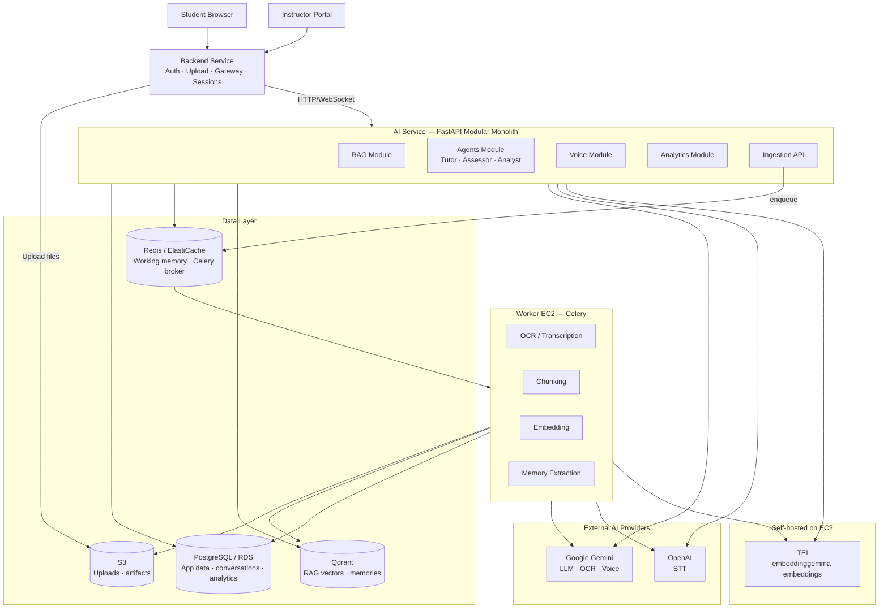

### Ownership boundaries

| Area | Owner | Notes |
|---|---|---|
| Frontend, auth, file upload, public gateway | Backend team | Backend uploads source files to S3 and calls AI webhooks. |
| AI modules, ingestion, retrieval, generation, memory, analytics | AI service | FastAPI modular monolith. |
| Raw source files | S3 | Backend writes; AI reads. |
| Structured AI data | PostgreSQL | Conversations, messages, assessments, logs, KPIs. |
| Working memory and queue | Redis | Conversation cache and Celery broker. |
| Vector search | Qdrant | Course chunks, memories, experiential patterns. |

---

## 3. Runtime Components & Versioning

| Component | Target Version | Responsibility | State | AWS Service & Compatibility |
|---|---|---|---|---|
| **AI Service** | FastAPI (latest) | Serves text tutoring, assessment, analytics, voice session setup, retrieval, generation. | Stateless; uses Redis/PostgreSQL/Qdrant. | AWS ECS (Fargate/EC2) |
| **Celery Worker** | Celery 5.x | Runs heavy async jobs: OCR, transcription, chunking, embeddings, memory extraction. | Stateless; resumable through PostgreSQL + S3 artifacts. | AWS ECS (Fargate/EC2) |
| **PostgreSQL** | v17 | Source of truth for conversations, messages, assessments, ingestion status, costs, analytics. | Durable managed data. | AWS RDS PostgreSQL (Fully compatible in `eu-central-1`) |
| **Redis** | v7.0 | Working memory cache, active sessions, Celery broker, dashboard cache. | Rebuildable cache/queue. | AWS ElastiCache Redis (Fully compatible, can upgrade to v7.1) |
| **Qdrant** | v1.18.2 | Hybrid vector retrieval for RAG and semantic memories. | Persistent vectors + payload metadata. | Qdrant Cloud (Managed HA in `eu-central-1`) |
| **S3** | Standard | Original uploads and reusable ingestion artifacts. | Durable object storage. | AWS S3 (Standard API compatibility; mocked locally via Garage v2.3.0) |

> [!NOTE]
> Garage v2.3.0 is used strictly in the local development environment (`docker-compose.yml`) to mock S3 API compatibly. The production environment targets the official AWS S3 service directly.
---

## 4. Model Stack

The stack is **role-routed, not hardcoded to one provider and not dynamically improvised per query**. [M2-4] benchmarks each role on Enara's real datasets; [M2-5] pins the resulting primary/fallback deployments in LiteLLM configuration. Simplicity and operational stability are preferred over per-request model micro-optimization.

| Task | Default | Provider | Notes |
|---|---|---|---|
| Turn Decision | `openai/gpt-5.6-luna` (fb: Gemini 3 Flash) | LiteLLM gateway (OpenRouter) | **Decided — M2-4 run `20260804T191135Z`.** Highest-volume node; Luna scored within one metric of Gemini at ~5x lower cost. Structured planning + per-step teaching selection; schema validation + retry covers its rare invalid-enum slip. |
| Grounded Tutor generation | `openai/gpt-5.6-luna-pro` (fb: DeepSeek V4 Pro → Gemini 3 Flash) | LiteLLM gateway (OpenRouter) | **Decided — M2-4.** Best blind-review scores (6/6 ship), statistically tied quality with Gemini at ~65% lower cost. Main student-facing quality role: Egyptian Arabic, grounding, citations, refusal. |
| Multi-step Composer | `z-ai/glm-5.2` (fb: DeepSeek V4 Pro) | LiteLLM gateway (OpenRouter) | **Decided — M2-4.** Perfect citation-ID preservation in benchmark at lowest cost/latency (p50 2.3s). Qwen 3.6 Plus excluded (empty outputs). |
| Validator / query rewriter | `openai/gpt-5.6-luna` (fb: Gemini 3 Flash → DeepSeek V4 Pro) | LiteLLM gateway (OpenRouter) | **Decided — M2-4.** Perfect decision/rewrite accuracy at lowest cost. Cheap conditional role; not called after every node. |
| Background summary/chapter/memory roles | `deepseek/deepseek-v4-flash` (fb: Luna Pro → DeepSeek V4 Pro) | LiteLLM gateway (OpenRouter) | **Decided — M2-4.** Highest judged summary quality at lowest cost; off the student path so slower p50 (19s) is acceptable. |
| PDF OCR | Gemini 3 Flash VLM | Google | All PDFs go through VLM OCR; Arabic and English use same path. |
| Complex OCR fallback | Gemini 3.1 Pro | Google | Single fallback, used only when quality checks fail. |
| Voice primary | Gemini 3.1 Flash Live | Google | Single session STT + LLM + TTS. |
| Embeddings (dense) | `embeddinggemma-300m` **(decided — M1-6b)** | Self-hosted TEI (primary) | **Locked by M1-6b.** Won the 540-question Arabic+English golden-set benchmark across `embeddinggemma-300m` / `bge-m3` / `granite-embedding` / `multilingual-e5-small` (self-hosted) plus `bge-m3` & `text-embedding-3-small` API baselines: best **recall@10 0.815** (vs `bge-m3` 0.778) at native 768-dim; **served/stored at 512-dim via MRL truncation** (~50% cheaper storage than `bge-m3`'s 1024, no measurable quality loss), and **~2× faster** corpus embed than `bge-m3`. **Self-hosted** because there is **no reliable managed embedding endpoint** for it (OpenRouter lists it but serves no provider); this also fits the current $0-API / AWS-credits budget. Returns **dense only**; sparse for the hybrid is generated locally (FastEmbed BM25/SPLADE). Gemma license permits commercial self-host. `bge-m3` is retained as a documented **re-index recovery path** (open + API-available) — see §4.1. |
| Audio STT / transcription | `gpt-4o-mini-transcribe` *(candidate — TBD by benchmark)* | OpenRouter | **Not locked.** Selected by the **M1-4c** benchmark across `gpt-4o-transcribe` / `gpt-4o-mini-transcribe` / `whisper-large-v3` / `whisper-large-v3-turbo` (Arabic+English WER, dialect, latency, cost). The **backend** extracts audio from lecture videos and sends audio only — the AI service never receives video files. |
| Reranking | bge-reranker-v2-m3 | API (Cohere/Jina) or self-hosted TEI | **Optional / fast-follow.** Cross-encoder: it scores every (query × candidate) pair, so it is the most latency-heavy step. On **CPU it is slow** (measured — hundreds of ms to seconds for K≈20+), so for v1 keep it **tunable/optional** (small K, skip for easy queries). Self-host only on **GPU** (colocated with the embedding TEI) once volume crosses break-even; otherwise use an API reranker for latency-sensitive traffic. |
| Voice self-host at scale | Whisper + NAMAA TTS | GPU EC2 | Phase 3+ when voice API cost crosses GPU break-even. |
| OCR self-host at scale | Qwen3-VL-32B | GPU EC2 | Phase 4+ when OCR volume crosses break-even. |

### 4.1 Embedding model (M1-6b) & availability

**Decision (M1-6b):** dense embeddings use **`embeddinggemma-300m`, self-hosted on TEI.** It won the retrieval benchmark on the 540-question Arabic+English golden set, beating the previous `bge-m3` candidate on **every** course and slice while being cheaper to store and faster to embed.

| Model | Host | dim | recall@10 | mrr@10 | ndcg@10 | corpus ms/chunk (CPU) |
|---|---|---|---|---|---|---|
| **embeddinggemma-300m** | self-host | 768 | **0.815** | **0.650** | **0.648** | 906 |
| `bge-m3` | API = self-host | 1024 | 0.776–0.778 | 0.600 | 0.601 | 1826 |
| granite-embedding | self-host | 768 | 0.729 | 0.542 | 0.552 | 7491 |
| text-embedding-3-small | API | 1536 | 0.612 | 0.440 | 0.443 | — |
| multilingual-e5-small | self-host | 384 | 0.557 | 0.398 | 0.402 | 156 |

`bge-m3` self-hosted matched its API baseline within **±0.002** on every metric — confirming open weights reproduce the API vector space exactly (the property that makes the recovery path below re-index-free *for `bge-m3`*).

**Operating dimension — 512-d (MRL), locked.** EmbeddingGemma is natively 768-d but supports **Matryoshka Representation Learning (MRL)**: truncating the L2-normalized 768-d vector to its first **512** components and renormalizing is identical to encoding at `truncate_dim=512`. The MRL sweep showed **no measurable quality loss** at 512-d while cutting vector storage/RAM ~33% (and ~50% vs `bge-m3`'s 1024). **The Qdrant collection's dense vector size is therefore `512`**, and the TEI service must serve 512-d vectors (native 768 truncated + renormalized) for **both** query and ingestion so the vector spaces match. Re-confirmed on the re-chunked corpus (2026-07): first-stage **hit@10 = 0.926** at 512-d + tuned BM25 (`w_sparse=0.15`).

**Sparse vectors — generated + stored at ingestion (not query-time).** The hybrid needs a **BM25 sparse vector per chunk** (a `token_id → weight` map, mostly zeros) alongside the dense vector. Unlike the offline benchmark — which built an in-memory BM25 index on the fly — production **precomputes each chunk's sparse vector during ingestion (FastEmbed BM25, using the tuned Arabic-aware tokenizer, `k1=1.2`, `b=0.75`) and stores it in Qdrant** as a named sparse vector next to the dense one. At query time Qdrant converts the question to dense + sparse and fuses them **natively** (weighted RRF, `w_sparse=0.15`). **Performance impact:** this *improves* retrieval quality (BM25 recovers ~33% of questions dense missed) at **negligible** latency/storage cost — sparse search is a fast inverted-index lookup, generation is a cheap tokenize+count done **once at ingestion**, and the sparse vector stores only present terms. It does **not** add query-time computation.

**Why self-hosted (not API-first):** unlike `bge-m3`, EmbeddingGemma has **no reliable managed embedding endpoint** — OpenRouter lists it but serves no provider (`qwen3-embedding-0.6b` had the identical gap: `404 No endpoints found`). Self-host is therefore the primary, which also fits the current **$0-API / AWS-credits** posture. **License:** EmbeddingGemma is under the **Gemma Terms of Use** (open weights, responsible commercial use permitted); the app must stay within the **Gemma Prohibited Use Policy** — already aligned with our grounding + privacy rules.

Availability is protected by **redundancy + graceful degradation** (there is no managed API to fail over to):

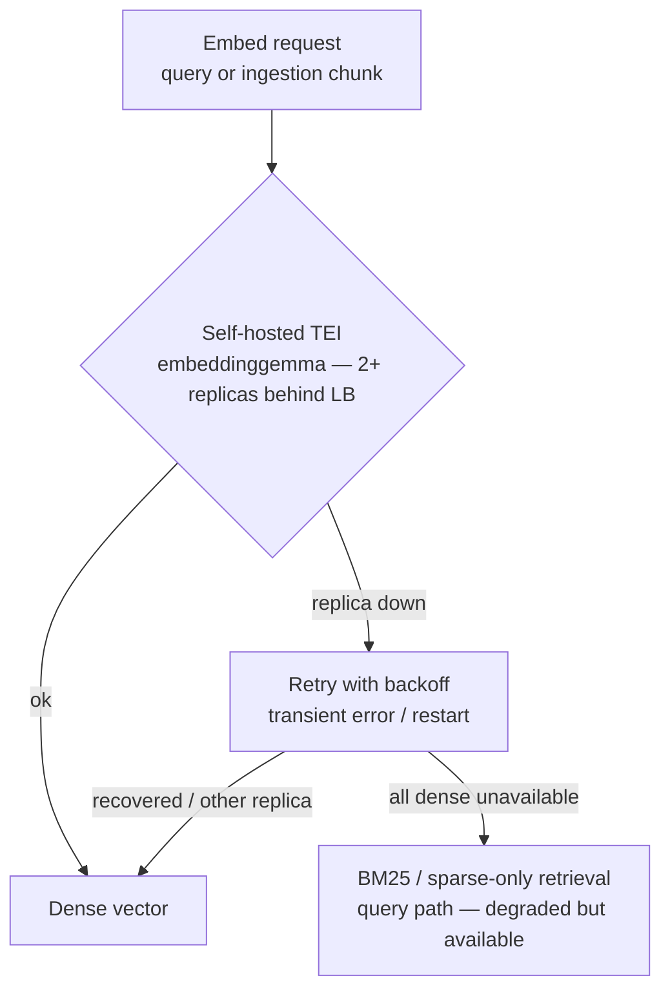

**Tiers (in order):**

| Tier | Trigger | Behavior | Cost |
|---|---|---|---|
| 1 — Replica LB | One TEI replica dies | Internal LB routes to a healthy replica (2+ behind a target group). Full quality, no interruption. | Warm infra |
| 2 — Retry | Transient error / replica restart | `retry_with_backoff` on the TEI call. Handles most blips. | Free |
| 3 — Sparse degrade | All dense unavailable (query path only) | Serve **BM25/sparse-only** retrieval so the tutor stays up (lower quality, no outage). Ingestion path just waits/retries — it is not latency-critical. | Free |

**Break-glass recovery — `bge-m3`:** if the self-hosted EmbeddingGemma path ever proves unworkable, or a managed API becomes worth paying for later, `bge-m3` is the fallback of record — it is **open *and* API-available**, so it can run either way. **Switching to it requires a full re-index** (different vector space + dimension), so it is a deliberate, planned recovery — **not a hot failover**. Keep the `bge-m3` embed path in the codebase and periodically validated so it does not rot.

**Serving runtime — TEI (Text Embeddings Inference):** self-hosted embedding runs on HuggingFace **TEI** (Rust, dynamic token-batching, OpenAI-compatible `/embeddings`, Prometheus metrics, fast <30s cold start). TEI is **open-source inference software we run ourselves in a Docker container on our own EC2** — the model weights are pulled from the HF hub **once at container start** (or baked into the image); **no call is made to any HuggingFace or external API at request time**. It is a **separate service** — never inline in the Celery worker or the AI service process. The same TEI runtime also serves the reranker (`/rerank`) when self-hosted. Autoscale on `te_queue_size` (queue backlog), not CPU.

**One model, two callers — query vs ingestion:** the **same** TEI model serves **both** the query path (student question → dense vector) **and** the ingestion path (Celery worker → chunk vectors). This is mandatory for correctness: query and chunk vectors must live in the **identical vector space**, so they cannot be produced by different models. The two workloads have opposite latency profiles, though — a query is a single **latency-critical** call, while ingestion is **bulk, batched, and not latency-critical** (it just waits/retries). We therefore protect query latency by **isolating the load, not the model**:
- **At launch (low volume, ~1.5K files/day):** a single CPU TEI comfortably serves both; ingestion calls arrive in sparse batches.
- **At sustained volume:** run multiple replicas behind the LB and **dedicate a replica/pool to query traffic** so bulk ingestion embedding can never starve student-facing queries (queue-size autoscaling absorbs ingestion bursts on the ingestion pool).

**Hygiene:** pin the **exact `embeddinggemma-300m` revision**, the **same query/document prompt prefixes**, and identical pooling/normalization across **all replicas** (and the `bge-m3` recovery path) so vectors stay bit-compatible; exercise each replica with a periodic synthetic health check.

**Recommended EC2 sizing:**

| Role | Instance | Why |
|---|---|---|
| TEI embedding primary — CPU (v1, low QPS) | `c7i.xlarge` (4 vCPU / 8 GB) — or Graviton `c7g.xlarge` for lower cost | `embeddinggemma-300m` (~300M params, lighter than `bge-m3`'s 568M) fits easily; CPU query ~290 ms is fine for retrieval. Warm-small to control cost. |
| TEI embedding at sustained volume | `c7i.2xlarge` (8 vCPU / 16 GB) | Headroom for higher steady QPS before GPU is justified. |
| Embedding **+ reranker** on GPU (P3+ / break-even) | `g5.xlarge` (1× A10G 24 GB) — or `g6.xlarge` (L4) | GPU + batching makes the cross-encoder reranker fast; one card hosts both TEI instances. Only cost-justified at high, sustained volume. |
| HA | 2× replicas behind an internal LB/target group | Same model on each; one replica dies → LB routes to the other. |

> **Cost reality:** at launch volume, embedding self-hosts on **CPU** (`c7i.xlarge` ≈ ~$150/mo, ×2 for HA) — well within **AWS startup credits**, which is why self-host-primary is affordable now despite no embedding API being available for EmbeddingGemma. A **GPU** (`g5.xlarge` ~$730/mo, ×2 ≈ ~$1,460/mo) is only justified at high sustained QPS or once the **reranker** is enabled (the cross-encoder is the part that really needs GPU); defer GPU to **Phase 3+**. On CPU, embedding latency (~290 ms/query) is acceptable for retrieval; the reranker is the slow path and stays optional until GPU break-even.

### 4.2 Embedding serving v2 (2026-08-18) — GPU TEI → CPU ONNX Runtime, validated

**Decision:** production embedding serving moves off GPU entirely. The validated
runtime is **ONNX Runtime (CPU) serving `onnx-community/embeddinggemma-300m-ONNX`
(fp32)** behind an OpenAI-compatible `POST /v1/embeddings`. The interim GPU path
(TEI Candle on Modal L4, `modal-tei/tei_modal.py`) remains deployed as the live
endpoint until the AWS migration, but it is no longer the production target.

**Why TEI-on-GPU existed at all:** TEI's CPU backends could not serve this model —
the MKL/Candle CPU path crashes on Gemma3 (`Intel MKL ERROR ... SGEMM`) and the
CPU/ORT path silently **skips the model's Dense MRL heads**, producing vectors in
the wrong space. The community ONNX export solves this properly: mean pooling +
the Dense MRL heads + normalization are **baked into the graph**, which exposes a
ready `sentence_embedding` (768-d) output. Note the same dense-heads trap rules
out the **fastembed** wrapper for this model (its custom-model path re-pools the
first graph output, skipping the dense heads); we use ONNX Runtime — fastembed's
own engine — directly.

**Reference implementation:** `modal-embed-cpu/embed_cpu_modal.py` — a standalone
Modal service on **8 vCPU / 16 GB** (sized to approximate `c7i.2xlarge`) used to
validate the CPU path end-to-end. The API contract matches TEI exactly: the
server returns **raw 768-d vectors**; task prompts and MRL truncation to 512-d
stay client-side in `TEIEmbeddingClient` (`src/integrations/tei/client.py`), so
GPU/CPU/serverless backends are interchangeable via `embedding_base_url` alone.

**Validation evidence (2026-08-18, all live, no mocks):**

| Check | Result |
|---|---|
| Vector parity vs TEI GPU (`scripts/embed_cpu_parity_check.py`) | worst cosine **0.99998** @768-d and @512-d (AR+EN, query+doc prompts) — same vector space, the TEI-embedded Qdrant corpus needs **no re-index** |
| Full golden eval, `CANDIDATE_DEPTH=50` (555 q / 912 gold) | recall@15 **0.8962 = GPU baseline exactly**; hit@1 0.6667 vs 0.6685, mrr@15 0.7669 vs 0.7674 — every delta ≤1 question in 555. Evidence: `eval/results/m2/m2-22/20260818T190851Z/` |
| Latency (8 vCPU, warm) | **~14 ms/query** server-side; ~25 s cold start incl. 1.23 GB weight download |
| Release gates | all pass (`MIN_RERANK_RECALL_AT_15=0.88` etc.), decision: **accepted** |

**Quantized variants — tested and rejected (q8), forbidden (fp16):**

| Variant | Size | Warm latency | Worst cos vs corpus | Verdict |
|---|---|---|---|---|
| fp32 (`onnx/model.onnx`) | 1.23 GB | ~14 ms | 0.99998 | **The only approved variant** |
| q8 (`onnx/model_quantized.onnx`) | 309 MB | **133–195 ms (~10× slower)** | 0.9944 (real drift) | Rejected — ORT dynamic-int8 kernels lose to fp32 SGEMM on this arch; size advantage bought nothing (cold start identical at ~24–25 s) |
| fp16 | — | — | — | Unsupported by EmbeddingGemma activations (model card) — never deploy |

**Production topology (decided, pending M2-25 staging build-out):**

| Path | Runtime | Why |
|---|---|---|
| **Query (student chat)** | Dedicated small **CPU EC2** (`c7i.xlarge` to start) in the same VPC/region as Qdrant, running the ORT service | Latency-critical, light continuous load (~14 ms/query ⇒ <5% utilization at launch); private in-VPC traffic, no egress cost. **Its own box** — not on the App or Worker EC2 — so bulk jobs can never starve student queries (same isolation principle as §17 "Ingestion isolation") |
| **Ingestion (Celery workers: files/audio chunks)** | **AWS Lambda (container image, fp32)** — scale-to-zero serverless | Bursty by nature (a course upload, then hours of idle); a second always-on EC2 would idle >90%. 1.23 GB weights fit Lambda's 10 GB image limit; workers are not latency-critical so cold starts are acceptable |
| **Fallback / current dev** | The Modal CPU service (same API) | Already validated; serves as an off-AWS safety net — flipping `embedding_base_url` is the entire failover |

Supporting decisions: **ALB deferred** until >1 inference instance (single EC2 +
private DNS/Elastic IP first). **Off-peak saving:** the query EC2 can be stopped
overnight with queries routed to the serverless endpoint — same API contract,
one config line. Both paths must pin the same model revision + fp32 variant so
vectors stay bit-compatible (§4.1 hygiene rules apply unchanged).

---

## 5. RAG Architecture

The RAG module guarantees grounded answers from institution materials.

### Supported ingestion inputs

- **PDFs** (text-based and scanned): OCR using Gemini 3 Flash VLM.
- **Audio** (extracted from lecture videos **by the backend** before upload — smaller and easier to transfer; the AI service never receives video files): VAD segmentation → transcription → chunking.

> **Initial scope:** only `pdf` and `audio` are accepted at launch. Other formats (`docx`, `pptx`, `txt`) are planned as future features and are rejected by the ingest webhook until then.

### Core RAG flow


### PDF pipeline

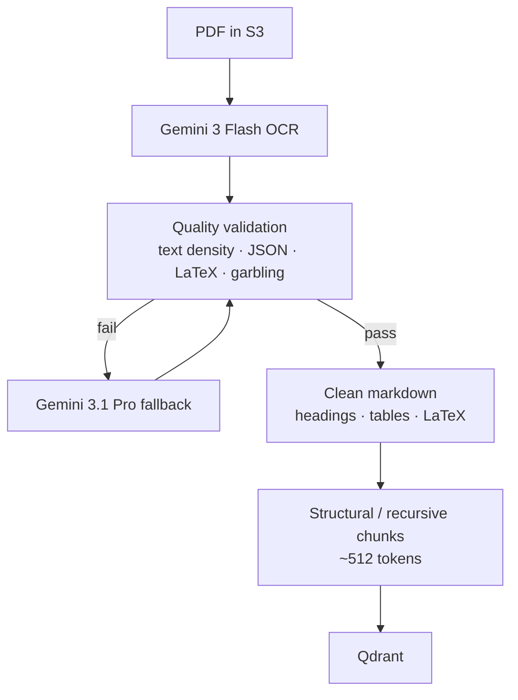

### Audio pipeline

> The backend extracts audio from lecture videos before upload, so this pipeline starts from an audio file — no video handling or ffmpeg extraction in the AI service.

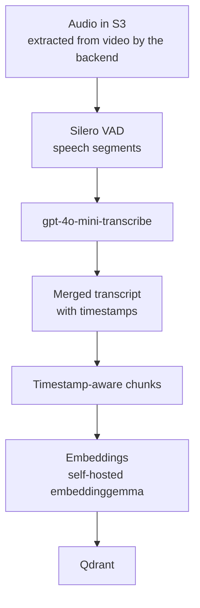

> **Contextual Retrieval cache guard (candidate upgrade — see [M1-5]):** if Contextual Retrieval is adopted, the per-chunk context call context-caches the **full source doc**. Google only caches inputs **≥ ~4K tokens** (Gemini 3.x Flash implicit-cache minimum), so the ingestion pipeline must ensure the cached document sent per chunk is **> 4K tokens** — batch/group small docs so they clear the threshold. Below it, caching is skipped and the doc is billed at the full input rate (`$0.50/1M`) instead of the cached rate (`$0.05/1M`), making the real cost ~10× the `cost-model` estimate.

### Retrieval and generation

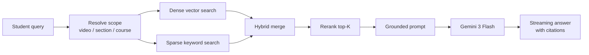

### Retrieval rules

- Always scope by `institution_id` and `course_id`.
- Optionally narrow by `section_id` or `video_id` when the student is inside a specific context.
- Do **not** filter by language; Arabic questions may need English course materials and vice versa.
- PDFs and lecture (audio) transcripts live in the same searchable course space.
- Every answer includes citations and an out-of-scope flag.

> **Multi-granularity retrieval (candidate upgrade — "Grain" approach, [github.com/h9-tec/grain](https://github.com/h9-tec/grain)):** fixed ~512-token chunks are a single granularity, which is wrong for a chunk of the queries Enara will get. The Grain idea is to index each document at **5 levels at once** — propositions (atomic facts) → sentences → paragraphs → sections → **summaries** — then detect the query type and assemble the right level: `FACTUAL` → propositions/sentences, `CONCEPTUAL/PROCEDURAL` → paragraphs/sections, `SUMMARIZATION` → summaries. **This is directly relevant to Enara:** a student asking *"لخّصلي المحاضرة دي"* or *"لخّص المحاضرتين دول"* needs section/document-level **summaries**, which fixed chunking cannot serve well. Deferred until the embedding model is locked (M1-6b) and a reranker is in; treat the current fixed-chunk pipeline as the baseline the multi-granularity index would extend, not replace. Grain's own honest benchmark shows the architecture is sound (100% on precise factual queries) but needs retrieval-threshold tuning + reranking for other query types.

---

## 6. Agents Architecture

The Agents module contains three logical agents. They share the same core stack: RAG, memory, role-specific LLMs chosen by the [M2-4] multi-provider benchmark (routed through the [M2-5] LiteLLM gateway — never assumed to be Gemini), structured logging, and security validation. The Tutor Agent is orchestrated as a **LangGraph state graph** (see "Tutor agent graph" below); Assessor/Analyst are simpler single-pass calls for now and may adopt the same pattern later if their tasks grow compound sub-parts.

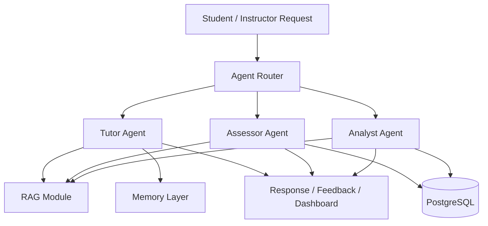

### Tutor Agent

| Responsibility | Details |
|---|---|
| Grounded Q&A | Answers from course materials only. |
| Teaching style adaptation | Uses explicit signals, recent history, assessments, and experiential memory. |
| Supported request types | Questions, summaries, explain differently, practice, “I do not understand”. |
| Teaching modes | Direct answer, Socratic tutoring, reality check, mock examiner, prerequisite gap filler, mnemonic creator, protégé effect, study path advisor, error analysis. |
| Memory use | Working memory for continuity; Factual/Episodic/Experiential for personalization. |

#### Tutor agent graph (LangGraph): dependency-aware bounded adaptive Plan-and-Execute

A flat "classify once, run one fixed pipeline" cannot handle a compound
student message, but a free-running ReAct/Reflexion loop is also the wrong
fit: Enara has a small, closed set of grounded operations and a strict
latency/cost budget. The Tutor therefore uses **dependency-aware, bounded
adaptive Plan-and-Execute**:

- one **Turn Decision LLM** call jointly decomposes the request and selects
  the most appropriate teaching strategy;
- a deterministic scheduler runs only dependency-ready steps, in parallel
  when they are independent;
- retrieval, generation, and composition are repaired **only when a concrete
  validator fails**, never after every node;
- every repair loop has a hard bound and ends in a safe refusal/fallback;
- one-step answers bypass the Composer; multi-step answers use an LLM
  Composer followed by final validation.

This keeps the explicit long-horizon planning and parallelism benefits of
LLMCompiler-style systems without claiming the old all-steps-parallel list is
a true DAG. It also keeps the quality benefit of reflection where evidence
shows it is needed, without paying for an unconditional reflection call on
every student turn.

```mermaid
flowchart TD
    START(["Student message + application scope"]) --> INPUT_CHECK["Input sanitization<br/>CODE — M2-16"]
    INPUT_CHECK --> LOAD["Load compact decision context<br/>CODE — recent turns, learner profile, assessment signals"]
    LOAD --> DECIDE["Turn Decision<br/>LLM — M2-12<br/>plan DAG + per-step teaching modes"]
    DECIDE --> PLAN_POLICY{"Plan and teaching policy validator<br/>CODE"}
    PLAN_POLICY -->|"invalid"| PLAN_FALLBACK["Safe one-step question plan<br/>is_standalone=false + socratic"]
    PLAN_POLICY -->|"valid"| SCHEDULER
    PLAN_FALLBACK --> SCHEDULER["Dependency scheduler<br/>CODE — select every ready step"]
    SCHEDULER --> FANOUT{{"LangGraph Send<br/>run ready independent steps in parallel"}}

    subgraph STEP ["execute_step — one ready PlanStep"]
        ELIGIBLE{"Cache eligible?<br/>question AND standalone"}
        ELIGIBLE -->|"yes"| CACHE{"Semantic cache lookup<br/>CODE — M2-17"}
        CACHE -->|"HIT"| CACHED["Use validated cached StepResult"]
        CACHE -->|"MISS"| SOURCE
        ELIGIBLE -->|"no"| SOURCE{"Choose grounded source<br/>CODE"}

        SOURCE -->|"question / practice"| RETRIEVE["Hybrid retrieve + rerank<br/>M2-1 — non-generative models"]
        SOURCE -->|"summarize"| SUMMARY["Pre-generated asset/chapter summary<br/>M2-6 / M2-8 — DB lookup"]
        SOURCE -->|"explain differently / confused"| REUSE["Reuse previous-turn chunks<br/>M2-10"]
        REUSE -->|"missing"| RETRIEVE
        REUSE -->|"found"| ASSEMBLE
        SUMMARY -->|"missing"| SUMMARY_FALLBACK["Live summary fallback<br/>LLM — rare"]
        SUMMARY -->|"found"| ASSEMBLE
        SUMMARY_FALLBACK --> ASSEMBLE

        RETRIEVE --> RETRIEVAL_GATE{"Material sufficient?<br/>CODE — relevance / coverage thresholds"}
        RETRIEVAL_GATE -->|"yes"| ASSEMBLE["Assemble stable + dynamic context<br/>CODE — M2-14"]
        RETRIEVAL_GATE -->|"weak; rewrite unused"| REWRITE["Rewrite query once<br/>cheap LLM"]
        REWRITE --> RETRIEVE
        RETRIEVAL_GATE -->|"weak after rewrite"| STEP_REFUSAL["Grounded refusal for this step<br/>CODE"]

        ASSEMBLE --> GENERATE["Generate StepResult<br/>Tutor LLM — M2-15"]
        GENERATE --> STEP_CHECK{"Step safety + grounding validation<br/>CODE always; cheap LLM when semantic check is required — M2-16"}
        STEP_CHECK -->|"pass"| CACHE_STORE["Write cache if eligible<br/>CODE"]
        STEP_CHECK -->|"fail; revision unused"| STEP_REVISE["Revise answer once<br/>LLM"]
        STEP_REVISE --> STEP_CHECK
        STEP_CHECK -->|"fail after revision"| STEP_FALLBACK["Safe step fallback<br/>CODE"]

        CACHED --> STEP_DONE["StepResult ready"]
        CACHE_STORE --> STEP_DONE
        STEP_REFUSAL --> STEP_DONE
        STEP_FALLBACK --> STEP_DONE
    end

    FANOUT --> ELIGIBLE
    STEP_DONE --> COLLECT["Collect batch results<br/>CODE"]
    COLLECT --> ALL_DONE{"All dependencies complete?"}
    ALL_DONE -->|"no"| SCHEDULER
    ALL_DONE -->|"yes"| RESULT_COUNT{"Number of StepResults"}

    RESULT_COUNT -->|"one"| PASSTHROUGH["Use StepResult as-is<br/>no Composer call"]
    RESULT_COUNT -->|"two or more"| COMPOSE["Compose coherent answer<br/>LLM — whitelisted StepResults + citation IDs only"]
    COMPOSE --> FINAL_CHECK{"Final structural + semantic validation<br/>CODE + cheap LLM — M2-16"}
    FINAL_CHECK -->|"pass"| PERSIST
    FINAL_CHECK -->|"fail; revision unused"| COMPOSE_REVISE["Revise composition once<br/>LLM"]
    COMPOSE_REVISE --> FINAL_CHECK
    FINAL_CHECK -->|"fail after revision"| SAFE_COMPOSE["Deterministic sectioned assembly<br/>CODE"]

    PASSTHROUGH --> PERSIST["Persist turn, decisions, outcomes, costs, traces<br/>M2-9 / M2-13 / M2-19 / M2-20"]
    SAFE_COMPOSE --> PERSIST
    PERSIST --> END(["END"])
```

##### Turn Decision: planning and teaching-mode selection in one LLM call

Planning and teaching-mode selection consume the same expensive context:
the current message, recent turns, learner profile, assessment history, and
current teaching mode. They are therefore one **Turn Decision** call rather
than two LLM calls. The responsibilities remain logically separate in the
structured output and are evaluated independently, so they can be split
later if the role benchmark shows multi-task interference.

Before the call, deterministic code builds a compact decision context — not
the student's unbounded raw history:

```json
{
  "student_message": "مش فاهم الموضوع؛ اشرحه وامتحني فيه",
  "turn_number": 5,
  "application_scope": {
    "institution_id": "...",
    "course_id": "...",
    "section_id": "...",
    "asset_id": "..."
  },
  "current_mode": "socratic",
  "recent_turns": ["..."],
  "learner_profile": {
    "known_strengths": ["network layers"],
    "known_gaps": ["transport protocols"],
    "successful_modes": ["socratic", "scaffolded_zpd"],
    "unsuccessful_modes": ["metacognitive"]
  },
  "assessment_signals": {
    "wrong_answer_streak": 3,
    "repeated_confusion_count": 2,
    "mastery_score": 0.41
  }
}
```

The output is machine-readable and contains observable decision facts —
**never hidden chain-of-thought**:

```python
class PlanStep(BaseModel):
    step_id: str
    request_type: Literal[
        "question",
        "summarize",
        "explain_differently",
        "practice",
        "i_dont_understand",
    ]
    query: str
    is_standalone: bool
    depends_on: list[str]
    teaching_mode: TeachingMode
    mode_reason_codes: list[str]

class TurnDecision(BaseModel):
    default_teaching_mode: TeachingMode
    mode_confidence: float
    learner_signals: list[str]
    mode_reason_codes: list[str]
    plan_steps: list[PlanStep]
```

Example:

```json
{
  "default_teaching_mode": "scaffolded_zpd",
  "mode_confidence": 0.88,
  "learner_signals": ["repeated_confusion", "weak_prerequisite"],
  "mode_reason_codes": ["EXPLICIT_CONFUSION", "MISSING_PREREQUISITE"],
  "plan_steps": [
    {
      "step_id": "explain",
      "request_type": "question",
      "query": "اشرح الفرق بين TCP و UDP",
      "is_standalone": true,
      "depends_on": [],
      "teaching_mode": "scaffolded_zpd",
      "mode_reason_codes": ["MISSING_PREREQUISITE"]
    },
    {
      "step_id": "practice",
      "request_type": "practice",
      "query": "اعمل أسئلة مبنية على الشرح",
      "is_standalone": false,
      "depends_on": ["explain"],
      "teaching_mode": "formative_assessment",
      "mode_reason_codes": ["EXPLICIT_PRACTICE_REQUEST"]
    }
  ]
}
```

A mode is per step because one compound turn can require scaffolded explanation
and then formative practice. `default_teaching_mode` is only the turn-level default.

##### Deterministic policy around the LLM decision

The LLM chooses the teaching mode using the CEO pedagogical-framework prompt;
code validates the decision shape:

- **Turn 1:** force `socratic` for the turn default and all plan steps.
- **Turn 2+:** retain every valid LLM mode selection; the LLM uses the message,
  history, learner memory, and assessment signals to adapt.
- Validate unique `step_id`s, existing dependencies, an acyclic graph, the
  request/mode allowlists, and `MAX_PLAN_STEPS`.
- Any invalid/provider-failed decision degrades to one `question` step with
  `is_standalone=false` and `socratic` (cache safety first).

##### Dependency-aware scheduling

`depends_on=[]` steps are ready immediately and may run in parallel through
LangGraph `Send`. A step with dependencies waits until every referenced
`StepResult` exists. This preserves the user's ordering in requests such as
"لخص المحاضرة ثم اعمل أسئلة من الملخص" while retaining parallel execution
for requests such as "اشرح TCP واشرح UDP".

The execution output is also structured:

```python
class StepResult(BaseModel):
    step_id: str
    status: Literal["success", "refused", "safe_fallback", "cached"]
    answer: str
    citation_ids: list[str]
    used_step_ids: list[str]
    retrieval_rewrites: int
    answer_revisions: int
```

Citations receive stable IDs before generation. The generator/Composer may
reference only those IDs; application code resolves them to actual metadata.

##### Bounded correction, not unconditional reflection

`max_iterations` alone only caps worst-case cost; it does not make an always-on
reflection loop cheap. Enara instead enters repair paths only after an
external/deterministic validator reports a concrete failure:

```python
MAX_PLAN_STEPS = 5
MAX_RETRIEVAL_REWRITES_PER_STEP = 1
MAX_STEP_REVISIONS_PER_STEP = 1
MAX_COMPOSE_REVISIONS = 1
MAX_TOTAL_REPAIR_ACTIONS = 2
```

- Weak retrieval → rewrite that step's query once, then refuse if still weak.
- Unsupported/incomplete step answer → revise that answer once, then safe
  fallback.
- Unfaithful/incomplete multi-step composition → revise composition once,
  then deterministic sectioned assembly.
- Availability fallback (rate limit/5xx) remains a gateway concern, separate
  from quality repair.

##### LLM Composer and final validation

A one-step plan is returned directly after step validation. Two or more step
results are sent to a role-specific **Composer LLM** so the student receives
one coherent explanation rather than robotic concatenation. Its input is a
structured, ordered list of answers/statuses/whitelisted citation IDs. It may
organize and bridge the results, but may not add facts, invent citations,
move a citation between unsupported claims, or hide a refused step.

The final validator always performs structural checks (all steps represented,
valid citation IDs, preserved refusals). A cheap semantic judge is used for
multi-step/high-risk responses to check faithfulness and completeness. One
compose-only revision is allowed; retrieval and step generation are not
repeated. If that fails, deterministic sectioned output is safer than another
open-ended loop.

##### Streaming correctness

A response cannot be repaired after its tokens have already been shown to the
student. Therefore compound or repair-enabled answers are buffered until the
blocking validators pass. The Tutor's M2 chat transport is a bidirectional
WebSocket: the client sends `start`, `cancel`, and `ping`; the server emits
versioned, monotonic `status`, `answer`, `citations`, terminal, and safe-error
events. It may emit `planning`, `retrieving`, `generating`, `validating`, and
`composing` progress meanwhile, but sends answer content only after validation.
Cancellation is cooperative: the active provider call may finish, but no
further avoidable retrieval or provider work starts. A future measured fast
path may stream low-risk one-step answers directly, but M2 does not assume
that optimization before quality/latency evaluation.

##### Delivery channel: text chat vs. speaking avatar (M2-26)

The Tutor serves two clients with the **same graph, the same plan and the same
validation**: the text chat, and a **speaking avatar that lives in the frontend**
and owns its own STT and TTS. The avatar sends us the transcribed question as
ordinary text and pipes our answer text straight into its TTS, so the AI service
never touches audio on this path (this is deliberately *not* the Gemini Live
voice architecture in §7, which is a separate, deferred M5 design).

Because the answer is spoken rather than read, exactly two properties change:

| Property | Text chat | Voice / avatar |
|---|---|---|
| Answer length | Full written explanation (role default `max_tokens`) | ~60 words per step, ~120 words per turn total |
| Notation | Markdown, LaTeX math, `[cN]` citation markers inline | Plain spoken prose; math written as words; markers stripped from the spoken copy |
| Plan / teaching mode | Turn Decision + policy | **Identical** — no step is ever dropped |
| Validation / repair bounds | M2-16 | **Identical** |

Ownership boundary — the AI service stays text-in/text-out, and the avatar keeps
its own audio pipeline:

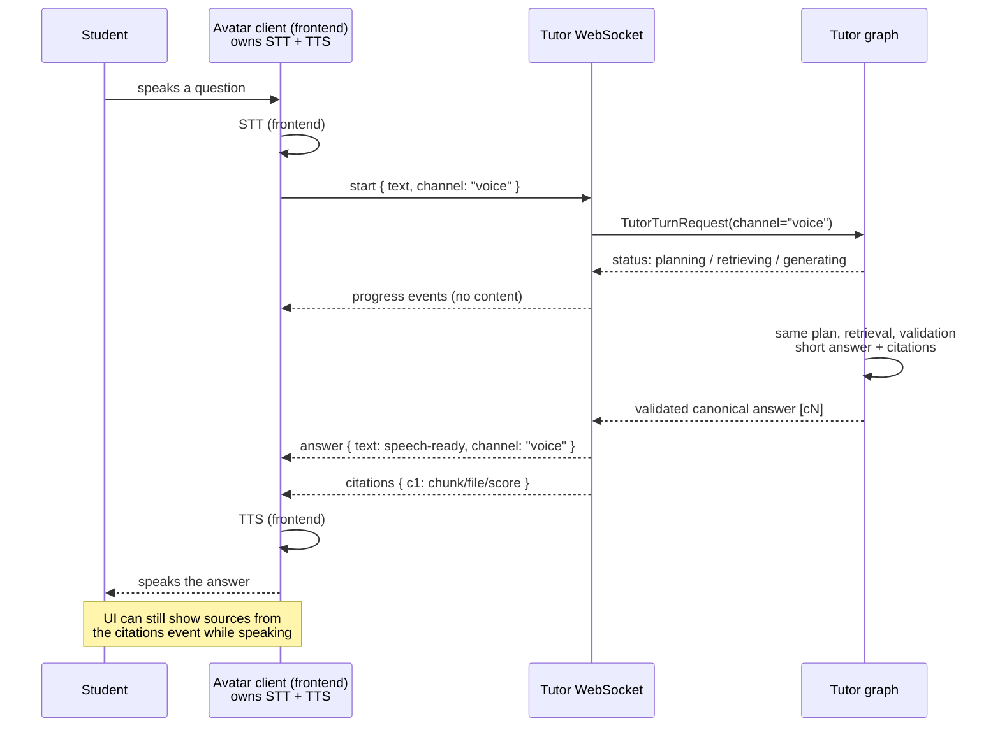

Everything else — retrieval, grounding, citations, judges, repair bounds,
persistence — is byte-for-byte the same code path. The channel arrives as
`channel: "text" | "voice"` on the WebSocket `start` command, travels on the
graph runtime, and is read in exactly four places:

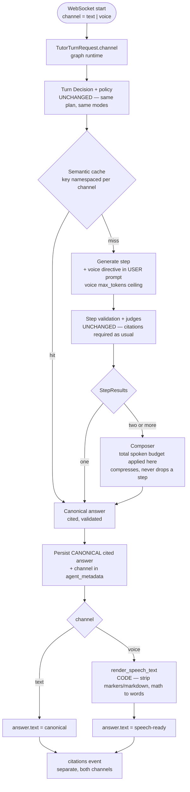

**1. Prompt (the real shortening mechanism).** `voice_directive`
(`src/agents/tutor/speech.py`) is appended to the **user** message of the
generation, step-revision, composer and compose-revision calls. It is never
merged into the system prompt, because `rag_grounding.yaml` is the stable
provider prompt-cache prefix (§ "Context assembly") — branching it per channel
would halve the cache hit rate for no benefit.

**2. Output ceiling.** `routing.yaml` gains an optional per-role `channels:`
block (`generation` 1800→600, `composer` 900→700 for voice), applied via
`chat_role(..., channel=...)`. This is a **safety ceiling, not the shortening
mechanism**: it sits ~4× above the word budget's Arabic token cost on purpose,
because a provider-truncated half sentence is worse for TTS than a long answer.
Model, temperature, timeout and rate limits are properties of the role, not of
delivery, so they are unchanged for every channel.

**3. Cache isolation.** The same question answered for chat and for the avatar
are two genuinely different answers, so they must never share a cache entry. The
delivery channel is a component of the M2-17 key (`semcache:v2:…:{course}:
{section}:{channel}:…`) — per-course *and* per-channel isolation inside the
existing cache, with no second Redis to operate. Two channels warming separate
entries is correct behavior, not waste. The schema version was bumped `1 → 2` so
every pre-M2-26 entry is orphaned deliberately.

**4. Speech rendering at the wire boundary only.** The model keeps emitting
`[cN]` citations as usual, so the canonical answer stays fully cited — that copy
is what gets validated, persisted and audited. Only the copy handed to the
avatar goes through `render_speech_text`, a deterministic pass that strips
citation markers/markdown/URLs and converts leftover LaTeX to spoken words
(`\frac{b\times h}{2}` → "b في h على 2", `x^2` → "x squared") in the answer's own
language. It **never truncates** (length is the prompt's job) and it reports
reason codes (`SPEECH_MATH_SANITIZED`, `SPEECH_CITATIONS_STRIPPED`, …) so how
often the model ignores the directive is measured, not assumed. Citations are
not lost from the product: they are already emitted in their own `citations`
WebSocket event, so the UI shows sources while the avatar never pronounces a
marker.

> **Why the plan is not shortened instead.** Capping plan steps in voice mode
> was rejected: silently answering two of a student's three sub-questions is an
> invisible correctness regression, and invisible failures are the worst kind.
> The **total** spoken length is bounded at the Composer — the component whose
> job is already merging steps — so every part of a compound question is still
> answered, just tightly. Single-step turns bypass the Composer, which is why the
> per-step budget exists too. One safety interaction to keep in mind: the
> "long answer with no citations" rule in `src/security/step_checks.py` only
> fires above 280 characters, so the voice directive explicitly requires the
> usual `[cN]` markers — otherwise short spoken answers would quietly skip that
> check.

##### Critical-path latency measurement

Tutor timings use the versioned `m2-19-v1` schema with monotonic timestamps.
The tracker records memory projection/profile/working/experiential reads,
Turn Decision and teaching-policy changes, scheduler/dependency waits, cache,
dense/sparse embedding, Qdrant, reranking, context packing, generation,
validation/judges/repairs, composition, persistence, background-memory enqueue,
and WebSocket first-status/first-validated-answer. Parallel step intervals are
merged by interval union for critical-path wall time; sibling durations are
never summed as if they ran serially. Raw stage sum and overlap remain
diagnostics.

Provider calls expose queue wait separately when available. HTTP provider time
and internet transit are reported as one honest `provider_network_ms` value
because the current SDK cannot split server processing from network transit.
Local-workstation evidence therefore indicates bottlenecks and relative
behavior, but is explicitly marked `production_slo_comparable=false`; staging
in `eu-central-1` is the source of production SLO measurements. Background
Mem0 extraction, learner-profile aggregation, Redis projection rebuild, and
experiential sync report their own task timings and are not added to the
student-turn critical path.

For production, keep the API, TEI embedding service, Redis, and Postgres on
private AWS networking in `eu-central-1`, with Qdrant Cloud co-located in the
same region. Prefer the same Availability Zone for the latency-sensitive
API→TEI path where resilience policy permits, while retaining multi-AZ
failover through an internal load balancer. TEI replicas must stay warm and be
sized/autoscaled from measured queue plus inference time; co-location removes
public-network transit but cannot fix undersized CPU/GPU inference or queueing.
The release target should split and alert on TEI queue, inference, and internal
network time independently. The local ~20s dense-embedding observation is not
an acceptable production target and must be re-measured in staging against the
architecture's sub-second query-embedding expectation.

After co-location, OpenRouter calls remain external. Their latency includes AWS
egress/network transit, provider queueing, and model inference/generation—not
internet time alone. Student connectivity affects the WebSocket leg to AWS,
but not the internal API→TEI/Qdrant path. Experiential-memory retrieval also
uses embedding/vector services and must be cached, bounded, and independently
timed so personalization cannot silently dominate first-answer latency.

##### Cost tracking

Every Tutor and background provider call is normalized through the versioned
`m2-20-v1` cost schema before it is written to `ai_cost_log`. The gateway
`usage` payload is the source of truth for tokens and `actual_usd` when the
provider reports them. Missing usage is estimated from the committed pricing
snapshot in `src/integrations/costing/pricing.yaml` (USD, half-up to 8 decimal
places internally and 6 on `cost_usd`). Cached input tokens are billed at the
snapshot cache-read rate, not the full prompt rate. Self-hosted TEI embeddings
record units with a zero provider bill; Cohere rerank records documents and
uses `usage.cost` when OpenRouter returns it.

The recorder is bound for the student-turn critical path and for background
summary/chapter jobs. It never stores prompts or student text. Streaming, if
enabled later, reconciles partial chunks against the final usage object; the
current gateway is non-streaming, so one `chat_role` result is one cost row.
Internal HTTP retries inside the gateway client emit only the final outcome.
Failed exhausted calls persist `status=failed`. Client cancellation persists
already-completed spend and does not invent tokens for work that did not run.

##### LLM calls by role

| Role | LLM call? | When |
|---|---:|---|
| Input sanitizer / plan policy / scheduler / cache | No | Deterministic code. |
| Turn Decision | Yes | Every student turn. |
| Retrieval embedding + reranker | Non-generative models | On cache miss when source is retrieval. |
| Query rewrite | Yes, cheap role | Only after weak retrieval; once per step. |
| Live summary fallback | Yes | Only if no pre-generated summary exists. |
| Context assembly | No | Deterministic packing and citations. |
| Step generation | Yes, primary Tutor role | Every non-cached/non-refused step. |
| Semantic step judge | Yes, cheap role | Conditional/high-risk or sampled. |
| Step revision | Yes | Only after a failed semantic validation; once. |
| Composer | Yes | Only for 2+ step results. |
| Final semantic validator | Yes, cheap role | Compound/high-risk responses. |
| Compose revision | Yes | Only after failed final validation; once. |
| Persistence/profile aggregation | No in request path | Background memory extraction uses an LLM separately. |

The [M2-4] benchmark chooses models **per role**; one provider/model is not
required to win Turn Decision, generation, composition, validation, and
background summarization simultaneously. [M2-5] exposes those choices as
config rather than application-code branches.

##### Teaching-effectiveness learning loop

Every per-step decision stores `selected_mode`, `previous_mode`, confidence,
structured reason codes, profile/policy versions, model, and eventual outcome
signals (feedback, follow-up confusion, assessment correctness, mode switch,
latency). [M2-13] aggregates these events asynchronously into a compact,
versioned learner profile that the next Turn Decision consumes. This is a
feedback/data pipeline, not hidden self-reflection and not an LLM call in the
student request path.

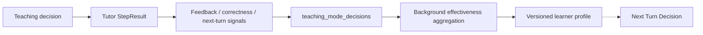

##### Request types

The Turn Decision recognizes five request types and may emit more than one
step for a compound message:

| Request type | Trigger | Strategy |
|---|---|---|
| `question` | Factual or conceptual question about material. | Hybrid retrieve → rerank → grounded answer with citations. |
| `summarize` | "لخّصلي المحاضرة/الدرس/الكورس" | Return pre-generated asset/chapter summaries. Multiple distinct summaries stay distinct inputs to the Composer; never summarize summaries. |
| `explain_differently` | "اشرحلي تاني" / "مش فاهم" | Reuse previous-turn chunks when available; change teaching mode/instruction. |
| `practice` | "اعملي أسئلة" | Generate MCQ/free-text practice from grounded course context. |
| `i_dont_understand` | Explicit confusion signal. | Reuse context and select a simpler/prerequisite-filling mode. |

##### Real validation policy for M2 agent nodes

`pytest` remains mandatory for deterministic contracts, but it is never the
only completion evidence for an M2 issue. Every node also has an opt-in live
validation using the real dependency class it wraps:

- real local Docker PostgreSQL/Redis/Qdrant/S3-compatible storage for state;
- real authenticated gateway/provider calls for LLM roles;
- versioned course fixtures and conversation scenarios, never toy strings
  only;
- Langfuse trace IDs plus actual token/cost/p50/p95 latency for LLM runs;
- versioned inputs, config/model IDs, dataset hash, metrics, and redacted
  outputs under `eval/results/m2/m2-XX/<run-id>/`;
- no secrets in fixtures/results, and live checks remain opt-in rather than
  normal unit-test/CI calls.

An issue is complete only when both its deterministic tests and its live
evidence artifact pass. Previously implemented foundations remain code-complete
but must backfill missing live evidence before the milestone release gate.

#### Lesson, chapter, and course summaries

#### Lesson, chapter, and course summaries

Fixed-size chunks are a poor unit for "summarize this lecture / this chapter / this whole unit" requests. The system pre-generates summaries at **two levels**, once at ingestion time (never at query time), and resolves a summary request purely by ID lookup:

- **Asset-level** — one summary per uploaded file (video or PDF), stored on `course_files.summary`.
- **Chapter-level** — a Backend `section_id` (Udemy-style folder of videos/PDFs) does **not** by itself tell us where one topical "chapter" ends and the next begins, and a single video may cover two chapters while a chapter may span a video *and* a PDF. A dedicated pipeline (`ARCHITECTURE.md` §11.2.1: `asset_chapters` → `section_chapters` → `chapter_mappings`) detects chapters per asset (PDF: from `heading_path`; audio: one cheap LLM call per asset over the numbered transcript segments — see §11.2.1 for why segment-level, not sub-segment, granularity is the correct precision), reconciles matching chapter titles across assets in the same section, and pre-generates one summary per canonical chapter from the union of its mapped chunks.

**Response rule — never re-summarize a summary:**

| Request | Response |
|---|---|
| One lesson/asset | Its pre-generated asset summary. |
| One chapter (even if it spans multiple assets) | Its pre-generated chapter summary — generated **once** from the combined raw chunks of that single logical chapter, not by merging asset summaries. |
| Multiple distinct lessons/chapters, or "the whole unit" | The **list** of their individually pre-generated summaries, separated by clear delimiters — never re-synthesized by another LLM call. |
| No pre-generated summary exists (edge case) | Fall back to a live map-reduce over the relevant chunks only. |

Future phase: a multi-granularity index (propositions → sentences → paragraphs → sections → summaries) can replace or augment this approach once the reranker and scale justify it.

#### Teaching-mode adaptation inside Turn Decision

Teaching-mode selection is not a separate LLM node. [M2-12]'s single Turn
Decision call sees the same compact history/profile/assessment context needed
for planning and emits a default mode plus a mode for each PlanStep. That
keeps the analysis model-driven without paying to send the same context to a
second model. The responsibilities remain separate fields/rubrics so [M2-4]
can detect multi-task interference.

The Turn Decision LLM owns adaptation and selects its mode using the CEO
pedagogical-framework guidance. The deterministic policy only validates it:

- **Turn 1:** force Socratic; signals may be observed but cannot change the mode.
- **Turn 2+:** the LLM chooses among the allowed modes based on the current
  request, history, learner memory, and versioned assessment signals.
- The policy does not use regex cue matching or override a valid LLM choice;
  it enforces only the mode allowlist and structural plan integrity.

The per-step mode is injected invisibly into generation and never bypasses
grounding. [M2-9] persists the structured decision; [M2-13] learns from
observable outcomes asynchronously.

#### Semantic cache scoping (M2-17)

A semantic cache (Redis: embedding of the question → answer) is only safe when the **surface text of the question does not fully determine the correct answer** — two correctness bugs otherwise:

1. **Cross-course collision.** A generic question ("لخّصلي الفصل ده") has near-identical embeddings regardless of course, so a raw embedding-only key would return another course's answer. **Fix:** the cache key/namespace always includes `course_id` (and `section_id` when relevant) — never the embedding alone: `semcache:{institution_id}:{course_id}:{section_id?}:{embedding_hash}`.
2. **Conversation-context collision.** A short question ("ليه؟", "اشرح أكتر") depends on the preceding turns (Working Memory), not just its own text — identical wording can have a different correct answer per conversation. **Fix:** only **standalone, context-independent** questions (flagged by the M2-12 Turn Decision as `is_standalone`) are cache-eligible. Context-dependent/follow-up steps always skip the cache and go through retrieval + LLM directly — embedding the recent conversation context into the key would collapse the hit rate anyway, so skipping is both safer and simpler.

**Cache eligibility is checked per plan-step (see "Tutor agent graph" above), not once for the whole message.** For a compound message ("اشرح الفرق بين TCP و UDP واديني أسئلة عليهم"), the `question` step is checked/stored in the cache independently of the `practice` step next to it — a compound message should not lose the cache hit on the half of it that is a repeated standalone question. `safety_check` (M2-16) likewise runs only on freshly generated steps; validated cached answers rely on content-version invalidation.

`summarize` requests never need this cache: M2-6/M2-8 already resolve them to a direct ID lookup (§11.2.1), which is faster than any embedding search.

### Assessor Agent

| Responsibility | Details |
|---|---|
| Question generation | MCQ, true/false, short-answer, essay from course materials. |
| Grading | Exact match for MCQ/TF; Gemini 3 Flash rubric grading for free-text. |
| Adaptive difficulty | Increase after success streak; decrease after repeated failure. |
| Error analysis | Conceptual error, careless mistake, knowledge gap, misunderstanding. |
| Behavioral signals | Per-question timing for struggle/rushing/suspicious patterns. |
| Question quality | Discrimination index flags too-easy, too-hard, or ambiguous questions. |

### Analyst Agent

| Responsibility | Details |
|---|---|
| Institutional insights | Natural-language queries over learning and AI data. |
| Data sources | PostgreSQL, retrieval logs, Qdrant access stats, Redis metrics, cost logs. |
| Output | Instructor dashboards, KPI summaries, content-gap insights, model-quality trends. |

---

## 7. Voice Architecture

Voice uses Gemini Live as the primary path because it combines STT, LLM, and TTS in one low-latency session.

### Primary path

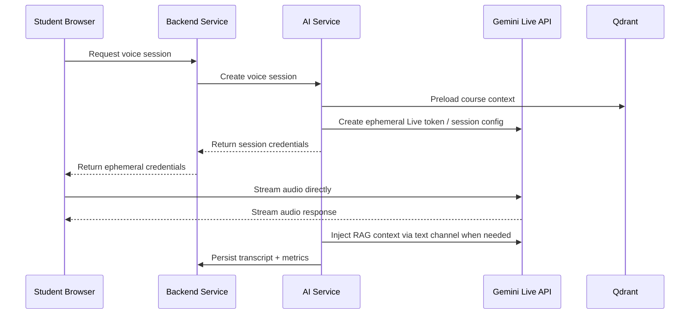

### Voice + RAG

Gemini Live does not perform retrieval by itself. The AI service injects context:

1. Start voice session with student profile, memory, and course overview.
2. Use the live transcript to detect the current topic.
3. Retrieve relevant chunks from Qdrant in the background.
4. Inject retrieved context into the Gemini Live session through the text channel.
5. Persist transcript, sources, TTFA, provider, and session metrics.

### Fallback path

When voice is self-hosted at scale or Gemini Live is unavailable:

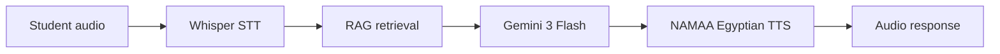

Fallback is for availability and cost control at scale; it is expected to have higher latency than Gemini Live.

---

## 8. Memory Architecture

Memory is split by function so the LLM receives only relevant context instead of raw history dumps.

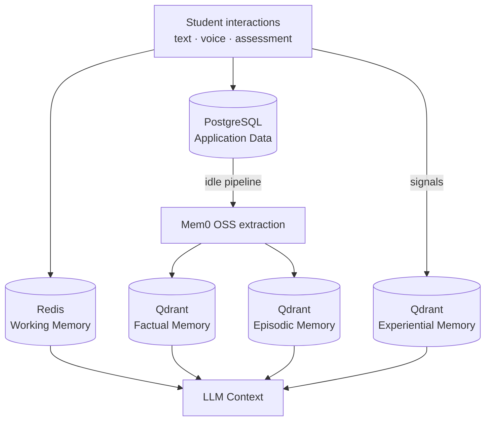

| Layer | Storage | Purpose | Read pattern | Write pattern |
|---|---|---|---|---|
| **Working** | Redis | Current conversation turns. | Every turn. | Every turn. |
| **Factual** | Qdrant via Mem0 OSS | Stable student facts: preferences, level, weaknesses, goals. | Conversation open and relevant queries. | Idle pipeline. |
| **Episodic** | Qdrant via Mem0 OSS | Summaries of past conversations. | New conversations. | Same Mem0 extraction as Factual. |
| **Experiential** | Qdrant custom | Teaching strategies that worked before. | Per question / mode selection. | Real-time signals + background jobs. |
| **Application Data** | PostgreSQL | Raw audit trail and source of truth. | Analytics, cache rebuild, extraction. | Every interaction. |

### Conversation lifecycle

```mermaid
stateDiagram-v2
    [*] --> EmptyChat: Student clicks New Chat
    EmptyChat --> Active: First message creates conversation_id
    Active --> Active: Each message persists to PG + Redis
    Active --> Idle: No activity for ~30 min
    Idle --> ExtractMemory: Idle pipeline
    ExtractMemory --> Cached: Factual/Episodic/Experiential updates
    Cached --> Cold: Redis TTL expires after inactivity
    Cold --> Active: Student returns; reload last messages from PG
    Active --> Archived: Student archives conversation
```

### New vs resumed conversation

| Scenario | Context loaded |
|---|---|
| New conversation | Factual + Episodic + empty Working memory + per-question Experiential. |
| Resume existing conversation | Factual + last raw messages from Redis/PostgreSQL + per-question Experiential. Episodic is skipped because raw messages are higher fidelity. |

---

## 9. Ingestion Worker Architecture

The worker is isolated from the app tier so heavy uploads never block student traffic.

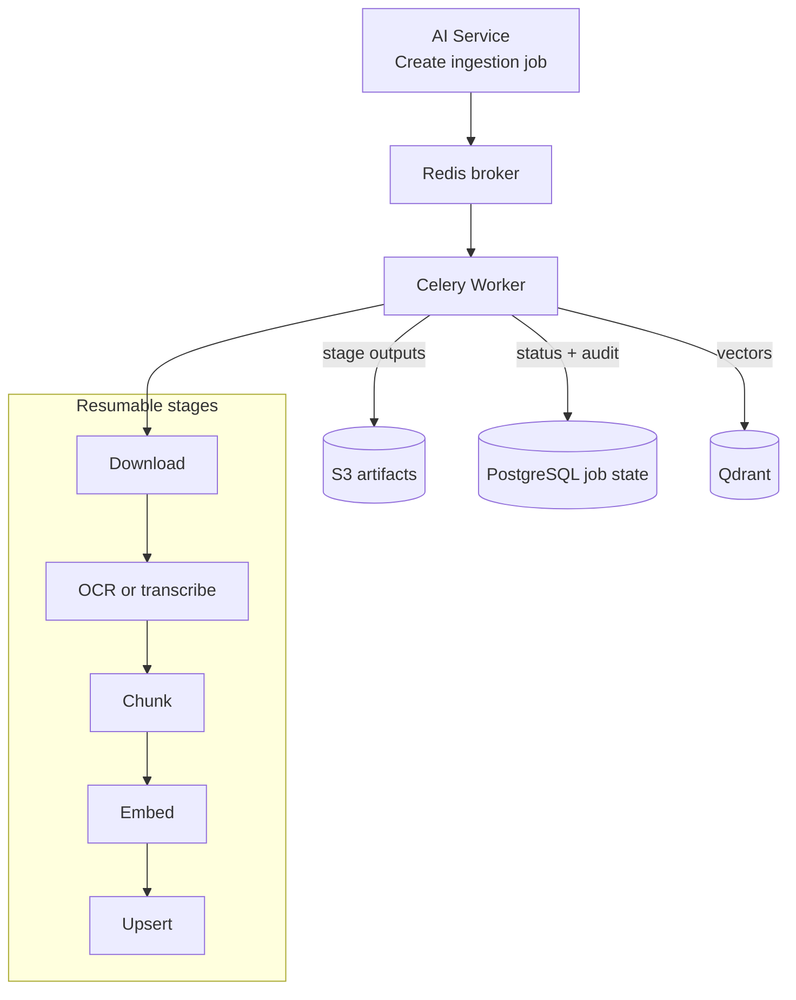

### Ingestion guarantees

- Every stage is idempotent.
- Per-page/per-segment/per-batch state is stored in `ingestion_stages`.
- Intermediate artifacts are cached in S3.
- Retries resume from the last failed unit instead of starting over.
- Job status is visible through `ingestion_jobs` and `ingestion_audit_log`.

### Trigger contract

The backend starts ingestion by calling the AI **ingest webhook** with a file reference. The webhook is intentionally thin: **validate signature/token → dedupe by `event_id` (idempotent) → create the `ingestion` row (`queued`) → enqueue the Celery job → return `202`.** It never does the heavy work inline. The webhook payload contract and how to drive it locally before the backend exists are in §20 → *Simulating the backend trigger locally*.

---

## 10. Vector Database Architecture

Qdrant stores both dense and sparse retrieval data for hybrid search.

### Collection strategy

| Decision | Choice |
|---|---|
| Tenant isolation | Collection per institution: `inst_{institution_id}`. |
| Course isolation | Payload filter by `course_id`. |
| Delete institution | Drop collection. |
| Delete course/file | Delete by payload filter. |
| Retrieval | Dense vector + sparse keyword search + optional rerank. |

### Point payload

Core fields stored with each chunk:

| Field | Purpose |
|---|---|
| `institution_id` | Tenant ownership and analytics. |
| `course_id` | Primary retrieval filter. |
| `section_id` | Section-level retrieval scope. |
| `file_id`, `file_name` | Source tracking. |
| `source_type` | PDF or lecture audio transcript. |
| `chunk_text` | Context returned to LLM. |
| `page_number` | PDF citation. |
| `timestamp_start`, `timestamp_end` | Lecture (audio) citation. |
| `language` | Analytics only. |
| `last_accessed`, `retrieval_count` | Content-quality analytics. |

---

## 11. Database Architecture

### 11.1 Two separate databases (ownership boundary)

The Backend and the AI service run **completely separate PostgreSQL databases** — they do **not** share a database or schema. The Backend owns identity/course data (`institutions`, `courses`, `instructors`, `students`) in **its own database**; the AI service owns all ingestion, conversation, assessment, and analytics tables in **its own database**.

The Backend passes the relevant **IDs** (e.g. `institution_id`, `course_id`, `student_id`) to the AI service over the API/webhook. The AI service stores those IDs as plain values and uses them for scoping and analytics — it never reaches into the Backend's database.

**External reference convention (no cross-database FK):**

- A column that points at a Backend-owned entity (`institution_id`, `course_id`, `instructor_id`, `student_id`, `reviewer_id`) is stored as an **indexed `UUID`** with **no `FOREIGN KEY` constraint** — the target row lives in another database. These are **logical references**; the AI service is responsible for validating them, not the engine.
- A column that points at another **AI-owned** table (e.g. `ingestion_jobs.file_id → course_files.id`, `messages.conversation_id → conversations.id`) **is** a real `FOREIGN KEY` — both rows live in the AI database.
- **`institution_id` is denormalized** onto every tenant-scoped AI table. Because we cannot `JOIN` to the Backend's `courses` table to derive it, the Backend sends `institution_id` alongside `course_id`/`student_id` and we store it directly. This keeps tenant filtering and analytics rollups fast and self-contained.

> In the tables below, FK notes are marked **(external — backend DB, no constraint)** or **(internal — AI DB)** to make the boundary explicit.

**Where the external IDs come from** — the Backend sends them; they are never created in the AI database:

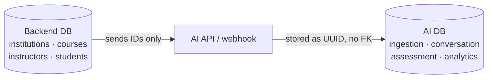

**AI database schema** — only AI-owned tables exist here. Columns marked `external` hold Backend IDs (plain indexed `UUID`, no foreign key); all relationship lines are real foreign keys between AI-owned tables:

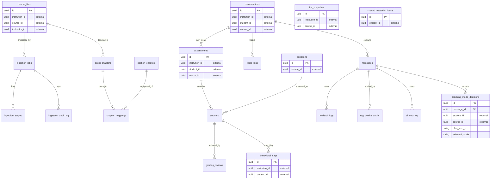

> **Reading the diagram:** every entity shown is **AI-owned** and lives in the AI database. Columns marked `external` (`institution_id`, `course_id`, `student_id`, `instructor_id`) hold IDs sent by the Backend — plain indexed `UUID`s with **no foreign key**. The Backend-owned tables they reference (`institutions`, `courses`, `instructors`, `students`) live in a **separate database** and are never created here.

### Table groups

| Group | Tables | Purpose |
|---|---|---|
| Ingestion | `course_files`, `ingestion_jobs`, `ingestion_stages`, `ingestion_audit_log` | File processing state and audit. |
| Chapter & summary | `asset_chapters`, `section_chapters`, `chapter_mappings` | Pre-generated asset/chapter summaries (§11.2.1); `course_files.summary` holds the asset-level summary. |
| Conversation | `conversations`, `messages`, `teaching_mode_decisions`, `voice_logs` | Unified text/voice history plus per-step teaching decisions and outcomes. |
| Assessment | `assessments`, `answers`, `questions` | Quizzes, grading, question quality. |
| Analytics / Quality | `kpi_snapshots`, `retrieval_logs`, `rag_quality_audits`, `grading_reviews`, `behavioral_flags`, `ai_cost_log` | Dashboards, audits, cost tracking. |
| Learning | `spaced_repetition_items` | Concept review scheduling. |

### Enums

| Enum | Values |
|---|---|
| `file_type` | `pdf`, `audio`, `docx`, `pptx`, `txt`, `video` — **initial launch accepts `pdf` + `audio` only**; the rest are future features (kept in the enum for forward-compat) |
| `embedding_status` | `pending`, `processing`, `completed`, `failed`, `partially_completed` |
| `language` | `ar`, `en`, `auto`, `mixed`, `ar_en` |
| `ingestion_stage` | `download`, `extract_audio`, `ocr_or_transcribe`, `chunk`, `embed`, `store`, `done` |
| `ingestion_status` | `queued`, `running`, `failed`, `completed`, `partially_completed` |
| `unit_status` | `pending`, `success`, `failed`, `retrying` |
| `audit_event` | `job_created`, `stage_started`, `stage_succeeded`, `stage_failed`, `unit_retried`, `manual_resume`, `job_completed`, `job_failed` |
| `conversation_type` | `text_tutor`, `voice_tutor`, `assessment` |
| `message_role` | `student`, `ai`, `system` |
| `example_type` | `theoretical`, `practical`, `mixed`, `none` |
| `difficulty` | `easy`, `medium`, `hard`, `expert` |
| `question_type` | `mcq`, `true_false`, `short_answer`, `essay` |
| `error_type` | `conceptual`, `careless`, `knowledge_gap`, `misunderstanding`, `none` |
| `service_type` | `llm`, `embedding`, `ocr`, `voice_stt`, `voice_tts`, `reranker` |
| `relevance_label` | `relevant`, `partial`, `irrelevant`, `unlabeled` |
| `audit_method` | `llm_judge`, `human_review`, `citation_check`, `embedding_similarity` |
| `disagreement_type` | `false_positive`, `false_negative`, `agreement` |
| `flag_type` | `too_fast_correct`, `copy_paste`, `pattern_anomaly`, `unusual_streak` |
| `flag_severity` | `low`, `medium`, `high` |
| `flag_status` | `flagged`, `reviewed`, `dismissed`, `confirmed`, `appealed` |
| `discrimination_flag` | `normal`, `too_easy`, `too_hard`, `ambiguous` |
| `kpi_period` | `hourly`, `daily`, `weekly`, `monthly` |

> Postgres `ENUM` types require an `ALTER TYPE` migration to add/rename values. They are used here deliberately for the closed sets above; columns expected to churn use `VARCHAR` instead.

### 11.2 Ingestion tables

#### `course_files`

| Column | Type | Notes |
|---|---|---|
| `id` | UUID (PK) | |
| `institution_id` | UUID, indexed | External — backend DB, no constraint (denormalized for tenant scope). |
| `course_id` | UUID, indexed | External — backend DB, no constraint. |
| `instructor_id` | UUID | External — backend DB, no constraint. |
| `file_name` | VARCHAR(255) | Original filename. |
| `file_type` | `file_type` | |
| `s3_url` | TEXT | Original file in S3. |
| `file_size` | INTEGER | Bytes. |
| `chunk_count` | INTEGER | Final count after embedding. |
| `embedding_status` | `embedding_status` | Summary of the latest job's overall status. |
| `language` | `language` | |
| `created_at` | TIMESTAMP | |
| `embedded_at` | TIMESTAMP | When the pipeline completed. |
| `summary` | TEXT | Asset-level summary, generated once at the end of ingestion (M2-6). NULL until generated. |
| `summary_generated_at` | TIMESTAMP | |
| `summary_status` | VARCHAR(30) | `pending`, `completed`, `failed`, or `stale`; separate from ingestion success. |
| `summary_model` | VARCHAR(100) | Gateway-resolved model ID used for the latest summary. |
| `summary_prompt_version` | VARCHAR(50) | Versioned M2-3 prompt. |
| `summary_source_checksum` | VARCHAR(128) | Invalidates summary when OCR/transcript source changes. |
| `summary_error` | TEXT | Redacted latest generation error; nullable. |

#### `ingestion_jobs`

One row per file-processing attempt; a file may have multiple jobs if reprocessed.

| Column | Type | Notes |
|---|---|---|
| `id` | UUID (PK) | |
| `file_id` | UUID | FK → `course_files.id` (internal — AI DB). |
| `file_type` | `file_type` | |
| `current_stage` | `ingestion_stage` | |
| `overall_status` | `ingestion_status` | |
| `total_units` | INTEGER | Pages (PDF) or transcript segments (audio). |
| `processed_count` | INTEGER | Units successfully processed. |
| `failed_count` | INTEGER | Units that failed after all retries. |
| `retry_count` | INTEGER | Job-level retry count. |
| `last_error_message` | TEXT | Most recent error. |
| `s3_artifacts_prefix` | TEXT | e.g. `s3://enara-artifacts/ocr/{file_id}/`. |
| `started_at` | TIMESTAMP | |
| `completed_at` | TIMESTAMP | |
| `created_at` | TIMESTAMP | |

**Indexes:** `(file_id, created_at DESC)`, `(overall_status)`.

#### `ingestion_stages`

Per-unit (per-page / per-segment) tracking for resume-from-failure.

| Column | Type | Notes |
|---|---|---|
| `id` | UUID (PK) | |
| `job_id` | UUID | FK → `ingestion_jobs.id` (internal — AI DB). |
| `stage` | `ingestion_stage` | |
| `unit_index` | INTEGER | Page/segment index; NULL for file-level stages. |
| `unit_id` | VARCHAR(100) | e.g. `page_47`, `segment_15`. |
| `status` | `unit_status` | |
| `attempts` | INTEGER | Attempts for this unit. |
| `s3_artifact_url` | TEXT | Stage output in S3. |
| `error_message` | TEXT | Last error for this unit. |
| `latency_ms` | INTEGER | |
| `processed_at` | TIMESTAMP | |

**Indexes:** `(job_id, stage, unit_index)`, `(job_id, status)`. **Resume:** `WHERE job_id = X AND status != 'success'`.

#### `ingestion_audit_log`

Append-only event log (insert only, no update/delete except retention).

| Column | Type | Notes |
|---|---|---|
| `id` | UUID (PK) | |
| `job_id` | UUID | FK → `ingestion_jobs.id` (internal — AI DB). |
| `event_type` | `audit_event` | |
| `stage` | VARCHAR(50) | Nullable for job-level events. |
| `unit_index` | INTEGER | Nullable, unit-level events only. |
| `payload` | JSONB | Structured details (error stack, latency, tokens, retries). |
| `created_at` | TIMESTAMP | |

**Partitioning:** by day (configurable retention). **Indexes:** `(job_id, created_at DESC)`, `(event_type, created_at DESC)`.

### 11.2.1 Chapter & summary tables (M2-6, M2-7, M2-8)

Fixed-size chunks are a poor unit for "summarize this lecture / this chapter / this whole unit" requests — sending every chunk to the LLM at query time is slow and expensive, and the "chapter" the student means (e.g. "الباب الأول") is a **content concept**, independent of how the material happens to be split across files. A single video may cover two chapters; a chapter may span a video *and* a PDF within the same Backend-defined `section_id` (Udemy-style folder). These tables solve that with a two-level, pre-generated summary hierarchy: **asset-level** (whole file) and **chapter-level** (logical topic, possibly spanning multiple assets).

**Design principle — never re-summarize a summary.** When a request spans multiple distinct logical units (e.g., "summarize lessons 1 and 2", or "summarize the whole unit"), the response is the **list** of their individually pre-generated summaries, not a new LLM call over already-compressed text. When a request is genuinely **one** logical chapter that happens to be split across files (e.g., a chapter spanning two videos), its summary is generated **once** from the raw combined chunks of that chapter — that is a single logical unit, not multiple ones.

**Pipeline (runs once, at ingestion time — never at query time):**

1. **Per-asset chapter detection** (M2-7):
   - **PDF:** deterministic — `chapter = heading_path[0]` (the top-level Markdown heading), already produced by the M1-5 chunker. No LLM call.
   - **Audio:** the AI service has no finer timestamp resolution than the ffmpeg silence-aware transcription segments (~5 min each, per `SegmentationConfig` in `src/ingestion/audio_segmentation.py`) — OpenRouter's STT returns text only, no internal timestamps, and every RAG chunk derived from a segment inherits that segment's `[start, end]`. Chapter detection is therefore done at the **same segment/line granularity**, not invented sub-segment precision: one cheap LLM call (Gemini Flash) per audio asset receives the numbered transcript segments and returns which segment index starts each chapter. A chapter boundary landing mid-segment causes at most one segment's worth (~5 min) of boundary "bleed" — acceptable given chapters run 10+ minutes.
   - Stored in `asset_chapters` (below), scoped to a single `course_files.id`.
2. **Section chapter reconciliation** (M2-8): triggered whenever an asset's chapters are (re)detected within a `section_id`. Chapter titles across assets in the same section are matched first by normalized exact/fuzzy text match (handles the common case: courses use consistent naming like "الباب الأول" everywhere — no LLM needed). Only when titles disagree in wording does a single small LLM call run, given **just the list of titles** (never full content) across the section's assets, to produce a canonical, deduplicated chapter list + mapping. Result stored in `section_chapters` + `chapter_mappings`.
3. **Chapter summary generation:** for each canonical chapter, gather every chunk mapped to it (possibly from multiple assets) and summarize once with a cheap model. Stored directly on `section_chapters.summary`.

#### `asset_chapters`

Raw, per-asset chapters detected in step 1, before cross-asset reconciliation.

| Column | Type | Notes |
|---|---|---|
| `id` | UUID (PK) | |
| `course_file_id` | UUID | FK → `course_files.id` (internal — AI DB). |
| `chapter_index` | INTEGER | Order within this asset (0-based). |
| `title` | VARCHAR(255) | Raw detected title. |
| `start_ref` | VARCHAR(50) | PDF: N/A. Audio: transcript segment index (not a free timestamp — see design note above). |
| `end_ref` | VARCHAR(50) | Same units as `start_ref`. |
| `created_at` | TIMESTAMP | |

#### `section_chapters`

Canonical, reconciled chapters — one row per logical chapter within a Backend `section_id` (or within a single asset, when it has no section). Carries the final pre-generated summary directly (no separate summary table needed).

| Column | Type | Notes |
|---|---|---|
| `id` | UUID (PK) | |
| `section_id` | UUID, indexed, nullable | External — backend DB, no constraint. NULL when the asset has no section (course-level or standalone asset). |
| `course_id` | UUID, indexed | External — backend DB, no constraint. |
| `canonical_index` | INTEGER | Display/lookup order (e.g., 1 = "الباب الأول"). |
| `title` | VARCHAR(255) | Canonical display title. |
| `summary` | TEXT | Pre-generated once; NULL until generated. |
| `summary_generated_at` | TIMESTAMP | |
| `created_at` | TIMESTAMP | |

**Indexes:** `(section_id, canonical_index)`, `(course_id, canonical_index)`.

#### `chapter_mappings`

Join table: which raw `asset_chapters` row belongs to which canonical `section_chapters` row. A canonical chapter may map to chapters from several different assets (e.g., a chapter split across two videos, or covered by both a video and a PDF).

| Column | Type | Notes |
|---|---|---|
| `id` | UUID (PK) | |
| `asset_chapter_id` | UUID | FK → `asset_chapters.id` (internal — AI DB). |
| `section_chapter_id` | UUID | FK → `section_chapters.id` (internal — AI DB). |

**Query-time retrieval (no LLM call — direct ID lookup):**

```sql
-- "summarize this asset" (whole file)
SELECT summary FROM course_files WHERE id = :asset_id;

-- "summarize chapter N" (one logical chapter, possibly multi-asset)
SELECT summary FROM section_chapters WHERE section_id = :section_id AND canonical_index = :n;

-- "summarize all chapters" (list, not re-summarized)
SELECT title, summary FROM section_chapters WHERE section_id = :section_id ORDER BY canonical_index;
```

### 11.3 Conversation tables

#### `conversations`

Persistent chat threads scoped to a `(student_id, course_id)` pair. No auto-timeout; persists until archived.

| Column | Type | Notes |
|---|---|---|
| `id` | UUID (PK) | The `conversation_id` used system-wide. |
| `institution_id` | UUID, indexed | External — backend DB, no constraint (denormalized). |
| `student_id` | UUID, indexed | External — backend DB, no constraint. |
| `course_id` | UUID, indexed | External — backend DB, no constraint. |
| `conversation_type` | `conversation_type` | |
| `title` | VARCHAR(255) | Auto-generated from first message. |
| `is_archived` | BOOLEAN | Default `false`. |
| `started_at` | TIMESTAMP | |
| `last_activity_at` | TIMESTAMP | Sidebar sort + Redis TTL refresh. |
| `messages_count` | INTEGER | Running counter. |
| `ai_model_used` | VARCHAR(50) | e.g. `gemini-3-flash`. |
| `voice_provider` | VARCHAR(50) | `gemini_live`, `whisper_namaa`, or NULL. |

**Indexes:** `(student_id, course_id, last_activity_at DESC)`, `(student_id, is_archived, last_activity_at DESC)`.

#### `messages`

| Column | Type | Notes |
|---|---|---|
| `id` | UUID (PK) | |
| `conversation_id` | UUID | FK → `conversations.id` (internal — AI DB). |
| `role` | `message_role` | `student`, `ai`, `system`. |
| `content` | TEXT | |
| `language` | `language` | |
| `sources` | JSONB | RAG sources cited. |
| `confidence_score` | FLOAT | RAG confidence. |
| `out_of_scope` | BOOLEAN | Did the AI refuse? |
| `sentiment_score` | FLOAT | -1 to 1. |
| `example_type` | `example_type` | Learning-style A/B tracking. |
| `latency_ms` | INTEGER | |
| `retrieval_log_id` | UUID | FK → `retrieval_logs.id` (internal — AI DB; nullable). |
| `cost_log_id` | UUID | FK → `ai_cost_log.id` (internal — AI DB; nullable). |
| `agent_metadata` | JSONB | Versioned TurnDecision/plan/StepResult summary (no hidden chain-of-thought). |
| `trace_id` | VARCHAR(100) | Langfuse turn trace used for feedback/evaluation linkage. |
| `feedback` | JSONB | Optional up/down vote + note. |
| `step_latencies` | JSONB | Decision, retrieval, rerank, assembly, generation, validation, compose, total. |
| `created_at` | TIMESTAMP | |

#### `teaching_mode_decisions`

One auditable decision row per executed plan step. Decision fields are
immutable; the `outcome` projection is updated idempotently as later evidence
arrives, while M2-13's raw effectiveness events remain append-only. It stores
observable signals/outcomes, never hidden model chain-of-thought.

| Column | Type | Notes |
|---|---|---|
| `id` | UUID (PK) | |
| `message_id` | UUID | FK → `messages.id` (internal — AI DB). |
| `institution_id` | UUID, indexed | External — backend DB, no constraint. |
| `student_id` | UUID, indexed | External — backend DB, no constraint. |
| `course_id` | UUID, indexed | External — backend DB, no constraint. |
| `plan_step_id` | VARCHAR(100) | Stable ID inside the persisted TurnDecision. |
| `request_type` | VARCHAR(50) | `question`, `summarize`, etc. |
| `previous_mode` | VARCHAR(50) | Nullable on first turn. |
| `selected_mode` | VARCHAR(50) | One of the nine allowed teaching modes. |
| `confidence` | FLOAT | Selector confidence after policy validation. |
| `reason_codes` | JSONB | Structured observable codes, not free-form reasoning. |
| `learner_signals` | JSONB | Compact signals used for this decision. |
| `profile_version` | VARCHAR(50) | Learner-profile snapshot consumed. |
| `policy_version` | VARCHAR(50) | Turn-decision policy version. |
| `model_used` | VARCHAR(100) | Turn Decision role model. |
| `outcome` | JSONB | Feedback, follow-up confusion, correctness, mode switch, latency; populated/updated as evidence arrives. |
| `created_at` | TIMESTAMP | |

**Indexes:** `(student_id, course_id, created_at DESC)`, `(selected_mode, request_type, created_at DESC)`, `(message_id, plan_step_id)` unique.

#### `voice_logs`

| Column | Type | Notes |
|---|---|---|
| `id` | UUID (PK) | |
| `conversation_id` | UUID | FK → `conversations.id` (internal — AI DB). |
| `ttfa_ms` | INTEGER | Time to first audio. |
| `stt_fallback` | BOOLEAN | |
| `barge_in` | BOOLEAN | Did the student interrupt? |
| `sentiment_score` | FLOAT | |
| `drop_off_second` | INTEGER | When engagement dropped. |
| `audio_duration_seconds` | FLOAT | |
| `provider` | VARCHAR(50) | `gemini_live`, `whisper_namaa`. |

### 11.4 Assessment tables

#### `assessments`

| Column | Type | Notes |
|---|---|---|
| `id` | UUID (PK) | |
| `institution_id` | UUID, indexed | External — backend DB, no constraint (denormalized). |
| `course_id` | UUID | External — backend DB, no constraint. |
| `student_id` | UUID | External — backend DB, no constraint. |
| `conversation_id` | UUID | FK → `conversations.id` (internal — AI DB; optional). |
| `topic` | VARCHAR(255) | |
| `difficulty` | `difficulty` | |
| `total_questions` | INTEGER | |
| `score` | FLOAT | 0–100. |
| `completed` | BOOLEAN | |
| `started_at` | TIMESTAMP | |
| `completed_at` | TIMESTAMP | |

#### `questions`

Stable question bank for cross-student aggregation.

| Column | Type | Notes |
|---|---|---|
| `id` | UUID (PK) | |
| `course_id` | UUID | External — backend DB, no constraint. |
| `topic` | VARCHAR(255) | |
| `question_text` | TEXT | Canonical text. |
| `question_type` | `question_type` | |
| `difficulty` | `difficulty` | |
| `correct_answer` | TEXT | |
| `source_chunks` | JSONB | Chunk IDs the question was generated from. |
| `generated_by_model` | VARCHAR(50) | |
| `times_used` | INTEGER | Reuse counter. |
| `discrimination_flag` | `discrimination_flag` | Set by aggregation job. |
| `created_at` | TIMESTAMP | |

#### `answers`

| Column | Type | Notes |
|---|---|---|
| `id` | UUID (PK) | |
| `assessment_id` | UUID | FK → `assessments.id` (internal — AI DB). |
| `question_id` | UUID | FK → `questions.id` (internal — AI DB). |
| `question_text` | TEXT | Denormalized snapshot at attempt time. |
| `question_type` | `question_type` | |
| `difficulty` | `difficulty` | |
| `student_answer` | TEXT | |
| `correct_answer` | TEXT | |
| `is_correct` | BOOLEAN | |
| `score` | FLOAT | 0–100 partial credit. |
| `error_type` | `error_type` | |
| `weak_concept` | VARCHAR(255) | |
| `ai_grading_confidence` | FLOAT | |
| `question_shown_at` | TIMESTAMP | For Struggle Time KPI. |
| `first_keystroke_at` | TIMESTAMP | |
| `response_time_ms` | INTEGER | |
| `struggle_time_ms` | INTEGER | `first_keystroke_at − question_shown_at`. |
| `attempt_number` | INTEGER | |
| `hint_used` | BOOLEAN | |
| `hint_text` | TEXT | |
| `suspicion_flags` | JSONB | e.g. `{"too_fast": true}`. |

### 11.5 Analytics & Quality tables

#### `kpi_snapshots`

| Column | Type | Notes |
|---|---|---|
| `id` | UUID (PK) | |
| `course_id` | UUID | External — backend DB, no constraint. |
| `institution_id` | UUID, indexed | External — backend DB, no constraint. |
| `kpi_name` | VARCHAR(100) | e.g. `avg_rag_confidence`. |
| `kpi_value` | FLOAT | |
| `period` | `kpi_period` | |
| `recorded_at` | TIMESTAMP | |

#### `ai_cost_log`

| Column | Type | Notes |
|---|---|---|
| `id` | UUID (PK) | |
| `conversation_id` | UUID | FK → `conversations.id` (internal — AI DB; nullable). |
| `message_id` | UUID | FK → `messages.id` (internal — AI DB; nullable). |
| `job_id` | UUID | FK → `ingestion_jobs.id` (internal — AI DB; nullable). |
| `institution_id` | UUID, indexed | External — backend DB, no constraint. |
| `student_id` | UUID, indexed | External — backend DB, no constraint. |
| `course_id` | UUID, indexed | External — backend DB, no constraint. |
| `service` | `service_type` | |
| `provider` | VARCHAR(50) | Model vendor after normalization (`openai`, `google`, `self_hosted`). |
| `model` | VARCHAR(100) | Normalized model id (OpenRouter/LiteLLM prefixes stripped). |
| `role` | VARCHAR(50) | Gateway role (`turn_decision`, `generation`, `composer`, …). |
| `prompt_version` | VARCHAR(80) | |
| `step_id` | VARCHAR(100) | Plan step when the call belongs to one. |
| `trace_id` | VARCHAR(64) | Langfuse / request correlation. |
| `tokens_in` | INTEGER | Prompt tokens, or estimated when the provider omitted usage. |
| `tokens_out` | INTEGER | Completion tokens. |
| `tokens_cache` | INTEGER | Provider-native cached input tokens. |
| `unit_count` | INTEGER | Pages / seconds / chunks / texts / documents. |
| `unit_kind` | VARCHAR(20) | `tokens`, `texts`, `documents`, … |
| `cost_usd` | DECIMAL(10,6) | Billed amount: actual when present, else estimate. |
| `actual_usd` | DECIMAL(12,8) | Provider/gateway `usage.cost` when reported. |
| `estimated_usd` | DECIMAL(12,8) | Snapshot price × tokens, including cache-read discount. |
| `cost_source` | VARCHAR(20) | `provider`, `estimated`, `missing`. |
| `status` | VARCHAR(20) | `ok`, `failed`, `cancelled`, `missing_usage`. |
| `used_fallback` | BOOLEAN | Gateway served a fallback model. |
| `cache_hit` | BOOLEAN | `tokens_cache > 0`. |
| `is_repair` | BOOLEAN | Revision / rewrite / compose repair. |
| `repair_index` | INTEGER | |
| `pricing_version` | VARCHAR(40) | Committed snapshot id (`m2-20-v1`). |
| `idempotency_key` | VARCHAR(120), unique | LiteLLM call id or hash of role/step/seq. |
| `extras` | JSONB | Bounded numeric metadata only — never prompts or student text. |
| `latency_ms` | INTEGER | |
| `created_at` | TIMESTAMP | |

**Indexes:** `(conversation_id, created_at)`, `(service, created_at)`, `(student_id, created_at)`, `(course_id, created_at)`, `(role, created_at)`, `(model, created_at)`, `(step_id, created_at)`.

One student turn writes one row per provider operation (Turn Decision, embeddings, rerank, generation, judges/rewrites, Composer, fallbacks). Semantic-cache hits write no LLM row. Cancellation persists completed calls and a zero-cost `cancelled` marker for work that never started. Retries reuse `idempotency_key` so spend is never double-counted. Aggregate queries sum tokens/USD by student/course/conversation/message/step/role/model/day and never select message content.

#### `retrieval_logs`

| Column | Type | Notes |
|---|---|---|
| `id` | UUID (PK) | |
| `message_id` | UUID | FK → `messages.id` (internal — AI DB). |
| `query_text` | TEXT | |
| `query_embedding_id` | VARCHAR(100) | Optional cached-embedding reference. |
| `retrieved_chunks` | JSONB | `{chunk_id, score, source_file_id, page}`. |
| `reranked_chunks` | JSONB | Top-K after reranker. |
| `top_score` | FLOAT | |
| `chunks_used_in_answer` | JSONB | Subset actually cited. |
| `relevance_label` | `relevance_label` | |
| `created_at` | TIMESTAMP | |

**Indexes:** `(message_id)`, JSONB index on `chunk_id`.

#### `rag_quality_audits`

| Column | Type | Notes |
|---|---|---|
| `id` | UUID (PK) | |
| `message_id` | UUID | FK → `messages.id` (internal — AI DB). |
| `audit_method` | `audit_method` | |
| `groundedness_score` | FLOAT | 0–1. |
| `hallucination_detected` | BOOLEAN | |
| `unsupported_claims` | JSONB | Flagged spans. |
| `reviewer_id` | UUID | External — backend DB (`instructors`), no constraint; nullable. |
| `notes` | TEXT | |
| `created_at` | TIMESTAMP | |

**Sampling:** 10% via `llm_judge`; 100% via `citation_check`.

#### `grading_reviews`

| Column | Type | Notes |
|---|---|---|
| `id` | UUID (PK) | |
| `answer_id` | UUID | FK → `answers.id` (internal — AI DB). |
| `reviewer_id` | UUID | External — backend DB (`instructors`), no constraint. |
| `ai_decision` | BOOLEAN | |
| `human_decision` | BOOLEAN | |
| `disagreement_type` | `disagreement_type` | |
| `review_notes` | TEXT | |
| `created_at` | TIMESTAMP | |

#### `behavioral_flags`

Append-only with student appeal mechanism.

| Column | Type | Notes |
|---|---|---|
| `id` | UUID (PK) | |
| `institution_id` | UUID, indexed | External — backend DB, no constraint (denormalized). |
| `student_id` | UUID | External — backend DB, no constraint. |
| `conversation_id` | UUID | FK → `conversations.id` (internal — AI DB; nullable). |
| `answer_id` | UUID | FK → `answers.id` (internal — AI DB; nullable). |
| `flag_type` | `flag_type` | |
| `severity` | `flag_severity` | |
| `evidence` | JSONB | Timestamps, signal values. |
| `status` | `flag_status` | |
| `appeal_notes` | TEXT | |
| `reviewed_by` | UUID | External — backend DB (`instructors`), no constraint; nullable. |
| `created_at` | TIMESTAMP | |

> **Privacy:** behavioral data must comply with privacy regulations. Students must be notified flags exist and have appeal rights.

### 11.6 Learning tables

#### `spaced_repetition_items`

| Column | Type | Notes |
|---|---|---|
| `id` | UUID (PK) | |
| `student_id` | UUID, indexed | External — backend DB, no constraint. |
| `concept` | VARCHAR(255) | |
| `ease_factor` | FLOAT | SM-2 algorithm. |
| `interval_days` | INTEGER | |
| `next_review_date` | DATE | |
| `review_count` | INTEGER | |
| `success_count` | INTEGER | |

### 11.7 Multi-tenancy model

Tenancy is keyed by **`institution_id`** (not a generic `tenant_id`) since tenants are educational institutions. The AI service has its **own** database (separate from the Backend, §11.1); isolation within it is logical. Isolation differs by store, by design:

| Store | Pattern | Isolation |
|---|---|---|
| **PostgreSQL (AI database)** | Single AI-owned database, one schema | **Logical** — every tenant-owned row carries a denormalized `institution_id` (sent by the Backend); every query filters on it. The relational engine enforces the filter reliably. |
| **Qdrant** | Collection per institution (`inst_{institution_id}`) | **Physical** — vector search can leak across tenants on a filter miss, so each institution gets its own collection; `course_id` is a payload filter within it. |
| **S3** | Path prefix `{institution_id}/{course_id}/...` | **Logical** — object keys are namespaced per institution. |

Rules:

- `institution_id` (and `course_id`/`student_id`) arrive **from the Backend** via the authenticated request/webhook, **never** from client-supplied input. They are stored as external `UUID` references with no cross-database FK (§11.1).
- A single AI-owned Postgres database is sufficient at every planned phase; **database-per-tenant is explicitly not used** (avoids migration/backup/pooling overhead with no benefit at this scale).
- The AI database is **separate from the Backend database** — there is no shared schema and no cross-database join; tenant scope is carried by the denormalized `institution_id` column.
- Deleting an institution = drop its Qdrant collection + delete its `institution_id` rows in the AI database + delete its S3 prefix.

### Data scaling strategy

The constraint that grows first is **query performance**, not disk (RDS storage auto-scales with a click). Scale the conversation/message tables in this order, applying each level only when its trigger is reached:

| Level | Technique | Trigger | Notes |
|---|---|---|---|
| **1** | **Indexing** | From day one | Composite indexes on the columns that filter, e.g. `messages(conversation_id, created_at)` and `conversations(institution_id, student_id)`. Carries tens of millions of rows comfortably. |
| **2** | **Hot/Cold tiered storage** | Phase 2–3 | Keep recent conversations (~last 3 months) hot in Postgres; archive older ones to **S3**, rehydrate on demand. Maps to the `Archived` conversation state (§8). |
| **3** | **Table partitioning** | Phase 3–4 | Postgres `PARTITION BY RANGE (created_at)` (monthly). Queries touch only their partition; dropping an old partition archives in one step. |
| **4** | **Read replicas** | Phase 3–4 | RDS read replicas absorb read-heavy load; writes stay on the primary, reads fan out. |
| **5** | **Sharding** | 100K+ students (Phase 5) | Split data across physical databases, typically by `institution_id`. High complexity — only when forced. Aligns with the Phase-5 multi-region move in `ROADMAP.md`. |

> Current need is **Level 1 only**. Each higher level is additive and supported by the chosen RDS Multi-AZ topology without re-architecting.

---

## 12. Analytics Architecture

Analytics is generated from logs and stored events, not from ad-hoc LLM memory.

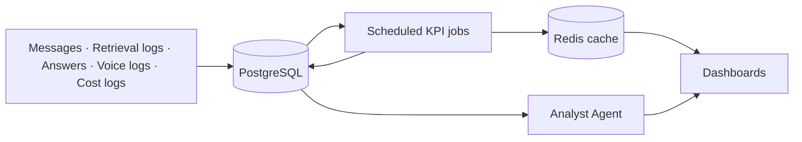

### Dashboard groups

| Dashboard | Focus |
|---|---|
| AI system performance | RAG confidence, latency, error rate, voice TTFA, cost ratio. |
| Assessment and cognition | Scores, difficulty adaptation, weak concepts, grading quality, timing signals. |
| Tutoring progress | Intervention effectiveness, retention, hint usage, learning efficiency. |
| RAG data quality | Groundedness, retrieval precision, unused content, chunk quality. |
| Student behavior | Frustration, rushing, suspicious timing, engagement drop-off. |
| Personalization | Preferred modality, learning-style affinity, review cadence. |

---

## 13. Security Architecture

Security follows defense-in-depth for agentic AI risks, especially prompt injection, tool misuse, and memory poisoning.

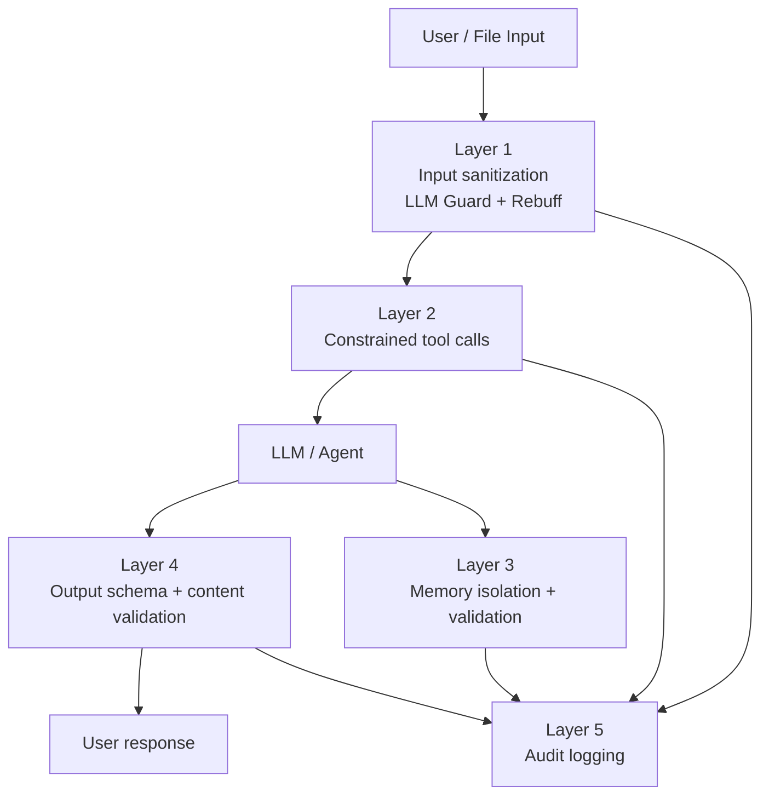

### Core controls

| Risk | Control |
|---|---|
| Prompt injection | LLM Guard + Rebuff before LLM calls; content validation for uploads. |
| Tool misuse | Agents use fixed allowed actions rather than arbitrary tool execution. |
| Memory poisoning | Per-student namespaces, schema validation, confidence thresholds, append-only audit. |
| Grade leakage | Assessor has constrained access to grading tools and source materials. |
| RAG poisoning | Ingestion scanning, OCR validation, source logging, retrieval audits. |
| Voice abuse | Lightweight live controls; post-hoc transcript scanning to preserve latency. |
| Privacy leakage | Avoid raw PII in logs; isolate tenants by institution and student. |

---

## 14. Deployment Architecture

### Region & provider availability

Primary region is **AWS `eu-central-1` (Frankfurt)**. All infra pricing in the cost model is based on Frankfurt, and the managed Qdrant Cloud cluster is co-located there. Frankfurt is ~13% cheaper than `me-south-1`; the tradeoff is ~80–100ms latency to Egypt vs ~40–50ms from Bahrain.

| Service | `eu-central-1` availability | Note |
|---|---|---|
| EC2 / RDS / ElastiCache / S3 | Available | Core infra runs in-region. |
| Qdrant Cloud | Available (Frankfurt) | Managed 3-node HA cluster co-located in `eu-central-1`. |
| AWS Bedrock | Available | Optional fallback LLM provider. |
| Gemini API | Available | Global endpoints. |
| OpenAI API | Available | Embeddings + STT. |
| Groq API | Available | Optional, global. |

### Phase 1–2 baseline

```mermaid
flowchart TB
    Internet[Students / Instructors]
    Edge[Backend-owned edge\nCloudFront · WAF · ALB]
    ASG[AI App ASG\nm6i FastAPI instances]
    Worker[Worker EC2\nm6i Celery]
    Qdrant[(Qdrant Cloud\nmanaged HA)]
    RDS[(RDS PostgreSQL\nMulti-AZ)]
    Redis[(ElastiCache Redis\nMulti-AZ)]
    S3[(S3)]
    Providers[Gemini + OpenAI APIs]

    Internet --> Edge --> ASG
    ASG --> RDS
    ASG --> Redis
    ASG --> Qdrant
    ASG --> S3
    ASG --> Providers
    Redis --> Worker
    Worker --> RDS
    Worker --> Qdrant
    Worker --> S3
    Worker --> Providers
```

### Instance types (Production)

Production runs a high-availability stack on dedicated-CPU `m6i` instances, managed Qdrant Cloud, and Multi-AZ managed databases. GPUs are added only when self-host break-even is crossed (voice at Phase 3+, OCR at Phase 4+). Source of truth for sizing/pricing: `@d:\projects\Enara_Project\cost-model\cost_model_guide.md` (`2_UnitPrices` + `5_Infrastructure`).

| Service | Phase 1 (1K–3K) | Phase 2 (10K) | Phase 3 (30K) | Phase 4 (100K) |
|---|---|---|---|---|
| **App EC2 (HA ASG)** | 2× `m6i.large` | 2× `m6i.xlarge` | 2× `m6i.xlarge` | 2× `m6i.xlarge` |
| **Worker EC2 (HA)** | 2× `m6i.large` | 2× `m6i.large` | 2× `m6i.large` | 2× `m6i.large` |
| **Vector DB** | Qdrant Cloud (managed HA) | Qdrant Cloud | Qdrant Cloud | Qdrant Cloud (16GB) |
| **PostgreSQL** | RDS Multi-AZ (`m6g`) | RDS Multi-AZ | RDS Multi-AZ | RDS Multi-AZ (xlarge) |
| **Redis** | ElastiCache Multi-AZ (`m6g`) | Multi-AZ | Multi-AZ | Multi-AZ |
| **Load balancer** | ALB | ALB | ALB | ALB |
| **Voice GPU (self-host)** | — | — | `g5.xlarge` | `g5.xlarge` |
| **OCR GPU (self-host)** | — | — | — | `g5.2xlarge` |
| **Security GPU (LLM Guard)** | — | — | optional | `g5.xlarge` class |

> **Why `m6i`, not `t3`?** App/Worker run sustained, not bursty, so dedicated-CPU `m6i` gives predictable latency without CPU-credit risk. `t3` is only a downgrade option for the smallest light setup.

### Environments: Production vs Dev / Test

Production and non-production run as **separate environments** with isolated data stores. Dev/Staging is intentionally a scaled-down clone, budgeted at ~30% of production infra cost (tracked as a line item in `6_HiddenCosts` → "Dev / Staging environment").

| Aspect | Production | Dev / Test (Staging) |
|---|---|---|
| **Purpose** | Live student/instructor traffic | Developer testing + pre-release validation |
| **App / Worker** | HA `m6i` per phase table above | Single small `m6i.large` (or `t3` burstable) each |
| **ASG** | min 2, scales out on load | min 1, fixed small |
| **PostgreSQL** | RDS Multi-AZ | RDS single-AZ small (or `t3.micro`) |
| **Redis** | ElastiCache Multi-AZ | Single-node small |
| **Vector DB** | Qdrant Cloud managed HA | Small Qdrant Cloud tier or single self-host node |
| **GPUs** | Added per phase (voice/OCR/security) | None — use Gemini/OpenAI APIs |
| **AI providers** | Same Gemini + OpenAI APIs | Same APIs, separate keys + quotas |
| **Data** | Real tenant data, backups + PITR | Synthetic / anonymized fixtures |
| **Relative cost** | 100% baseline | ~30% of production infra |

> **Rule**: Dev/Test never shares Production data stores or API keys. It exists to validate updates before an ASG instance refresh promotes them to Production.

### Scaling phases

| Phase | Students | Architecture move |
|---|---:|---|
| **1** | 1K–3K | HA `m6i` App/Worker + Qdrant Cloud + Multi-AZ RDS/Redis + S3. All AI via APIs. |
| **2** | 3K–10K | Same architecture; App scaled to `m6i.xlarge` + higher ASG max. No GPU. |
| **3** | 10K–30K | Add voice GPU (`g5.xlarge`) for Whisper + NAMAA. Text stays API. |
| **4** | 30K–100K | Add OCR GPU (`g5.2xlarge`) for Qwen3-VL. Upgrade Qdrant Cloud 16GB + RDS xlarge. Text stays API. |
| **5** | 100K+ | ECS auto-scaling, larger Qdrant Cloud + Redis/RDS topology, multi-region. |

### Stateless app rules

- Sessions and working memory live in Redis, not process memory.
- Files and artifacts live in S3, not local disk.
- PostgreSQL is the source of truth for durable structured data.
- Qdrant state is on persistent storage with snapshots/backups.
- App instances can be replaced by ASG without data loss.

---

## 15. Observability and Operations

```mermaid
flowchart LR
    App[FastAPI + Worker]
    CW[CloudWatch\nmetrics + logs + alarms]
    LF[Langfuse\nLLM observability]
    Prom[Prometheus]
    Graf[Grafana dashboards]
    Alerts[SNS / Slack / PagerDuty]

    App --> CW
    App --> LF
    App --> Prom
    CW --> Alerts
    Prom --> Graf
    CW --> Graf
    LF --> Graf
```

### Day-1 monitoring stack (recommended for Phase 1 scale)

| Area | Tooling | Rationale |
|---|---|---|
| LLM observability + evaluation | **Langfuse (self-hosted)** | Captures every Gemini/OpenAI call (prompt, tokens, cost, latency) and hosts eval scores/datasets. Non-negotiable from day 1. |
| Infrastructure metrics + logs | **CloudWatch** | Native to AWS, near-zero setup; covers EC2/ALB/RDS/Redis. |
| Custom app metrics + dashboards | **Prometheus + Grafana** (or **Grafana Cloud free tier**) | Solo/small team: prefer Grafana Cloud free tier to avoid self-host ops. |
| Alerts | **CloudWatch alarms → SNS → Slack** (PagerDuty for P1) | Single routing path by severity. |
| Error tracking | **Sentry (free tier)** | App + worker exception tracking. |

> Deferred to later phases: Loki (log aggregation, P2+), Tempo/Jaeger (distributed tracing, P3+), dedicated on-call tooling (P4).

### Evaluation & quality

Quality is measured continuously, not assumed:

- **Retrieval evaluation**: a curated query→expected-chunk set scores recall/precision and reranking impact before changes ship.
- **Groundedness / hallucination**: sampled answers scored (LLM-as-judge via Langfuse) against retrieved context; regressions alert.
- **Agent quality**: golden Q&A datasets per agent (tutor/assessor) tracked in Langfuse across prompt/model changes.
- **Tutor graph scenarios (M2-21)**: versioned `m2-21-v1` suite in `eval/m2_21/` scores the full bounded-adaptive graph over WebSocket — plan shape, mode/request policy, retrieval/refusal, citations, Composer faithfulness, safety, repair bounds, no-leak delivery, p50/p95 latency, and [M2-20] cost. An LLM judge (`graph_quality_judge` / `m2-21-rubric-v1`) is calibrated against labeled items; a blind human subset is exported beside each live run. Release gates live with the dataset thresholds and are recorded in Langfuse. Local workstation runs are `production_slo_comparable=false`.
- **Ingestion accuracy**: an OCR/transcription spot-check set validates extraction quality per pipeline change.

Online scores live in Langfuse; offline eval runs against versioned datasets in CI before release.

### Key SLOs

| Metric | Target |
|---|---|
| Tutor response p95 | < 3s |
| Voice TTFA p95 | < 1.5s |
| API availability | 99.5% Phase 1, 99.9% Phase 3+ |
| Error rate | < 1% |
| Ingestion turnaround p95 | < 5 min/file |

### Critical alerts

- App CPU or memory saturation.
- ALB 5XX spikes.
- RDS connection exhaustion or slow queries.
- Redis memory pressure or evictions.
- Qdrant search latency or disk usage.
- Celery queue backlog or worker heartbeat loss.
- LLM provider error/rate-limit spikes.

> The 5 critical infra alarms (CPU, RDS connections, ALB 5XX, Redis memory, Celery
> queue depth) → SNS → Slack are specified, with ready AWS CLI commands, in
> `docs/runbooks/cloudwatch-alarms.md`. They are executed at the first AWS deploy
> (M2 hardening), not during local development.

---

## 16. Instance Management

EC2 instances are treated as replaceable compute. Persistent state lives outside the instance.

| Service | Preferred resizing method | Notes |
|---|---|---|
| App EC2 (`m6i`) | ASG instance refresh | Rolling, near-zero downtime. |
| Worker EC2 (`m6i`) | Drain queue → stop/modify/start | Brief downtime acceptable. |
| Qdrant Cloud | Managed scale-up | Provider-managed HA; no instance resize needed. |
| GPU EC2 (`g5`) | stop/modify/start | Model weights on persistent volume. |
| RDS | Managed resize | Prefer maintenance window or Multi-AZ failover. |
| ElastiCache | Managed resize | Enable snapshots; cluster mode at scale. |

---

## 17. Key Architectural Decisions

| Decision | Choice |
|---|---|
| Architecture style | FastAPI modular monolith, extract modules only when scaling/failure isolation requires it. |
| Ingestion isolation | Celery Worker on separate EC2 to protect student request latency. |
| RAG framework | Custom retrieval/generation; LlamaIndex only for ingestion helpers if needed. |
| Agent orchestration | LangGraph state graph for the Tutor agent (Turn Decision → dependency-aware parallel Execute → bounded repair → LLM Compose/validate, see §6). Orthogonal to the "no LangChain for RAG" rule above — orchestrates control flow only; retrieval/rerank/grounding stay custom. |
| Vector DB | Qdrant with hybrid dense + sparse search. |
| RAG grounding | Course-scoped retrieval, citations, refusal when material is absent. |
| OCR | Gemini 3 Flash VLM for all PDFs; no language-based routing. |
| Voice | Two distinct paths. **Now (M2-26):** a frontend avatar owns STT/TTS and exchanges plain text with the Tutor — one `channel="voice"` flag on the existing graph shortens the answer and renders it speech-ready (§6 "Delivery channel"); no audio in the AI service. **Later (M5):** real-time Gemini Live sessions primary, self-host Whisper + NAMAA at scale. |
| Text LLM roles | **Not locked to Gemini and not forced to one model.** [M2-4] benchmarks Turn Decision, grounded generation, Composer, validator/rewriter, and background summarization separately; [M2-5] routes each role's primary/fallback through LiteLLM config. |
| Embeddings | Self-hosted **EmbeddingGemma-300m** at 512-d (MRL), CPU-only via **ONNX Runtime** (§4.2, validated 2026-08-18): dedicated small inference EC2 for the query path + **AWS Lambda (fp32 container)** for bursty ingestion embedding; no GPU at any phase for embeddings. `bge-m3` remains the break-glass recovery (§4.1). |
| Text LLM fallback | Role-specific primary → fallback ordering is an [M2-5] `proxy.yaml` config entry, not hardcoded application code (no text self-host at any phase). |
| Deployment region | AWS `eu-central-1` (Frankfurt) — cost model is priced on Frankfurt and Qdrant Cloud is co-located there. ~13% cheaper than Bahrain, ~80–100ms to Egypt. |
| Memory | Working + Factual + Episodic + Experiential + Application Data. |
| Memory framework | Mem0 OSS for Factual/Episodic; custom Experiential. |
| Data ownership | Backend owns identity/upload/gateway; AI owns AI tables and vector data. |
| Security | OWASP ASI-style defense-in-depth with input scanning, constrained tools, memory isolation, output validation, audit logs. |
| Scaling | API-first; self-host only voice and OCR when cost break-even is clear. |

---

## 18. Module Map

| Module | Primary dependencies | Output |
|---|---|---|
| RAG | S3, Worker, Qdrant, Gemini, OpenAI | Grounded context + citations. |
| Tutor | RAG, Memory, Gemini, Redis, PostgreSQL | Streaming grounded explanation. |
| Assessor | RAG, Gemini, PostgreSQL | Questions, grades, feedback, weak concepts. |
| Analyst | PostgreSQL, Qdrant logs, Redis KPIs | Insights and dashboard summaries. |
| Voice | Gemini Live, RAG, Memory, PostgreSQL | Real-time audio tutoring + transcript. |
| Memory | Redis, PostgreSQL, Qdrant, Mem0, Gemini | Personalization context. |
| Ingestion Worker | Redis, S3, Gemini/OpenAI, Qdrant, PostgreSQL | Searchable course chunks. |
| Analytics | PostgreSQL, Redis, Langfuse/cost logs | KPIs and reports. |
| Security | LLM Guard, Rebuff, schemas, audit logs | Guardrails and traceability. |

---

## 19. Repository & Code Structure

The codebase is organized by **business domain**, not by file type. File-type grouping (`routers/`, `models/`, `services/`) does not scale once a monolith holds many domains; domain-grouping keeps each capability self-contained and cleanly extractable later. This follows the Netflix Dispatch / `fastapi-best-practices` convention.

### Repository split

| Repository | Owner | Contents |
|---|---|---|
| `enara-backend` | Backend team | Auth, file upload, public gateway, session management. Uploads source files to S3, calls AI webhooks. |
| `enara-ai` | AI team | FastAPI modular monolith **and** the Celery worker — one codebase, one Docker image, two process types (`web` + `worker`). |

> The Celery worker is **not** a separate repository. It shares chunking, embedding, and provider-client code with the ingestion API, so it ships from the same image and is separated by **process**, not by repo. This avoids code duplication and keeps ingestion logic testable without Celery.

### `enara-ai` layout

```
enara-ai/
├── alembic/                     # migrations for AI-owned tables
├── src/
│   ├── main.py                  # FastAPI app factory + router registration
│   ├── celery_app.py            # Celery app + task autodiscovery
│   ├── models.py                # shared base ORM models
│   │
│   ├── config/                    # cross-cutting infra — all global config lives here
│   │   ├── settings.py          # pydantic BaseSettings (env-driven)
│   │   ├── database.py          # Postgres engine/session
│   │   ├── logging.py           # logging config
│   │   ├── security.py          # keys, auth helpers
│   │   └── exceptions.py        # global exception types + handlers
│   │
│   ├── prompts/                 # versioned prompt templates (YAML, one per use-case)
│   │   ├── loader.py            # loads + caches YAML, validates required variables
│   │   ├── tutor.yaml
│   │   ├── assessor.yaml
│   │   ├── analyst.yaml
│   │   ├── rag_grounding.yaml
│   │   ├── memory_extraction.yaml
│   │   ├── hallucination_check.yaml
│   │   └── ocr.yaml
│   │
│   ├── rag/                     # retrieval + generation
│   │   ├── router.py            # endpoints
│   │   ├── schemas.py           # pydantic models
│   │   ├── models.py            # db models
│   │   ├── service.py           # retrieve · rerank · ground · generate
│   │   ├── dependencies.py
│   │   ├── constants.py
│   │   └── exceptions.py
│   ├── agents/                  # tutor / assessor / analyst sub-packages
│   │   ├── tutor/
│   │   ├── assessor/
│   │   └── analyst/
│   ├── voice/                   # Gemini Live session setup + self-host fallback
│   ├── memory/                  # working · factual · episodic · experiential
│   ├── ingestion/               # ingest webhook + job orchestration (API side)
│   ├── analytics/               # KPI computation + dashboards
│   ├── security/                # guardrails · sanitization · audit
│   │
│   ├── tasks/                   # Celery tasks = thin wrappers over domain services
│   │   ├── ocr.py
│   │   ├── transcription.py
│   │   ├── chunking.py
│   │   ├── embedding.py
│   │   └── memory_extraction.py
│   │
│   └── integrations/            # shared external provider clients
│       ├── gemini/
│       ├── openai/
│       ├── qdrant/
│       └── s3/
├── tests/                       # mirrors src/ by domain
├── requirements/                # base.txt · dev.txt · prod.txt
├── Dockerfile                   # one image; CMD selects web vs worker
├── docker-compose.yml
└── .env
```

### Structure rules

| Rule | Reason |
|---|---|
| Each domain owns its `router · schemas · models · service`. | Self-contained, independently testable, cleanly extractable. |
| Cross-domain calls go through the **service** layer, never another domain's router. | Keeps boundaries explicit; prevents hidden coupling. |
| `tasks/` are thin Celery wrappers that call domain services. | Business logic stays in domains and runs without a broker in tests. |
| All provider SDK access lives in `integrations/`. | Single place to swap models/vendors (e.g. embeddings API → self-host). |
| Web and worker share one image, differ only by start command. | No duplicated ingestion/provider code; consistent deploys. |
| All global configuration is centralized under `config/` (settings, database, logging, security, exceptions). | One place to find and change cross-cutting setup; nothing scattered at the `src/` root. |
| Prompts are versioned **YAML, one file per use-case**, loaded via `prompts/loader.py`. | Clean diffs and review, no merge conflicts, editable by non-devs, hot-reloadable. Covers agent and non-agent prompts (grounding, memory extraction, hallucination check, OCR). |

### Path to extraction

When a domain's load or team ownership justifies a microservice, its folder lifts out with its `router/service/schemas` intact and is fronted by its own app — no rewrite. The most likely first candidates are the **Ingestion Worker** (already process-isolated) and **Voice** (separate latency/GPU profile).

---

## 20. Local Development & Environments

The same code and Docker image run everywhere; only **environment variables** change (12-factor). You do **not** write AWS-specific code paths.

### Two classes of dependency

**(a) Backing services the code connects to** — run locally as containers, swapped by config:

| Production (AWS) | Local (docker-compose) | Client library | Uses boto3? |
|---|---|---|---|
| RDS (Postgres) | `postgres` container | SQLAlchemy + psycopg | No |
| ElastiCache (Redis) | `redis` container | redis-py | No |
| Qdrant Cloud | `qdrant` container | qdrant-client | No |
| S3 | MinIO / LocalStack | boto3 | **Yes** |

> `boto3` is the AWS SDK and is used **only** for S3 (and SNS/CloudWatch). RDS/ElastiCache are reached through their normal Postgres/Redis drivers, not boto3.

**(b) Infrastructure / platform services** — **not** run locally; your machine + Docker play their role during development:

| Production (AWS) | Role | Local equivalent |
|---|---|---|
| EC2 | Host running the container | Your machine (`docker compose up`) |
| ALB | Routes traffic to instances | None — call `localhost:8000` directly |
| ASG | Scales EC2 | None — single local process |
| CloudWatch | Metrics + log sink | The console / stdout |
| SNS → Slack | Alert routing | None |

**Rule of thumb:** if the code calls `connect(...)` on it → run it locally; if it is *where the code runs* or *how traffic reaches it* → it is infrastructure and is not needed locally.

### Config-driven endpoints

Each provider client (in `integrations/`) reads its endpoint + credentials from `config/settings.py`. Example (S3):

- Local: `S3_ENDPOINT_URL=http://localhost:9000` → MinIO.
- Production: `S3_ENDPOINT_URL` unset → boto3 targets real AWS S3; credentials come from the instance IAM role.

### SaaS with no local equivalent

Gemini and OpenAI have no local stand-in. Use a **real dev API key** locally. These are the only external calls during local development.

### Local → production flow

1. **Local:** `docker compose up` brings up app + postgres + redis + qdrant + minio; `.env` points to them; LLM calls use dev keys.
2. **Build** the Docker image.
3. **Deploy:** same image to EC2; env vars now point to RDS, ElastiCache, real S3, and Qdrant Cloud.

### Simulating the backend trigger locally

Ingestion starts when the backend uploads a file and calls the AI ingest **webhook** (§9). During AI-engine development the backend does not exist yet, so only the **trigger** is faked — never the pipeline. The webhook, worker, OCR/STT, chunking, embedding, and Qdrant upsert are all built **exactly as production**; a small "fake backend" stands in for the caller.

**Principle — build the consumer for real, simulate only the producer.** When the real backend ships, the simulator is deleted and nothing else changes.

**Contract-first webhook payload** (the agreed shape the backend will send):

```json
{
  "event_id": "evt_01H...",
  "course_id": "course_123",
  "asset_id": "asset_456",
  "s3_bucket": "enara-uploads",
  "s3_key": "courses/course_123/lecture1.pdf",
  "content_type": "application/pdf",
  "modality": "document"
}
```

`modality` routes the work: `document` → OCR, `audio` → transcription; both then converge on chunk → embed → upsert. Only these two modalities are accepted at launch (videos are converted to audio **by the backend** before the webhook is called; `docx`/`pptx`/`txt` are future features).

**The fake backend** (`scripts/simulate_upload.py`) does two things: (1) puts a sample file in **MinIO** (local S3), then (2) `POST`s the payload above to the local webhook — identical to what the real backend will do. Sample fixtures (a text PDF, a scanned PDF, a short audio clip) live under `samples/`.

| Simulation level | Tool | When to use |
|---|---|---|
| Quick / manual | FastAPI Swagger UI (`/docs`) | Fire the webhook by hand to smoke-test |
| Repeatable (preferred) | `scripts/simulate_upload.py` | Upload to MinIO + send webhook — full fake backend |
| Automated | pytest integration test | Same flow as a CI test with fixtures |

> The webhook itself stays thin in all cases: **validate signature/token → dedupe by `event_id` (idempotent) → write `ingestion` row (`queued`) → enqueue Celery task → return `202`.** All heavy work runs in the worker, matching production.

---

## 21. LLM Rate-Limit & Resilience

External LLM APIs (Gemini, OpenAI) enforce rate limits (RPM/TPM) and can return `429`/`5xx` under load. Handling lives in `integrations/`, so domains never see the complexity.

### Layered approach (in priority order)

1. **Paid tier + quota increase.** A single paid project usually covers Phase-1 scale (1–3K students); request a quota raise before adding complexity.
2. **Concurrency limiter.** A client-side semaphore/rate limiter keeps in-flight requests under the provider ceiling; overflow is queued (Celery), not errored.
3. **Retry with exponential backoff + jitter** on `429`/`5xx`.
4. **Model fallback** — Gemini 3 Flash → Gemini 2.5 Flash on rate-limit/5xx (see §17).
5. **Multi-key rotation pool** — *last resort* only if one project cannot get enough quota: round-robin keys, cool down any key that returns `429`. Operationally heavy; avoid unless necessary.

> Phase-1 recommendation: paid key + concurrency limiter + backoff + fallback. Vertex AI is a strong alternative for higher, more stable production quotas. Multi-key rotation is deferred.

---

## 22. Versioning & Release Tagging

Enara follows **Semantic Versioning** (`MAJOR.MINOR.PATCH`), promoted through the three long-lived branches in §14/§16 (`dev` → `stg` → `main`).

### What each number means

| Segment | Meaning | Example |
|---|---|---|
| **MAJOR** | A breaking change (e.g., the ingestion webhook contract changes incompatibly), or the first release considered feature-complete and hardened for real production. | `1.0.0` |
| **MINOR** | A new backward-compatible capability (e.g., adding the Tutor on top of an unchanged ingestion API). | `0.2.0` |
| **PATCH** | A backward-compatible bug fix, no new capability. | `0.1.1` |

**`v1.0.0` is reserved for the first fully hardened production launch** (after the M2-H hardening milestone) — not for the first thing merged to `main`. Before that, releases are `0.x.y`: still evolving, no stability guarantee on the feature set, even though they may run on real AWS infrastructure. `v0.1.0` (the ingestion-only pipeline, M1-10) is the first such release; the Tutor (M2) release is `v0.2.0`.

### Pre-release tags (`stg` vs `main`)

The **same** version number is used on `stg` and `main` for one release — only a pre-release suffix differs, per the SemVer spec:

```
v0.2.0-alpha.1   → still building, missing pieces, internal only
v0.2.0-beta.1    → feature-complete, expected bugs
v0.2.0-rc.1      → release candidate — this IS the release if it survives testing
v0.2.0           → clean tag, no suffix — promoted to main, this is the production release
```

In practice, Enara tags **`stg` with `-rc.N`** directly (small team, skip alpha/beta): the first time a release lands on `stg`, tag `v0.2.0-rc.1`. Any bug fix is made on `dev`, re-merged into `stg`, and re-tagged `v0.2.0-rc.2`, `-rc.3`, etc. Once `stg` is validated, merge into `main` and tag the clean `v0.2.0` — no new version number is invented for production; the suffix is simply dropped.

```bash
# First candidate on stg
git tag -a v0.2.0-rc.1 -m "Tutor — release candidate 1 (staging)"
git push origin v0.2.0-rc.1

# After a fix, re-tag
git tag -a v0.2.0-rc.2 -m "fixed streaming disconnect bug"
git push origin v0.2.0-rc.2

# Promoted to production
git checkout main && git merge stg
git tag -a v0.2.0 -m "Tutor — first production release of M2"
git push origin v0.2.0
```

A hotfix found only on `stg` (or `main`) must be backported to `dev` too, so `dev` never regresses when the next feature branch is cut from it.

### Release history so far

| Version | Scope | Status |
|---|---|---|
| `v0.1.0` | Ingestion pipeline (OCR → transcribe → chunk → embed → Qdrant upsert). No query/tutor path. | M1-10 |
| `v0.2.0` | Adds the Tutor (M2): retrieval, grounding, streaming, conversations. | Planned |
| `v1.0.0` | First fully hardened production launch (post M2-H). | Planned |

---

## 23. What This File Intentionally Excludes

This architecture reference intentionally does not include:

- Historical model comparisons.
- Rejected vendor tables.
- Long prompt examples.
- Full DB column-by-column schema.
- CLI runbooks and operational command snippets.
- Cost spreadsheet formulas.
- Open TODO lists from older drafts.

Those details can remain in the original documents or be archived separately. This file is the clean architecture reference for engineering alignment.
