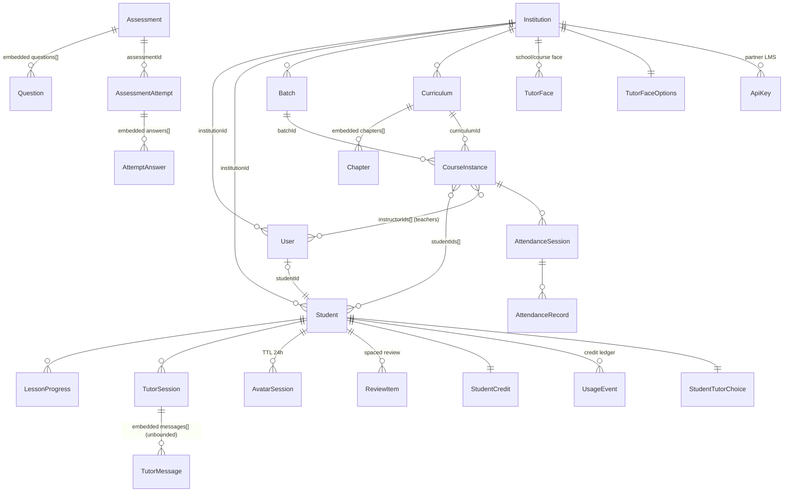
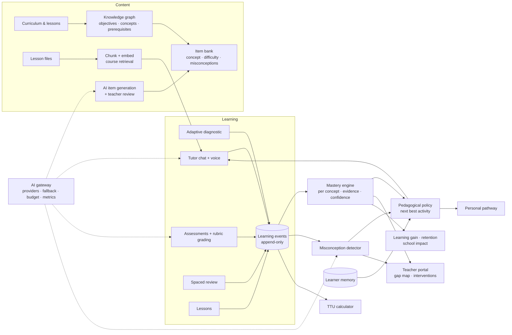

# Enara: Architecture Review and Adaptive Learning Roadmap

Status: **proposal, awaiting approval.** No code changes have been made for this plan.
Date: 24 October 2026. Branch reviewed: `connect-backend` (`55fc257`).

Goal: make Enara able to **identify learning gaps, deliver personalised instruction, verify understanding, and measure educational improvement**, safely, for many schools.

Every statement about the current system below was checked against the code, not the documentation. Where the guide (`docs/PLATFORM_GUIDE.md`) and the code differ, the code wins and the difference is called out.

---

## 1. Current architecture

### 1.1 Stack

| Layer | Technology | Notes |
|---|---|---|
| Frontend | React 19, Vite, Tailwind (CDN), lucide, recharts | ~26.6k lines. Single `App.tsx` page switch, no router. Static deploy on Vercel. |
| Backend | Node, Express 5, TypeScript, Mongoose | ~12.2k lines. One serverless function on Vercel (`arn1`, Stockholm). |
| Database | MongoDB Atlas (Stockholm) | 20 collections. No migrations framework (schemaless, defaults in Mongoose). |
| Optional SQL | Postgres (`config/postgres.ts`) | Only for Enara engine ingestion jobs; not provisioned in the sandbox. |
| Storage | Cloudflare R2 | Lesson files and videos; signed URLs for videos. |
| AI | Anthropic Claude (Opus 5.5 chat, Haiku 5.5 voice/visuals), Enara orchestrator on Modal (down), ElevenLabs (STT/TTS), Anam (video face) | Calls are server-side except ElevenLabs real-time STT (single-use token) and Anam WebRTC (session token). |
| Email | Resend | Built, disabled by default. |
| Jobs | Vercel Cron, daily 15:00 UTC | Reminders; weekly summary on Mondays. |
| CI/CD | GitHub Actions → Vercel | **Deploys only; runs no tests or type checks.** |
| Tests | Vitest + supertest + mongodb-memory-server | 77 backend tests in 10 files. **No frontend tests.** |

### 1.2 Domain model (as implemented)

Key facts:

- **Tenant key** is `institutionId`, applied through `scopedFilter()` in controllers. It is a convention, not enforced at the data layer.
- **Learning content** is a curriculum with an ordered list of chapters (lessons). Chapters hold a description and file URLs. There are **no learning objectives, concepts or prerequisites** anywhere.
- **Assessment questions** carry a free-text `topic` and optional `modelAnswer`. Topic strings are the only link between questions and content.
- **Student "intelligence" fields** (`learningEngineProfile`, `adaptiveProfile.topicMastery`, `riskPrediction`, `nextBestActions`, `ttu`) exist on the `Student` model but are **only ever written by the seed script**. The student dashboard serves them as if computed. This is the largest gap between appearance and reality.

### 1.3 Request flow for an AI tutor answer

1. Browser → `/api/me/tutor/sessions/:id/messages` (chat) or `/api/avatar/query-stream` (voice).
2. Backend loads the course tree, the lesson's materials (first 3 PDF/text files, whole), and the learner snapshot.
3. Chat: tries the Enara orchestrator (down) → Claude Opus. Voice: Claude Haiku, streamed.
4. Reply is stored in the session (chat) or streamed as NDJSON (voice); credits are reserved and settled.

### 1.4 What exists and is reusable

| Capability | What exists | Quality |
|---|---|---|
| Auth, roles, tenancy | JWT, 4 roles, `scopedFilter`, per-route role gates | Solid base; see findings |
| Curriculum + files | Curricula, chapters, R2 uploads, video compression | Good; no objectives |
| Assessments | MCQ/TF/short answer, attempts, grading, answer-key hiding | Works for MCQ; short answer is exact-match |
| Analytics | School overview, per-course, per-student, weekly summary | Real data, computed on request |
| Tutor | Curriculum-grounded Claude tutor (chat + voice), Socratic prompting, check questions, struggle mode, visuals, bilingual | Strong UX; no memory beyond one conversation, no evidence capture |
| Learner snapshot | Progress, weak topics from last 5 quizzes, reviews due, activity | Good seed for mastery; topic-level only |
| Spaced review | `ReviewItem` with 1/3/7/14/30-day schedule | Works; item-level, not concept-level |
| Teacher data | `instructorIds` on course instances, attendance API | Backend only; no teacher UI |
| Credits | Reserve/settle/release ledger per feature | Works; no token or cost capture |
| Jobs + email | Daily cron, reminders, weekly summary | Works; disabled by default |
| Partner API | Per-school hashed keys, revocation | Works |

---

## 2. Feature gap analysis

Legend: **Exists** (usable as is), **Partial** (foundation exists, needs work), **New** (build from scratch).

| # | Capability | Status | What exists | What's missing |
|---|---|---|---|---|
| 1 | Teacher Portal | **Partial** | Teacher role; `instructorIds`; attendance API; teachers share the admin UI | Teacher-scoped views (only my classes), class roster, gap map per class, interventions, assignment authoring scoped to my classes. Today a teacher gets the whole school's admin view. |
| 2 | Learning Objectives & Knowledge Graph | **New** | Free-text `topic` on questions; chapter descriptions | Objective and concept entities, prerequisites, mapping of lessons/questions/files to concepts |
| 3 | Adaptive Diagnostic Assessment | **New** | Fixed-form assessments | Item bank tagged by concept + difficulty, adaptive selection, stopping rule, diagnostic report |
| 4 | Concept-Level Mastery | **Partial** | Topic accuracy from last 5 quizzes (snapshot); seeded `topicMastery` (fake) | Persistent per-concept mastery with evidence, decay, confidence; replace seeded fields |
| 5 | Misconception Detection | **New** | Tutor names mistakes in conversation | Misconception catalogue per concept, distractor→misconception mapping, detection from answers and tutor turns, teacher visibility |
| 6 | Adaptive Pedagogical Engine | **Partial** | Teaching method per chat; struggle mode; check questions; proactive opening | A policy that picks the next activity (explain, worked example, practice, review, diagnostic) from mastery and misconceptions |
| 7 | Persistent Learning Memory | **Partial** | Snapshot rebuilt each call; tutor chat history per session; avatar sessions expire after 24 h | A durable per-student memory: goals, preferences, known misconceptions, what worked, summarised past sessions |
| 8 | Time to Understand (TTU) | **New** (field exists, seeded) | `Student.ttu` (seed only) | Definition, event-based measurement per concept, aggregation |
| 9 | AI Assessment Generation | **New** | Tutor can ask practice questions in chat | Generate concept-tagged items from curriculum + materials, with teacher review before use |
| 10 | Open-ended Assessment & Rubric Grading | **Partial** | Short-answer type; `modelAnswer` field (unused in grading) | Rubrics, AI-assisted scoring with rationale and confidence, teacher moderation, clear AI-vs-verified labelling |
| 11 | Teacher Intervention Management | **New** | Weekly summary lists at-risk students | Intervention records (who, concept, action, due, outcome), alerts, tracking effectiveness |
| 12 | Personalised Learning Pathways | **Partial** | Next-steps card (reviews, weak topics, next lesson) | Concept-prerequisite-driven pathway per student, teacher overrides |
| 13 | Curriculum Intelligence & Retrieval | **Partial** | Tutor reads first 3 whole files of the current lesson | Chunking, embeddings, retrieval across the course with citations, concept extraction from materials |
| 14 | Learning Gain & Retention Analytics | **New** | Scores over time | Pre/post per concept, normalised gain, retention at 7/30 days from review items |
| 15 | School Impact Dashboard | **Partial** | Admin dashboard (activity, scores, risk) | Mastery growth, learning gain, retention, intervention outcomes, comparisons by group |
| 16 | Learning Event Tracking | **New** | `UsageEvent` (credits only); app logs | An append-only event stream (xAPI-style) for every learning action |
| 17 | AI Reliability & Cost | **Partial** | Provider fallback (orchestrator → Claude); timeouts; prompt caching; Haiku for voice | Token/cost capture, per-call metrics, budgets per school, circuit breaker, evals, retries policy |

---

## 3. Security and reliability findings

Severity: **P0** exploitable now / data exposure; **P1** serious, fix before real schools; **P2** fix soon; **P3** minor.

> The backend route-by-route security review and the frontend review are merged into this section. Each finding was traced through the code.

### Security findings (verified against code unless marked "suspected")

| ID | Sev | Finding | Evidence | Impact | Fix (Phase 0) |
|---|---|---|---|---|---|
| S1 | **P0** | Account takeover through public registration | `backend/src/controllers/auth.controller.ts:43-69` (`ensureStudentLink`, called at :92 and :149) runs `Student.findOne({ email })` with no institution filter and no email verification | Anyone who registers an existing student's email gets that student's `studentId` and can read their results, courses, tutor sessions, credits | Link only through an invite token or verified email; scope by institution; never auto-link on login |
| S2 | **P0** | Live third-party key in the frontend bundle | `frontend/services/tutorService.ts:2` (Modal orchestrator key), used by `components/AIAssistant.tsx`, which every role layout mounts; also `services/avatarService.ts:5` | Key is public to anyone who loads the site | Remove; route AIAssistant through `/api/me/tutor`; rotate the key |
| S3 | **P1** | More secrets in the frontend build | `avatarService.ts:6` Beyond Presence key (dead path, still bundled); `vite.config.ts:16-17` injects `GEMINI_API_KEY` via `define` | Keys leak if set at build time | Delete the code and the `define`; rotate; add a CI grep of built assets |
| S4 | **P1** | Unlimited retakes, answer key shown after first submit | `meAssessment.controller.ts:92-110, 145-150, 200-211`; submit not atomic; attempt saved before `recordUsage` (:167 vs :170) | Submit blank, read key, retake, score 100%; parallel submits double-graded | Attempt limit per assessment; reveal answers only after the window closes or by teacher setting; atomic status transition |
| S5 | **P1** | Free tutor answers by setting `kind` | `avatar.controller.ts:218, 227, 256`: client-chosen `opening`/`nudge` skips credit reservation but still sends the client-supplied history to the model | Unmetered AI use | Decide `kind` server-side; cap history for system turns; always meter |
| S6 | **P1** | Canned stubs presented as AI output | `frontend/services/geminiService.ts` (`generateAssessment`, `generateRubric`, `generateStudyPlan`, `generateLessonPlan`, `generateInterventionPlan`, tutor fallback) | Admins may publish template questions; students see scripted answers as AI | Replace with backend AI, or label "template / unavailable" |
| S7 | P2 | Avatar routes open to all roles; non-students and `/speak` never charged | `routes/avatar.routes.ts:16`; `avatar.controller.ts:167, 256`; no validation in `startAvatarSession` (non-string `lesson_title` → 500) | Unmetered TTS/AI cost | Role check, metering per institution, input validation |
| S8 | P2 | Prompt injection into teachers' weekly summary email | `services/classSummaryService.ts:48-75` puts raw student questions in the prompt | Student can steer what teachers read | Treat questions as quoted data, structured output, strip links |
| S9 | P2 | `/uploads/:name` unauthenticated across schools | `backend/src/app.ts:107-123` | Anyone with a file name reads another school's files | Signed, expiring URLs or auth + tenant check |
| S10 | P2 | UI role chosen on the login screen | `pages/Login.tsx:70`, `App.tsx:47,64,122` (`localStorage['enara_ui_role']`) | Users can open other role layouts; backend still blocks data | Derive layout from the token's role |
| S11 | P3 | Attendance editable after submit; CORS allows no-Origin with credentials; Multer messages echoed | `teacherAttendance.controller.ts:158-205`; `app.ts:37`; `middleware/errorHandler.ts:32` | Low | Status check; tighten CORS; generic message |
| S12 | P3 (suspected) | Visual HTML sanitizer is regex-only | `services/avatarVisuals.ts:27-34` | Mitigated by `sandbox=""` iframe | Keep the sandbox; add an allowlist sanitizer |

Checked and correct: `requireAdmin`, `scopedFilter` use, register forces student role, `/auth/users` privilege checks, demo-login gating, cron secret, ingestion HMAC, upload validation, JWT (HS256, issuer/audience, status re-check), bcrypt, Mongo operator rejection.

### Reliability, data and AI findings (verified)

| ID | Sev | Finding | Evidence | Impact |
|---|---|---|---|---|
| R1 | **P1** | CI deploys to production without running tests, type checks or a build check | `.github/workflows/deploy-vercel.yml` has no test step | A broken commit ships straight to the live sandbox |
| R2 | **P1** | Student "learning engine", topic mastery, risk prediction, next best actions and TTU are **static seed data** shown to students and admins as if computed | Only `scripts/seed.ts` writes them; `meDashboard.controller.ts` serves them | Misleading data about real children; violates "AI output distinguishable from verified evidence" |
| R3 | **P1** | Short-answer questions are graded by exact lower-case string match; `modelAnswer` is never used | `meAssessment.controller.ts` `isCorrect = String(a)===String(b)` | Correct answers in other words are marked wrong; mastery built on this would be wrong |
| R4 | **P1** | No AI cost or token capture: `tokensIn/tokensOut` are never passed when settling usage | All `settleUsage` callers | No cost per school, no budget enforcement, no optimisation data |
| R5 | **P2** | Rate limits use the in-memory store on serverless; each instance has its own counters | `app.ts` `rateLimit` without `store` | Limits (login, AI, avatar) are not enforced reliably |
| R6 | **P2** | Tutor chat history is an unbounded embedded array in one document | `TutorSession.messages[]` | Slow loads and an eventual 16 MB document limit for heavy users |
| R7 | **P2** | Analytics loads a whole school's data on every request (up to 1,000 students, all attempts and sessions) | `analyticsService.loadScope` | Slow dashboards; silently wrong totals above 1,000 students |
| R8 | **P2** | Avatar sessions (and their conversation context) expire after 24 h; voice conversations are not stored | `AvatarSession` TTL; history lives in the browser | Nothing from voice tutoring feeds memory, mastery or teachers |
| R9 | **P2** | Chat "streaming" replays a finished answer word by word with 15 ms sleeps | `tutorExtras.controller.ts` | Slower first word; holds a serverless function open needlessly |
| R10 | **P2** | Retrieval reads at most 3 whole files of the current lesson; nothing across the course; no citations | `directTutorModel.loadMaterials` | Large or multi-file lessons are partly ignored; answers can't cite sources |
| R11 | **P2** | No structured AI observability: no per-call latency, model, fallback, refusal or error metrics | `utils/logging` free-form logs | Can't see reliability or quality regressions |
| R12 | **P2** | No schema migrations; model changes rely on Mongoose defaults | No migration tooling | Backfills and index changes are manual and unrepeatable |
| R13 | **P3** | Enara orchestrator is down (expired upstream key); Postgres for ingestion not provisioned | Logs, `/ready` | Chat always uses the fallback; engine ingestion unusable |
| R14 | **P3** | Single 772-line analytics service and several 900+ line React pages | `analyticsService.ts`, `AdminAvatarControlCenter.tsx` | Hard to change safely |

---

## 4. Target architecture

Principle: **evidence first.** Every claim the platform makes about a student (mastery, misconception, TTU, gain) is computed from recorded evidence, carries its source, and separates AI judgements from verified results.

### 4.1 Components

| Component | Responsibility | Built on |
|---|---|---|
| **Learning event log** | Append-only record of every learning action (lesson viewed/completed, question answered, tutor turn, hint used, review answered, diagnostic step). Single source of truth for all metrics. | New `LearningEvent` collection; written by existing controllers |
| **Knowledge graph** | Objectives and concepts per curriculum, prerequisite edges, links from lessons, questions, files and misconceptions to concepts | New collections; AI-assisted extraction from curriculum + files, teacher-confirmed |
| **Mastery engine** | Per student × concept mastery estimate (Bayesian Knowledge Tracing to start: P(known) updated per evidence, with slip/guess and decay), confidence, last evidence | Replaces seeded `topicMastery`; reads events |
| **Misconception detector** | Catalogue per concept; deterministic detection from tagged distractors; AI-suggested detection from free text and tutor turns, labelled as suggested until confirmed | New collections + AI gateway |
| **Pedagogical policy** | Chooses the next activity per student from mastery, prerequisites, misconceptions, review schedule and memory; explains why | Extends today's next-steps builder and tutor prompts |
| **Learner memory** | Durable per-student profile: goals, preferences, effective strategies, active misconceptions, rolling summaries of past sessions | New collection; summarised by AI after sessions; student-visible |
| **Diagnostic engine** | Adaptive item selection over the concept graph (start mid-difficulty, walk prerequisites on failure, stop on confidence or item cap) | Item bank + mastery engine |
| **Item bank & generation** | Concept-tagged items with difficulty, distractor→misconception tags; AI generation into a *draft* state; teacher approve/edit | Extends `Assessment.questions` into a shared bank |
| **Rubric grading** | Rubrics per open-ended item; AI proposes score + rationale + confidence; low-confidence or high-stakes go to teacher; final grade records who verified it | Extends attempts |
| **Retrieval** | Chunk and embed lesson files on upload; retrieve top chunks across the course for the tutor, with citations | MongoDB Atlas Vector Search (same database) |
| **Teacher portal** | Teacher-scoped app: my classes, class gap map, student drill-down, misconceptions, interventions, item review queue, grading queue | New frontend area; backend scoping by `instructorIds` |
| **AI gateway** | One module for all model calls: provider choice, timeouts, retries, fallback, circuit breaker, prompt caching, token and cost capture, per-school budgets, metrics | Refactors `directTutorModel` + other call sites |
| **Impact analytics** | Learning gain, retention, TTU, intervention outcomes; pre-aggregated nightly | Events + mastery snapshots |

### 4.2 Key definitions

- **Mastery (per concept):** BKT probability the student knows the concept. Evidence weights: verified assessment answer > review answer > diagnostic item > tutor check-question answer (AI-judged, lower weight). Mastered at ≥ 0.85 with ≥ 3 evidence items.
- **Time to Understand (TTU):** active learning time (events, idle gaps over 5 min excluded) from a student's first engagement with a concept to the first time mastery crosses the threshold. Reported per concept and as a median per student, class and school.
- **Learning gain:** normalised gain per concept between first diagnostic or pre-test and later evidence: (post − pre) / (1 − pre).
- **Retention:** share of mastered concepts still answered correctly at 7 and 30 days (from review items and later assessments).
- **Verified vs AI evidence:** every evidence record has `source` (`assessment`, `diagnostic`, `review`, `tutor_check`, `ai_graded`, `teacher_graded`) and `verified` (true only for deterministic grading or teacher confirmation).

---

## 5. Database changes

All additive. Existing collections keep working; new fields are optional. A lightweight migration runner (`backend/src/migrations/NNN_name.ts`, recorded in a `migrations` collection, run on deploy and from a CLI) handles indexes and backfills.

| Collection | Change | Purpose |
|---|---|---|
| `learning_events` **(new)** | `{ id, institutionId, studentId, actorId, type, conceptIds[], refs{courseId, lessonId, assessmentId, itemId, sessionId}, outcome{correct, score, hintsUsed}, durationMs, source, verified, at }`; indexes `(institutionId, at)`, `(studentId, at)`, `(studentId, conceptIds, at)` | Event log for everything |
| `objectives` **(new)** | `{ id, institutionId, curriculumId, code, title, description, conceptIds[] }` | Learning objectives |
| `concepts` **(new)** | `{ id, institutionId, curriculumId, name, description, prerequisiteIds[], lessonIds[], status: draft/confirmed, createdBy: ai/teacher }` | Knowledge graph |
| `misconceptions` **(new)** | `{ id, institutionId, conceptId, description, indicators[], remediation, status }` | Misconception catalogue |
| `items` **(new)** | `{ id, institutionId, conceptIds[], type, stem, options[], answer, distractorMisconceptions{}, difficulty, rubricId, status: draft/approved/retired, origin: teacher/ai, reviewedBy }` | Shared item bank |
| `rubrics` **(new)** | `{ id, institutionId, criteria[{name, levels[{score, descriptor}]}] }` | Open-ended grading |
| `mastery` **(new)** | `{ institutionId, studentId, conceptId, pKnown, evidenceCount, verifiedEvidenceCount, lastEvidenceAt, masteredAt, firstSeenAt, activeMs }`; unique `(studentId, conceptId)` | Mastery + TTU |
| `student_misconceptions` **(new)** | `{ studentId, conceptId, misconceptionId, status: suspected/confirmed/resolved, evidenceEventIds[], detectedBy }` | Per-student misconceptions |
| `learner_memory` **(new)** | `{ studentId, institutionId, goals[], preferences{}, strategies[], sessionSummaries[{at, summary, conceptIds}] (capped), updatedAt }` | Persistent memory |
| `interventions` **(new)** | `{ id, institutionId, teacherId, studentIds[], conceptIds[], reason, action, dueAt, status, outcome, createdFrom: alert/manual }` | Teacher interventions |
| `ai_calls` **(new)** | `{ institutionId, feature, provider, model, latencyMs, tokensIn, tokensOut, cacheRead, costMicros, status, fallbackUsed, at }`; TTL 180 d | Observability + cost |
| `tutor_messages` **(new, split)** | One document per message, indexed `(sessionId, at)` | Fixes unbounded embedded arrays (R6); migration copies existing messages |
| `assessments.questions[]` | add optional `itemId`, `conceptIds[]`, `rubricId` | Link existing questions to the bank |
| `assessment_attempts.answers[]` | add `score`, `maxScore`, `gradedBy: auto/ai/teacher`, `aiRationale`, `aiConfidence`, `verified`, `misconceptionIds[]` | Rubric grading + evidence |
| `students` | deprecate seeded AI fields; serve computed values instead | Fixes R2 |
| Indexes | `(institutionId, studentId)` on `review_items`; `(institutionId, createdAt)` on `avatar_sessions` | Tenant-scoped queries |
| Vector index | Atlas Vector Search on `content_chunks.embedding` (new `content_chunks` collection: `{ institutionId, curriculumId, lessonId, fileUrl, text, page, embedding, conceptIds[] }`) | Retrieval |

---

## 6. API changes

New routes follow existing conventions: `/api/me/*` for students, admin routes gated by role, every query scoped by `institutionId` (and by `instructorIds` for teachers).

| Area | Endpoints |
|---|---|
| Teacher | `GET /api/teacher/classes`, `GET /api/teacher/classes/:id` (roster + gap map), `GET /api/teacher/students/:id` (only if in my class), `GET/POST/PATCH /api/teacher/interventions`, `GET /api/teacher/review-queue` (AI items + AI grades awaiting approval), `POST /api/teacher/items/:id/approve`, `POST /api/teacher/grades/:attemptId/:questionId` |
| Knowledge graph | `GET/POST/PATCH /api/curriculums/:id/concepts`, `POST /api/curriculums/:id/concepts/extract` (AI draft), `GET/POST /api/concepts/:id/misconceptions` |
| Item bank | `GET/POST/PATCH /api/items`, `POST /api/items/generate` (AI → drafts), `GET/POST /api/rubrics` |
| Diagnostics | `POST /api/me/diagnostics` (start for a course/concepts), `POST /api/me/diagnostics/:id/answer` (returns next item or report), `GET /api/me/diagnostics/:id/report` |
| Mastery & pathway | `GET /api/me/mastery`, `GET /api/me/pathway`, `GET /api/me/memory`, `PATCH /api/me/memory` (student edits/deletes) |
| Events | Internal `recordLearningEvent()`; `POST /api/me/events` only for client-side signals (lesson time on page), validated and rate-limited |
| Analytics | `GET /api/analytics/mastery` (school/class/concept), `GET /api/analytics/impact` (gain, retention, TTU, interventions) |
| AI ops | `GET /api/admin/ai-usage` (cost, latency, errors by feature/model/school), per-school budget settings |
| Changed | Assessment submit returns per-question `gradedBy` / `verified`; tutor endpoints emit events and use retrieval with citations; chat stream becomes real token streaming |

---

## 7. Frontend changes

| Area | Change |
|---|---|
| **Teacher portal** (new) | Separate teacher navigation: My classes → class gap map (concepts × students heatmap, misconceptions), student drill-down (mastery, evidence, memory summary), interventions board, review queue (AI items, AI grades), assignment builder from the item bank |
| Student | Mastery view per course (concept map with mastered/learning/not started), pathway ("your next 3 steps" from the policy), diagnostic flow, memory page ("what your tutor remembers", editable), evidence labels on results (AI-graded vs verified) |
| Admin | Knowledge-graph editor (review AI-extracted concepts, prerequisites), item bank, rubrics, impact dashboard, AI usage and budget page |
| Remove/replace | Seeded "learning engine" panels → computed mastery; sample-data admin pages labelled or hidden until real |
| Shared | Router (deep links per page), consistent loading/error states, frontend tests for core flows (Vitest + Testing Library, Playwright smoke) |

---

## 8. Implementation phases

Each phase ships independently, keeps existing features working, and adds tests.

| Phase | Scope | Builds | Depends on |
|---|---|---|---|
| **0. Foundations & hardening** (1–2 weeks) | Fix security findings S1–S10 (S1, S2 first; rotate exposed keys); CI runs typecheck + tests before deploy; remove frontend secrets; label/replace seeded AI fields; shared rate-limit store; AI gateway skeleton with token/cost capture into `ai_calls`; migration runner; split tutor messages | R1, R2, R4, R5, R6, R12 + security | none |
| **1. Evidence layer** (2 weeks) | `learning_events` written by lessons, assessments, reviews, tutor turns (chat + voice, now persisted), diagnostics later; event explorer for admins | #16, part of #7 | 0 |
| **2. Knowledge graph & item bank** (2–3 weeks) | Concepts, objectives, prerequisites, misconceptions; AI extraction to drafts + teacher confirmation; item bank with concept/difficulty/misconception tags; link existing questions; retrieval with embeddings + citations | #2, #13, part of #9, #5 catalogue | 0 |
| **3. Mastery, TTU, misconceptions** (2 weeks) | BKT mastery per concept from events; TTU; deterministic misconception detection (distractors) + AI-suggested (labelled); replace seeded mastery; student mastery view | #4, #8, #5 | 1, 2 |
| **4. Teacher portal & interventions** (2–3 weeks) | Teacher-scoped backend + UI: classes, gap map, drill-down, misconceptions, interventions with alerts and outcomes, review queue | #1, #11 | 3 |
| **5. Adaptive diagnostics & pathways** (2–3 weeks) | Adaptive diagnostic engine + report; pedagogical policy driving next steps, tutor openings and pathways; learner memory with session summaries | #3, #6, #7, #12 | 2, 3 |
| **6. Assessment generation & rubric grading** (2 weeks) | AI item generation into review queue; rubrics; AI-assisted grading with rationale/confidence and teacher moderation; verified vs AI evidence in mastery | #9, #10 | 2, 4 |
| **7. Impact analytics** (2 weeks) | Learning gain, retention, TTU, intervention effectiveness; nightly aggregates; school impact dashboard | #14, #15 | 3, 4 |
| **8. AI reliability & cost** (continuous, 1 week focused) | Circuit breakers, provider health, budgets per school, cost dashboards, offline evals for tutor quality and grading agreement | #17 | 0 |

---

## 9. Dependencies and risks

| Risk | Mitigation |
|---|---|
| Concept extraction quality varies by subject and language | Drafts only; teacher confirms; start with 1–2 pilot courses |
| Mastery estimates wrong early (few items, exact-match grading) | Fix grading first (Phase 0/6); require minimum evidence; show confidence; never present mastery as a grade |
| AI grading disagreement with teachers | Measure agreement on a labelled set before enabling; low-confidence → teacher; record who verified |
| Student data privacy (minors) | Tenant isolation tests, data minimisation in prompts, memory visible/deletable by student, retention TTLs, DPA with AI providers |
| Serverless limits (60 s, memory) for batch jobs (embedding, nightly aggregates) | Run batch work in a queue/worker (Vercel Cron + chunked jobs, or a small worker on Railway/Fly) |
| Vector search requires Atlas tier supporting it | Confirm Atlas tier; fallback: keyword search over chunks |
| Cost growth from more AI calls | AI gateway budgets, Haiku for routine work, caching, batch API for offline generation |
| External services down (Anam, orchestrator) | Existing fallbacks (voice-only, Claude); health checks surfaced in admin |
| Scope creep | Phase gates with acceptance criteria below |

---

## 10. Acceptance criteria

**Phase 0: Foundations & hardening**
- All P0 and P1 security findings fixed with regression tests.
- CI blocks deploy when typecheck or tests fail.
- No credentials in the frontend bundle (automated check greps the built assets).
- Seeded AI fields no longer shown as real; dashboards show computed values or "not enough data".
- Every AI call writes an `ai_calls` record with model, latency, tokens and cost; an admin endpoint reports totals per school and feature.
- Rate limits hold across instances (verified with two concurrent instances in a test).
- Existing 77 tests still pass; new tests for each fix.

**Phase 1: Evidence layer**
- Lesson completion, assessment answers, review answers, tutor turns (chat and voice) each produce a `learning_events` record with tenant, student, timestamp, source and `verified`.
- Voice conversations persist (beyond 24 h) and are visible to the student.
- Cross-tenant event reads are impossible (tested).

**Phase 2: Knowledge graph & item bank**
- A teacher can generate, edit and confirm concepts and prerequisites for a curriculum; AI drafts are visibly marked until confirmed.
- Every new question can be tagged with concepts and difficulty; existing questions can be linked.
- Tutor answers cite the source chunk (file and page) for course content; retrieval covers all lessons in the course.

**Phase 3: Mastery, TTU, misconceptions**
- Mastery updates within seconds of an answer, per concept, with evidence count and confidence.
- TTU computed per concept and student, excluding idle time, with a documented definition.
- Choosing a tagged distractor records the linked misconception; AI-suggested misconceptions are marked "suspected" until confirmed.
- No seeded mastery values remain in API responses.

**Phase 4: Teacher portal & interventions**
- A teacher sees only classes where they are an instructor; requests for other classes return 404 (tested).
- Class gap map shows each student × concept mastery and active misconceptions.
- A teacher can create an intervention from an alert, assign students, set a due date, and record the outcome; outcomes feed impact analytics.

**Phase 5: Diagnostics & pathways**
- An adaptive diagnostic places a student across a course's concepts in ≤ 15 items with a report per concept.
- Next steps, tutor openings and the pathway come from the policy and state why (e.g. "prerequisite of X not mastered").
- The tutor remembers goals, preferences and prior misconceptions across sessions; the student can view and delete their memory.

**Phase 6: Generation & rubric grading**
- AI-generated items enter a review queue and can't reach students until approved.
- On a labelled set, AI rubric scores agree with teacher scores at a pre-agreed level (e.g. quadratic weighted kappa ≥ 0.7) before AI grading counts toward mastery.
- Every grade shows whether it was automatic, AI-assisted or teacher-verified.

**Phase 7: Impact analytics**
- School dashboard shows learning gain, 7/30-day retention, median TTU, and intervention effectiveness, by class, course and concept, with definitions on the page.
- Figures reproduce from raw events (a test recomputes them).

**Phase 8: AI reliability & cost**
- Provider failures trip a circuit breaker and fail over within one request.
- Per-school monthly budget enforced with alerts at 80%.
- Weekly eval run reports tutor answer quality and grading agreement trends.

---

## 11. Recommendation

Start with **Phase 0 (Foundations & hardening)**. It fixes the security findings, makes deployment safe, stops showing invented learning data, and adds the AI cost and observability base that every later phase needs. It is low-risk, entirely additive except the security fixes, and unblocks Phases 1–3, the core of "identify gaps, personalise, verify, measure".

Phase 0 needs these decisions before starting:

1. Approve the security fixes listed in section 3. Some change behaviour, for example who can register, and what teachers can see.
2. Agree how to handle the seeded "learning engine" fields: hide them now, or label them "sample" until Phase 3 replaces them.
3. Pick the shared rate-limit store: Upstash Redis (serverless-friendly) or MongoDB.

---

## 12. Phase 0 status (implemented)

Approved scope: Phase 0 **except sign-in logic**, seeded fields **labelled as sample**, rate limits in **MongoDB**.

| Item | Status | Where |
|---|---|---|
| S1 registration account takeover | **Open: excluded (sign-in logic)** | `auth.controller.ts:43-69` |
| S2/S3 frontend keys | Removed; staff assistant moved to `POST /api/analytics/assistant`; Gemini `define` and avatar key field removed. **Rotate the Modal and Beyond Presence keys** | `frontend/services`, `vite.config.ts` |
| S4 retakes / answer key | `maxAttempts` (default 1) and `answerReveal` (`after-submit` default, `after-close`, `never`); key hidden while attempts remain; atomic submit; credit failure reopens the attempt; one open attempt per student (unique index) | `meAssessment.controller.ts`, `assessmentSecurity.ts` |
| S5 free turns via `kind` | Opening once per call with no client history; at most two nudges per answered turn, trailing student text dropped | `avatar.controller.ts` |
| S6 canned AI | Canned tutor answers removed; template generators and plans labelled "template, not AI" | `geminiService.ts`, admin pages |
| S7 avatar metering | Input validation; 30 calls/day per student, 5 for staff; 20,000 spoken characters per call | `avatar.controller.ts` |
| S8 summary prompt injection | Questions sent as data (links and markup removed), system instruction, output links stripped | `classSummaryService.ts` |
| S9 `/uploads` | Signed, expiring links (6 h); API responses sign paths, request bodies are unsigned before saving | `utils/uploadSigning.ts`, `app.ts` |
| S10 UI role picker | **Open: excluded (sign-in logic)**; backend still enforces roles on every route | `Login.tsx` |
| S11 attendance / CORS / Multer | Submitted attendance teacher-locked; CORS without credentials; fixed Multer messages | |
| R1 CI | `check` job (backend typecheck + tests, frontend build, bundle secret scan) gates deploy; PRs run checks | `.github/workflows/deploy-vercel.yml` |
| R2 seeded AI fields | Labelled "Sample data" in the UI | `SampleBadge.tsx` |
| R4/R11 AI observability | `ai_calls` per call (feature, model, tokens, latency, estimated cost, school, user); `GET /api/analytics/ai-usage` | `services/aiCalls.ts` |
| R5 rate limits | MongoDB store shared across instances (`rate_limits`, TTL) | `services/mongoRateLimitStore.ts` |
| R6 tutor messages | New `tutor_messages` collection; reads merge older embedded messages; migration copies them (embedded copies kept: clearing them needs approval) | `services/tutorMessages.ts` |
| R12 migrations | Runner with lock and `migrations` collection; runs on start-up or `npm run migrate` | `src/migrations` |

Tests: 93 backend tests pass (77 existing + 16 new for these fixes).

Not changed in Phase 0, as planned: fake streaming (R9), retrieval (R10), short-answer grading (R3).

## 13. Phase 1 status (implemented)

| Item | Status | Where |
|---|---|---|
| `learning_events` collection (append-only; tenant, student, actor, type, source, `verified`, `gradedBy`, topic, refs, outcome, duration, time) | Done | `models/LearningEvent.ts`, `services/learningEvents.ts` |
| Lessons | `lesson_completed` (once per lesson, verified); `lesson_viewed` with visible time from the browser (unverified) | `me.controller.ts`, `POST /api/me/events` |
| Assessments | `assessment_started`, one `question_answered` per question (verified, `gradedBy: rule`), `assessment_submitted` with score and time | `meAssessment.controller.ts` |
| Reviews | `review_answered` (verified) | `reviewService.ts` |
| Tutor chat | `tutor_question` (verified) and `tutor_reply` (AI, not verified) | `services/tutorMessages.ts` |
| Live calls | Persisted as a `voice` tutor session (no 24 h expiry) with each turn in `tutor_messages`; events from `tutor_voice` are unverified (browser transcription, AI replies); students read them in chat history | `avatar.controller.ts` |
| Event explorer | Admin page **Learning Events**; `GET /api/analytics/events` (filters, paging, counts); `GET /api/me/events` for the student's own | `pages/LearningEvents.tsx` |
| Backfill | Migration creates events from past submitted attempts, completed lessons and tutor messages (fixed ids, re-runnable) | `migrations/index.ts` |
| Isolation | Admin reads scoped to their school (tested); students see only their own | `phase1.test.ts` |

Tests: 103 backend tests pass (10 new). `conceptIds` stay empty until Phase 2 (knowledge graph) fills them; `topic` carries the question's topic meanwhile.
