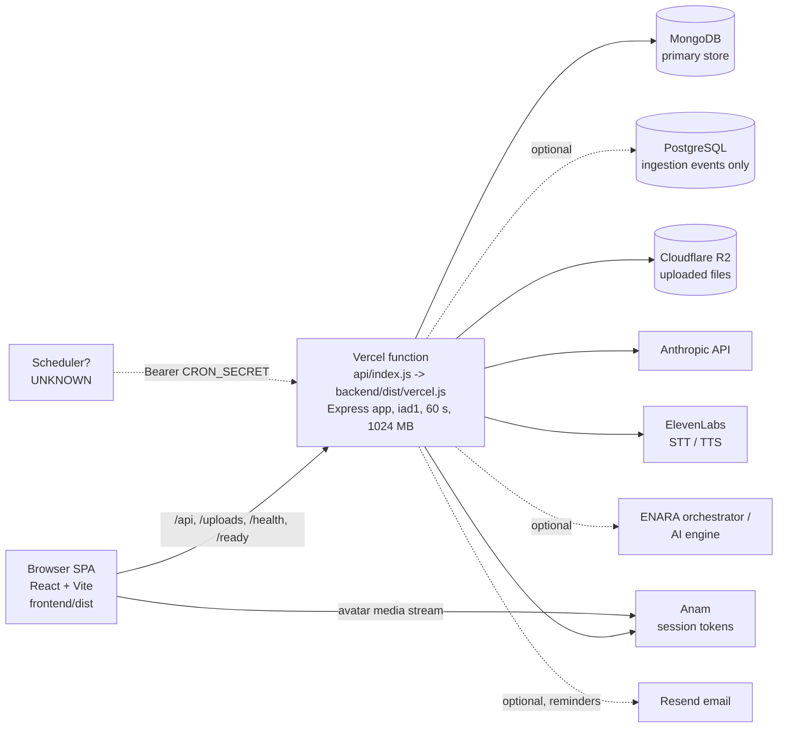
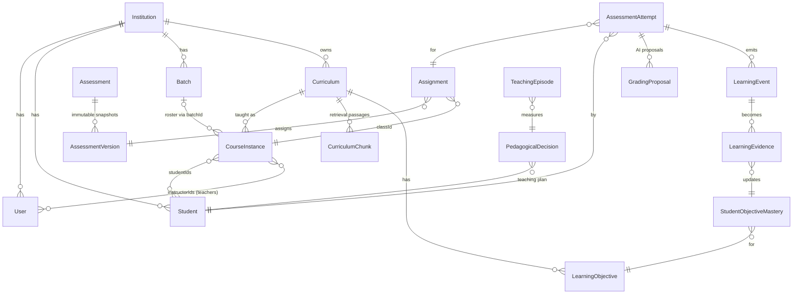
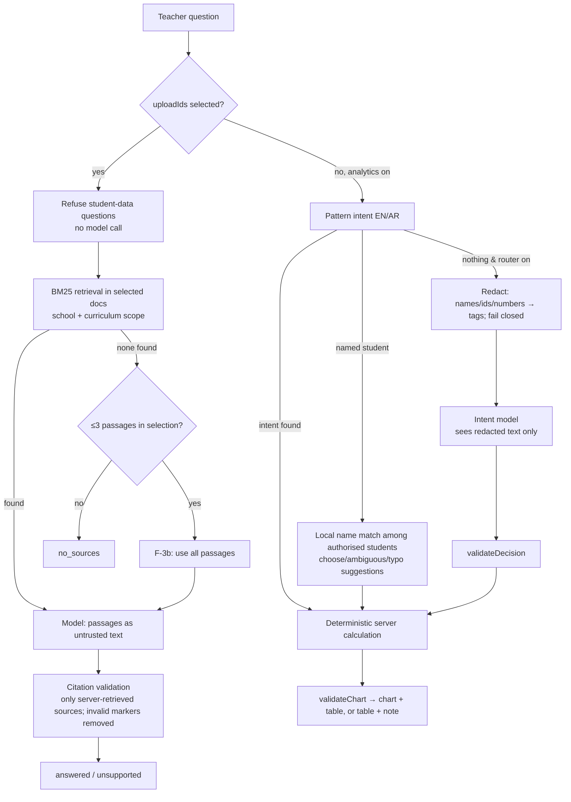

# ENARA — Technical Architecture (audited)

| | |
|---|---|
| Audit date | 2026-11-01 (UTC) |
| Commit audited | `f5dd116` on local branch `claude/codebase-review-kbxqan` of `enara-staging-alpha` |
| Scope | Source code and configuration in this checkout, plus dated reports. No remote service was contacted. |
| Labels | As defined in `ENARA_PRODUCT_DOCUMENTATION.md`. **"Configured"** means present in code or config. **"Proven deployed"** needs a dated staging report naming the deployment. |

---

## 1. Runtime topology

Dashed lines are optional or unverified.

| Component | Configured (evidence) | Proven deployed (evidence, date) |
|---|---|---|
| Static SPA | `vercel.json` `buildCommand`, `outputDirectory: frontend/dist`, SPA rewrite `/((?!assets/).*) → /index.html` | Reports P14.5 to P21 (2026-10-29 to 10-31) on `enara-staging-alpha.vercel.app` |
| API function | `vercel.json` `functions["api/index.js"]`: `maxDuration 60`, `memory 1024`, `includeFiles` backend/dist and swagger-ui-dist; region `iad1` | Same reports |
| Rewrites | `/api/:path*`, `/uploads/:path*`, `/ready`, `/health` → `/api` | Same |
| Custom domain `test.enara.app` | **Not in the repository.** Session record (2026-10-31/11-01): Cloudflare DNS records were created and deployment `dpl_Hw32FB6bvgv7bXoh6awf62o9JgLb` (`f5dd116`) was promoted. | **UNKNOWN to this audit.** No repository report mentions `test.enara.app`. |
| Git-triggered deploys | `vercel.json` `git.deploymentEnabled`: `main: false`, `staging-alpha: true` | Contradicted: P14.7 and P14.9 say the project is **not Git-linked**, and every recorded deploy was by CLI (see `INCONSISTENCY_REGISTER.md` I-05). If the project is ever linked, a push to `staging-alpha` deploys. |
| Cron | `routes/cron.routes.ts` `GET /api/cron/daily` (Bearer `CRON_SECRET`) | **No `crons` entry in `vercel.json`.** No scheduler is configured in this repository. Whether anything calls the endpoint is UNKNOWN. |
| Workers / queues | None. Background work runs in-request or through cron sweeps (`sweepGrading`, `sweepLearningIntelligence`, `sweepDocumentScans`, `sweepDocumentRetention`). | — |
| Other hosts | `Dockerfile.staging-single` and `railway.staging-single.toml` are present. | Railway and Render were proposed only (10-28 runbooks), never deployed. |

---

## 2. Request lifecycle

`backend/src/vercel.ts` runs `assertStagingEntry` (the staging guard) before `createApp`. The middleware order in `backend/src/app.ts` `createApp()` is below. **CODE-VERIFIED.**

1. `x-powered-by` off, simple query parser, `trust proxy`
2. `requestContext`: takes or creates a request ID (`x-request-id`, at most 128 characters) and echoes `X-Request-Id`
3. `dbAvailabilityGate`
4. `requestDeadline`: answers 503 at about 25 s (`REQUEST_DEADLINE_MS`), but not while an AI call is running
5. `idleDbController` (optional), `requestLogger` (not in tests)
6. `helmet`; `cors` (allow-list, `credentials: false`)
7. Rate limiters (Mongo store, `passOnStoreError`):
   - Auth: login 20 per 15 min; register 10/h; demo-login 10/min; password reset 10 per 15 min; accepting an invitation 20 per 15 min.
   - Upload, documents (60/h), educator chat ask (20/min), ingestion, tutor and events, AI generate, objective extraction, avatar.
   - Global `/api`: 300/min per verified user, 3000/min per IP.
8. Body parsers: `express.json` 1 MB, urlencoded 100 KB
9. `uploadLinkSigning`: signs every `/uploads/` string in JSON responses (see §8)
10. `/uploads` with `requireUploadSignature`
11. `/health`, `/ready`
12. Optional static frontend; Swagger (`setupSwagger`, with the `docsGate` password check); `/` redirects to `/api-docs`
13. 27 routers. **Authentication is applied inside each router** (`router.use(authMiddleware, …)`).
14. 404 `AppError`, then `errorHandler` (500s return a generic message plus the request ID)

### Authentication

`auth/jwt.ts` and `middleware/auth.middleware.ts`. **CODE-VERIFIED.**

- **Token:** HS256 with issuer, audience, subject and `typ: access`, plus `tv` (the token version).
- **Every request reloads the user.** The request is rejected if the user is missing, `status !== 'active'`, or the token version does not match. Role, institution and permissions come from the database, not from the token.
- **Revocation:** logout and password reset increment `tokenVersion`.
- **Invitations and resets:** SHA-256-hashed one-time tokens (`services/accountTokens.ts`). Invitations last 7 days and resets 30 minutes. A reset request always answers 202, so it does not reveal whether an account exists.
- **Gaps:**
  - No route sets `status: 'disabled'`.
  - `Institution.status: 'suspended'` is enforced only for partner API keys (`authenticateUserOrApiKey`), not for user sessions.

### API documentation

`config/swagger.ts`. Labels: CODE-VERIFIED; TEST-VERIFIED (`apiDocs.test.ts`).

- Served at `/api/docs/ui`, `/api-docs/ui` and `/api/docs.json`.
- `docsGate` uses HTTP Basic with `API_DOCS_PASSWORD`, compared with SHA-256 and `timingSafeEqual`.
- When the password is **unset**: production (`NODE_ENV=production`) answers 404; any other environment is **open**.
- Measured during this audit: **233 paths and 275 operations**. The platform document dated 2026-11-01 said 274; the difference is the `POST /api/auth/tour/complete` route added in `b9a49c0`.

---

## 3. Data stores

| Store | Responsibility | Evidence |
|---|---|---|
| MongoDB (Mongoose) | All application data. 44 model files in `backend/src/models` (`AccountToken.ts` defines two schemas). Also holds the rate-limit store, budget counters and reservations, and the usage ledger. | `config/db.ts`; models directory |
| PostgreSQL | **Ingestion event tracking only** (`services/ingestionService.ts` via `config/postgres.ts`). Optional: without `DATABASE_URL`, ingestion status answers 503 `*_UNAVAILABLE` (P14.8 F-1 fix). `/ready` treats Postgres as ready when unset outside production. | `config/postgres.ts`, `app.ts` `/ready` |
| Cloudflare R2 | Uploaded files (documents, materials, video). On staging the guard requires a bucket name containing "staging". | `services/uploadStorage.ts`; `config/stagingGuard.ts` |
| Local disk | `SERVE_LOCAL_UPLOADS` / `UPLOAD_DIR`; defaults on outside production. On Vercel, R2 is mandatory. | `config/env.ts` |
| Legacy S3 | `s3Service.uploadToS3` (`AWS_*`); a legacy path | `services/s3Service.ts` |

Every school-owned collection carries `institutionId`. Reads are scoped through `auth/authorization.ts` (`scopedFilter`, `requireInstitutionId`, `resolveWriteInstitutionId`). ENARA Admin bypasses scoping through `isGlobalAdmin`.

---

## 4. Core entity relationships

How students relate to users: a `Student` is the learner profile. A `User` with role `student` links to it through `studentId`; `requireStudent` requires that link. A student belongs to a class when listed in its `studentIds` **or** through the class's `batchId` (`learningAccess.classStudentIds`, `studentCourseService.getEnrolledInstances`).

There is no withdrawal status. "Withdrawn" means "not on the current roster". `Student.status` holds a performance label instead (`excelling`, `on track`, `at risk`).

---

## 5. AI architecture

### Gateway

`backend/src/services/aiGateway.ts`. **CODE-VERIFIED.**

1. `reserveAttempt`: the per-school AI rate limit (grading is exempt), then `upperBoundUsd` for the call, then `aiBudget.reserveAiBudget`.
2. The provider is called through `meteredMessage`, `meteredStream`, `meteredSpeech` or `meteredCall`. All Anthropic clients use `maxRetries: 0`. Retries are done by the gateway (408, 409, 429, 5xx and timeouts), and each attempt is reserved and metered separately.
3. `finishAttempt`: appends a `usage_ledger` row (key `ai:<requestId>:<uuid>:<attempt>`, append-only, at most once per attempt across crashes), writes the `AiCall` record, then `settleAiBudget` with the priced cost.

### Models

Set in `config/env.ts`. Defaults:

| Setting | Default | Used for |
|---|---|---|
| `ANTHROPIC_TUTOR_MODEL` | claude-opus-5-5 | tutor, grading, drafts, lesson plans, chat, assistant |
| `ANTHROPIC_INTENT_MODEL` | claude-haiku-5-5 | P9 router |
| `ANTHROPIC_VOICE_MODEL` | claude-haiku-5-5 | voice replies, next steps, reminders, weekly summary |
| `ANTHROPIC_VISUAL_MODEL` | claude-haiku-5-5 | avatar visuals |

The tutor uses server-side model fallback (`directTutorModel.ts`) and sizes its reservation at the most expensive model. One setting drives drafts, grading and the tutor (P12 finding R-5, still true).

### Pricing

`services/priceCatalog.ts`, `PRICE_CATALOG` v1. Every entry is marked `list_estimate`.

- Per million tokens: Opus $4 / $20, Sonnet $2 / $10, Haiku $0.1 / $0.5. Cache write is 1.25× the input price.
- ElevenLabs text-to-speech: $0.08 per 1,000 characters.
- An unknown model is `unpriced` (null), never zero.
- Anam, ElevenLabs speech-to-text and the external engines have no price (`UNKNOWN_PRICED_TOOLS`); their full reservation is kept as "unknown exposure".

Whether these list prices match the provider invoice has never been checked in any report.

### Provider paths

Every application provider path goes through the gateway. **CODE-VERIFIED.**

- Anthropic: tutor, `aiJson`, educator chat, data assistant, next steps, avatar visuals, objective extraction, reminders, weekly summary.
- ElevenLabs: speech-to-text token, text-to-speech, exam speech-to-text and text-to-speech.
- Anam: session token, released on failure.
- Orchestrator and ingestion engine.

Exceptions:

- **Offline evaluation scripts call Anthropic directly**, outside the gateway (`services/candidateV2Live/*`). These are script-only, with their own budget caps and `--execute` gates.
- **Anam avatar listing** (`tutorFaceService`) is not metered.

### Pricing and settlement defects

All CODE-VERIFIED.

- **Speaking-exam speech-to-text costs $0.** `priceUsage` prices ElevenLabs only by `characters`. The exam passes `audioSeconds`, so the cost comes out as 0 'estimated' and the reservation is refunded. It escapes both the school caps and the staging test-spend cap.
- **Anam language-switch reservations** (`avatar:<id>:switch:<uuid>`) and their test-spend copies are not settled by `finalizeAvatarUsage`. They expire after 48 h as unknown exposure. This over-counts; it does not leak spend.
- **Anam sessions have no length cap.** The only stop is a 60-minute inactivity timeout.

### Emergency grading path

See §6.

---

## 6. AI budget hierarchy

`services/aiBudget.ts` `reserveAiBudget`; `config/stagingGuard.ts`. **CODE-VERIFIED.**

| Order | Layer | Applies to | Behaviour |
|---|---|---|---|
| 1 | **Staging test-spend cap** `AI_TEST_SPEND_CAP_USD` + `AI_TEST_SPEND_ID` | Every feature, **including grading**, regardless of pause | One cumulative counter per spend ID. Refuses calls with no bound, refuses reused keys, fails closed if the store fails. **Final authority.** |
| 2 | Global pause (`AI_PAUSED` env or the `AiControl` global document) and per-school `OrgBudget.aiPaused` | All features **except grading** | `AI_PAUSED` |
| 3 | School budget (`OrgBudget`: daily, monthly, per-user-daily, `maxReservationUsdPerCall`) | All features except grading, **only when `enforcementEnabled`** | Without enforcement nothing is capped ("no default caps"). A call with no bound and no per-call ceiling is refused (`AI_BUDGET_POLICY_MISSING`). |
| 4 | Grading allowance, then emergency | `ai_grading` | Over the cap, grading uses `gradingAllowanceUsd`. Then it continues as an **uncapped `grading_emergency` overrun** (critical log). If the policy or store is unreadable, it runs **unmetered** with a log only. |

Grading cannot bypass:

- the test-spend cap;
- the `ai_grading_enabled` switch;
- grading validation and the leak guard.

If the test-spend cap refuses, the proposal fails and is retried. After 3 runs the attempt becomes `grading_exception`. No score is invented.

**Staging guard.** When `ENARA_STAGING=true` and any provider key is set, the guard requires the cap and the spend ID, with a cap above 0 and at most `STAGING_MAX_TEST_SPEND_USD`. That ceiling is **50** at `f5dd116` (commit `08eb2cf`, owner approval recorded 2026-11-01). The guard also requires:

- the database name `enara_staging_alpha`;
- an R2 bucket name containing "staging";
- distinct secrets of 32+ characters;
- no CORS wildcard;
- `RUN_MIGRATIONS_ON_START=false`;
- invite-only registration;
- demo mode off.

| Spend-ceiling history | Source |
|---|---|
| ≤ $5, with a $4.50 cap | P14.8 / P14.11 |
| $10 | P19 |
| $30 | P19.2 / P20 |
| $50 | `08eb2cf` |

Gaps:

- A **new `AI_TEST_SPEND_ID` starts a new counter at $0**.
- Outside staging, the cap has no upper limit.
- **Staging defaults to paused** (`AI_PAUSED` is true by default when staging), but reports state `AI_PAUSED=false` since 2026-10-29.
- Grading ignores pause anyway.

---

## 7. Educator Chat data flow

Where the model sees data:

- **Document mode:** passages only.
- **Router:** the redacted question only.
- **Deterministic analytics:** nothing. No model is called.
- **The school analytics assistant** (`dataAssistant.ts`) is outside this diagram. It sends **up to 300 named student rows** to the model with no redaction (CODE-VERIFIED).

F-3 and F-3b status:

- F-3 precision and recall guards are in `curriculumRetrieval.ts`. TEST-VERIFIED in this audit (`p8SmallScopeRetrieval.test.ts`, 45 tests).
- The F-3b fallback is in chat. The F-10 extension covers **only `generateAssessmentDraft`**, not question regeneration or lesson plans.
- **Never verified on deployed staging** (P8 required it; no later report did it).

---

## 8. File lifecycle and R2

| Step | Behaviour | Label |
|---|---|---|
| Upload | Multer 50 MB maximum (`MAX_UPLOAD_BYTES`). Extraction refuses files over 30 MB. Vercel's request body limit (about 4.5 MB) applies to non-direct uploads; it is noted only in a comment. Video uses presigned R2 PUT (1 GB, magic-byte check). | CODE-VERIFIED |
| Rights attestation | Required on `POST /api/documents` (`rightsAttestation`, statement `rights-v1`). | CODE-VERIFIED |
| Malware scan | **No scanner in non-test code** (`getMalwareScanner()` returns null). With no scanner, attested documents become `deferred`. Extracted text from deferred documents may be used by AI. **Raw files go to an AI provider only when `clean`.** | CODE-VERIFIED |
| Download (Documents API) | `viewable` only for clean, not_required or deferred files, with `DEFERRED_DOWNLOAD_WARNING`. Pending, failed and infected files get no URL. | CODE-VERIFIED |
| Download (**bypass**) | `uploadLinkSigning` signs **every** `/uploads/` path in **every** JSON response. Course `materials` (`studentCourseService`, from `chapter.uploads`) and curriculum responses therefore carry working links to deferred, pending or failed files, **without the warning**, to students as well as staff. | CODE-VERIFIED defect |
| Signed links | App HMAC links last 6 h (key derived from the JWT secret). R2 presigned links last 1 h. **The request log records full URLs, including signatures.** | CODE-VERIFIED |
| Bucket isolation | One bucket per environment (the staging guard requires "staging" in the name). Keys are a flat `uploads/<uuid>-<name>` with **no per-school prefix**; isolation relies on the app. Reports say the Cloudflare account also holds `enara-sandbox-uploads` and `enara-spark-uploads` (P14.6). Token scope is owner-attested only. | CODE-VERIFIED / owner-attested |
| Retention | `sweepDocumentRetention` deletes files 180 days after `pilotEndsAt` (nothing while it is unset). Deleting a document removes the file and its chunks and keeps a `removed` record. Chat conversations expire after 180 days (TTL index). | CODE-VERIFIED |

---

## 9. Tenant isolation and authorization

- **Server-side only.** Helpers: `scopedFilter` (used in 14 files), `requireInstitutionId` (11), `resolveWriteInstitutionId` (7), `assertSameInstitution`. Cross-school reads use scoped finds and **return 404** (existence is hidden).
- **Class scope:** `learningAccess.loadClassForStaff`, `teacherCurriculumIds`, `resolveStudentForRead`; `grading.controller.loadAttemptForStaff`; `assignments.controller.loadAssignmentForStaff`.
- **Students:** `/api/me/*` uses `req.user.studentId` only.

Prompt-injection and leak protections:

- Untrusted-data framing in the chat, retrieval, extraction, summary, router and grading prompts.
- Grading leak guard: `autoGrading.leaks` / `keyLeak` (v1 in production; P19.2 punctuation bypass fixed).
- `assessmentSecurity.stripAnswersForStudent`.
- Tutor "assessment integrity" rule and `TUTOR_BLOCKED`.
- Speaking-exam `safeFollowUp`.

Evidence:

- **TEST-VERIFIED (this audit):** `p7RoleMatrix` cross-school tests pass (the sweep test itself **fails** on the docs and tour-complete findings, see the readiness report); `teachingFeatures`, `p15StaffRouting`.
- **Prior reports, mocked files not re-run:** `p14_9TenantIsolation`, `p19TenantIsolation`.
- **STAGING-VERIFIED:** P19 100-workflow run, Tenant B, 111/111 isolation probes on `dpl_756oCbJo…`, 2026-10-30.

---

## 10. Configuration inventory

Names only. Source: `backend/src/config/env.ts`, `backend/staging.env.template`, `config/stagingGuard.ts`, `config/swagger.ts`.

| Purpose | Names | Required / notes |
|---|---|---|
| Runtime | `NODE_ENV`, `PORT`, `ENARA_STAGING`, `TRUST_PROXY`, `REQUEST_DEADLINE_MS`, `REQUEST_BODY_LIMIT`, `FORM_BODY_LIMIT`, `SERVE_FRONTEND_DIR` | `ENARA_STAGING=true` turns on the guard |
| Database | `MONGODB_URI`, `MONGO_MAX_POOL_SIZE`, `MONGO_SERVER_SELECTION_TIMEOUT_MS`, `DB_IDLE_DISCONNECT_MS`, `DATABASE_URL`, `DATABASE_SSL_REJECT_UNAUTHORIZED`, `RUN_MIGRATIONS_ON_START` | Mongo required; Postgres optional; migrations must be off in staging |
| Auth | `JWT_SECRET`, `JWT_EXPIRES_IN`, `JWT_ISSUER`, `JWT_AUDIENCE`, `BCRYPT_ROUNDS`, `REGISTRATION_INVITE_ONLY`, `DEMO_MODE_ENABLED`, `DEMO_MODE_PRODUCTION_CONFIRM` | Staging needs a 32+ character distinct secret, invite-only registration and demo mode off |
| Integration secrets | `INGEST_HMAC_SECRET`, `INGEST_HMAC_TOLERANCE_SECONDS`, `INGEST_ACCEPT_LEGACY_SIGNATURES`, `CRON_SECRET`, `ENARA_API_KEY`, `ENARA_ORCHESTRATOR_URL`, `AI_ENGINE_URL`, `AI_ENGINE_TIMEOUT_MS` | Staging needs distinct secrets |
| Web | `CORS_ALLOWED_ORIGINS`, `FRONTEND_URL`, `APP_URL`, `API_DOCS_PASSWORD` | No CORS wildcard allowed in staging |
| AI | `ANTHROPIC_API_KEY`, `ANTHROPIC_BASE_URL`, `ANTHROPIC_TUTOR_MODEL`, `ANTHROPIC_TUTOR_EFFORT`, `ANTHROPIC_INTENT_MODEL`, `ANTHROPIC_VOICE_MODEL`, `ANTHROPIC_VISUAL_MODEL`, `AI_PAUSED`, `AI_TEST_SPEND_CAP_USD`, `AI_TEST_SPEND_ID` | Any provider key in staging means the cap and spend ID are required |
| Voice / avatar | `ELEVENLABS_API_KEY`, `ELEVENLABS_VOICE_ID_EN`, `ELEVENLABS_VOICE_ID_AR`, `ELEVENLABS_FEMALE_VOICE_ID`, `ELEVENLABS_TTS_MODEL`, `ELEVENLABS_STT_MODEL`, `ELEVENLABS_EXAM_STT_MODEL`, `ANAM_API_KEY`, `ANAM_AVATAR_ID`, `ANAM_VOICE_ID_EN`, `ANAM_VOICE_ID_AR` | The four Anam values are all-or-none |
| Storage | `R2_ACCOUNT_ID`, `R2_BUCKET`, `R2_ACCESS_KEY_ID`, `R2_SECRET_ACCESS_KEY`, `SERVE_LOCAL_UPLOADS`, `UPLOAD_DIR`, `AWS_S3_BUCKET`, `AWS_REGION`, `AWS_ACCESS_KEY_ID`, `AWS_SECRET_ACCESS_KEY` | The four R2 values are all-or-none; R2 is mandatory on Vercel staging |
| Email | `RESEND_API_KEY`, `REMINDERS_ENABLED`, `REMINDER_FROM`, `REMINDER_TEST_RECIPIENT` | Optional |
| Seed / scripts | `SEED_ADMIN_PASSWORD`, `SEED_STUDENT_PASSWORD`, `SEED_INSTITUTION_ID`, `DEFAULT_COURSE_ID`, `ENARA_DEFAULT_COURSE_ID` | Scripts only |

Ignored local files found (values not read):

- `.vercel/` (project link: project name `enara-staging-alpha`; IDs present)
- `backend/dist/`, `frontend/dist/`
- `.gitignore` excludes `.env*` (except `.env.example`), `uploads/` and `node_modules/`

The template `backend/staging.env.template` is tracked and contains names only.

Secret scan of tracked files (this audit): the only credential-shaped strings found are **synthetic placeholder connection strings** in tests (`p6SingleService`, `p6StagingGuard`, `p6VercelStaging`), on example hosts such as `cluster.example.mongodb.net` and `127.0.0.1`. No API key, private key or JWT pattern was found.

---

## 11. Build, test, deploy and rollback

| Step | Grounding |
|---|---|
| Install | `vercel.json` `installCommand`: `npm ci` in frontend/ and backend/ |
| Build | `VITE_API_URL=/api npx vite build`; backend `tsc` |
| Type-check | `npm run typecheck` (backend); `npx tsc --noEmit` (frontend). **Both passed during this audit.** |
| Tests | `cd backend && npx vitest run` (`vitest.config.ts` blanks provider and R2 keys). 93 test files; 48 mock or fake a provider. |
| Deploy (as practised) | Session record and reports P17 to P21: `git archive` of the commit into a clean folder, `vercel deploy --prod --skip-domain` (not promoted), smoke checks with `vercel curl`, then `vercel promote`. **No deploy script exists in the repository.** |
| Rollback | `vercel promote <previous deployment>`. P14.7: the Hobby plan rolls back only to the previous deployment. P17: the keyless rollback target was lost after a later deploy. |
| Accidental-deploy risks | (a) `vercel.json` would deploy `staging-alpha` on push if Git is linked. (b) P17 to P20 deployed uncommitted overlays. (c) P21 and later deployed commits that are not pushed (`origin/staging-alpha` is still at `574010a` in this checkout). The deployed source is therefore not reproducible from the remote. |

---

## 12. External services

| Service | Contract | Guarded | Evidence |
|---|---|---|---|
| Anthropic | Messages API, streaming, beta server-side fallback | Gateway | CODE-VERIFIED; LIVE-AI on staging (P16 to P21) |
| ElevenLabs | Text-to-speech (`eleven_flash_v2_5`), real-time speech-to-text token, exam speech-to-text (`scribe_v2`) | Gateway; exam speech-to-text priced at $0 (defect) | CODE-VERIFIED |
| Anam | `POST /v1/auth/session-token`; `GET /v1/avatars` | Reserve and release; listing unmetered | CODE-VERIFIED |
| Resend | Reminder and weekly emails | Content generation metered | CODE-VERIFIED; P13.3: email not possible on staging |
| ENARA orchestrator / AI engine | `meteredCall`, needs a per-call ceiling | Gateway | CODE-VERIFIED; not configured on staging per reports |
| Partner LMS | API keys (hashed; scopes `curriculum:ingest`, `ingestion:read`). HMAC ingestion `v1=` with timestamp. **`/callback` accepts legacy body-only HMAC, so callbacks can be replayed.** | — | CODE-VERIFIED |
| Cron | `GET /api/cron/daily` with a Bearer secret. **The comparison is not constant-time.** No scheduler is configured. | — | CODE-VERIFIED |
| Cloudflare R2 / DNS | Storage; DNS for the custom domain (session record only) | — | Partly UNKNOWN |

---

## 13. Observability

| Capability | State |
|---|---|
| Request IDs | `X-Request-Id` in every response and in error bodies |
| Logs | JSON to stdout (`utils/logging.ts`) with key-based redaction. **Signed upload query strings are logged.** |
| Health and readiness | `/health` is static. `/ready` checks Mongo and Postgres only; **it does not check R2, AI providers or the budget store**. |
| Usage ledger | `usage_ledger` (append-only), `AiCall`, budget counters. Reconciled to the micro-dollar in P16 to P20 (ledger, logs and usage report). **Never reconciled against a provider invoice or console.** |
| Audit | **No persisted audit collection.** Events are log lines (`feature_flags_changed`, `learning_settings_changed`, `educator_analytics*`, `document_*`). Persisted trails exist for grading history, `MasteryHistory` and removed-document records. |
| Alerts | `aiBudget.storeAlert` emits a critical log line, throttled to once per 60 s, at thresholds 50/80/100%. **No alert sink** (no Sentry, Slack, paging or email). |
| Provenance snapshots | `docs/benchmarks/diagnostics/*-source-provenance/` (P0c to P6; `commit_sha` is null and `created_utc` is 10-28). No new snapshot was written by this audit. |

---

## 14. Performance and platform limits

Function: 60 s maximum duration, 1024 MB memory, region iad1. Request deadline about 25 s. Client timeouts: `aiJson` 55 s, extraction 50 s, avatar visuals 40 s, chat 30 s, tutor 25 s.

| Run | Report | Result | Findings |
|---|---|---|---|
| P20 true 100-user run | 2026-10-30 | run 1 0/100 (database connection storm); after fixes, run 5 98/100 | — |
| P19 100 workflows | 2026-10-30 | 98/100 | P18-1 slow dashboard; P19-1 general limit per IP |

No mobile performance or chart-on-mobile measurements exist: **UNKNOWN**.

## 15. Backup, recovery and ownership

**No backup, restore, disaster-recovery or on-call procedure was found in the repository or reports.** MongoDB Atlas backup configuration, R2 versioning and Vercel retention are UNKNOWN. Operational ownership is not documented beyond "owner" attestations in P14.8 to P14.11. This is a gap; it is not evidence of a working arrangement.
