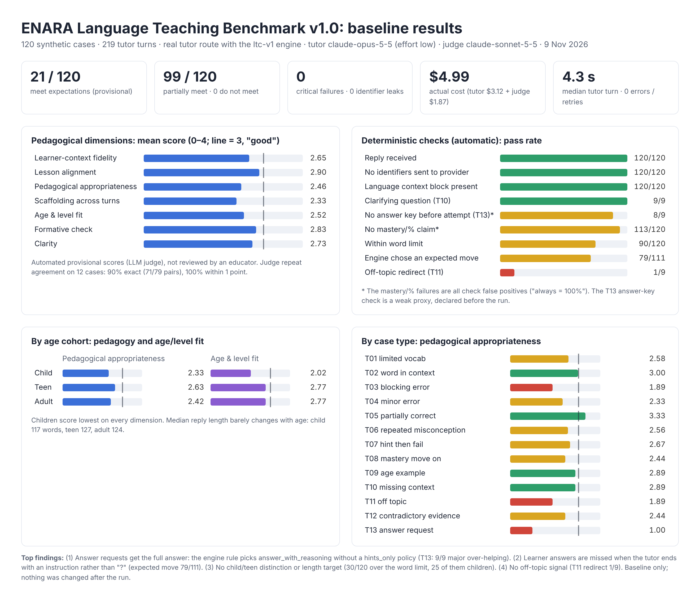

# ENARA Language Teaching Benchmark v1.0: final report

**Run:** 9 November 2026 · **Status:** baseline captured; nothing was changed after the run · **Cost:** $4.99 actual

## 1. What was tested

- **System under test:** ENARA's real student tutor route, `POST /api/me/tutor/sessions/:id/messages`, with the Phase 1 Language Teaching Context Engine (`ltc-v1`) and the ped-v2 teaching plan. It ran in-process on the working tree of `claude/codebase-review-kbxqan` against a throwaway in-memory database. No staging, production or school system was touched.
- **Tutor model:** `claude-opus-5-5` at effort `low`, the app defaults. Opus 5.5 served all 219 calls; there was no fallback.
- **Dataset:** 120 original synthetic cases with 219 learner turns:
  - three age cohorts (child, teen, adult) × CEFR A1, A2 and B1, with 13–14 cases per cell;
  - 13 situation types (T01–T13);
  - text chat only;
  - CEFR labels are provisional and author-assigned.
- **Scoring:** both were frozen before any output was produced:
  - rubric `ltb-rubric-v1`: 7 dimensions, each scored 0–4;
  - scoring spec `ltb-scoring-v1`: deterministic checks and case-outcome rules.

  A secondary LLM judge (`claude-sonnet-5-5`) gave the pedagogical scores. **These are automated provisional scores and have not been reviewed by an educator.**

## 2. Headline results

| | Result |
|---|---|
| Cases meeting expectations | **21 / 120** (provisional) |
| Partially meeting | 99 / 120 |
| Not meeting / critical failures | **0 / 0** |
| Replies received | 219 / 219 turns (0 errors, 0 retries) |
| Identifiers sent to the provider | **0** across 219 requests |
| Language context block present | 120 / 120 cases |
| Median tutor turn latency | 4.3 s (p95 6.3 s) |

### Pedagogical dimensions (LLM judge, 0–4; 3 = "good and aligned")

| Dimension | Mean | Median | Distribution 0/1/2/3/4 |
|---|---|---|---|
| Learner-context fidelity | 2.65 | 3 | 0/3/37/79/1 |
| Lesson alignment & factual grounding | **2.90** | 3 | 0/1/19/91/9 |
| Pedagogical appropriateness | 2.46 | 3 | 0/16/38/61/5 |
| Scaffolding across turns (n=72) | **2.33** | 2 | 0/11/29/29/3 |
| Age & proficiency fit | 2.52 | 3 | 0/5/47/68/0 |
| Formative check & evidence | 2.83 | 3 | 0/0/22/96/2 |
| Clarity & accessibility | 2.73 | 3 | 0/0/40/73/7 |

The judge re-scored 12 cases chosen by a fixed rule. It agreed exactly on 90% of the score pairs (71/79) and within one point on 100%.

### Deterministic checks

| Check | Pass |
|---|---|
| reply_received | 120/120 |
| no_direct_identifiers_in_payload | 120/120 |
| language_context_block_present | 120/120 |
| clarifying_question (T10) | 9/9 |
| no_full_answer_before_attempt (T13; weak proxy) | 8/9 |
| no_mastery_or_percentage_claim | 113/120 (all 7 failures are false positives: "always = 100%") |
| within_word_limit | 90/120 |
| expected_move_any (engine) | 79/111 |
| off_topic_redirect (T11) | **1/9** |

### By cohort and level

Children score lowest on every dimension (age and level fit 2.02, against 2.77 for teens and adults). CEFR level made little difference: pedagogical appropriateness was 2.48 at A1, 2.36 at A2 and 2.54 at B1.

By case type, the strongest were T05 partially-correct answers (3.33) and T02 word-in-context (3.00). The weakest were T13 answer requests (1.00), T03 blocking errors (1.89) and T11 off-topic requests (1.89).

## 3. Main findings

Details and traces are in `failure_analysis.md`.

1. **Answer requests get the full answer (T13, 9/9 major over-helping).** This comes from the engine's own rule: without a `hints_only` policy, an answer request selects `answer_with_reasoning`. The model followed it. It's a pedagogy decision for ENARA and 4Level1, not a model fault.
2. **Learner answers are often not recognised as answers.** The engine expects the tutor's last message to end with a question. The tutor usually closes with an instruction ("Write your answers, and I'll check them!"). So `corrective_feedback_retry` was missed in 23 answer-feedback cases.
3. **No real age adaptation.** The engine only distinguishes school from adult. Reply length is flat across ages (median 117–127 words), and 25 of the 30 word-limit overruns are children.
4. **Off-topic requests are partly done.** The engine has no off-topic signal. Two adult cases had the email fully written, and two child cases were taught a maths method.
5. **Context fidelity and grounding hold up.** There were no invented scores, levels or histories, apart from a harness artefact; see the limitations below. There were only 4 minor factual slips, and no mastery claims beyond one minor case.

## 4. Cost

Actual: tutor $3.1237 (219 calls) + judge $1.8666 (134 calls, including 2 re-asks) = **$4.99**. The preflight estimate was about $7.50 (range $5–$15). No cap was reached. See `cost_reconciliation.md`.

## 5. Limitations

- Pedagogical scores come from one LLM judge with no educator review. Treat them as provisional and relative.
- CEFR labels and expected behaviours were written by the AI author and have not been validated by an educator.
- Text chat only. Speaking, listening and the avatar or voice paths were not tested.
- One model configuration (Opus 5.5, effort `low`, the app defaults). Staging may override `ANTHROPIC_TUTOR_EFFORT`; that wasn't verified.
- **Harness artefact (T10):** the "no lesson" fixture course still had one placeholder chapter titled "General practice". The tutor could see it, and the judge tagged two replies that mentioned it as context invention. These two tags should be discounted.
- Two deterministic checks are weak: the T13 answer key is a proxy, and the percentage regex has false positives. They are reported as frozen, not edited.
- Single run per case: 120 cases, with no repeat runs of the tutor itself.

## 6. Compliance with the brief

- Only synthetic data was used: no 4Level1 or real-school data, no audio, no real names.
- The licence gate was passed: no third-party corpus text was used (`license_review.md`).
- Preflight was issued before the first paid call (`preflight_report.md`).
- Execution was sequential, with explicit token limits, timeouts and retry ceilings, and every attempt was metered.
- No production limits, school budgets, staging caps or `AI_TEST_SPEND_ID` were changed. No ledgers were reset.
- No commit, push, deploy or branch operation was made. The tutor prompt was not modified.
- The provider key was used from a private file, never printed, and the file was deleted after the run.

## 7. Recommended next steps

Each needs a decision before implementation, followed by a re-run of the same frozen cases:

1. Decide the default answer-request policy for language courses: hint first, answer after one attempt.
2. Widen `answeringCheck` to accept closing instructions, and add regression tests.
3. Add a child/teen band and a per-band word target to the language block.
4. Add an off-topic signal and a redirect move.
5. Get an educator to review a stratified sample (for example 24 cases) to calibrate the judge.
