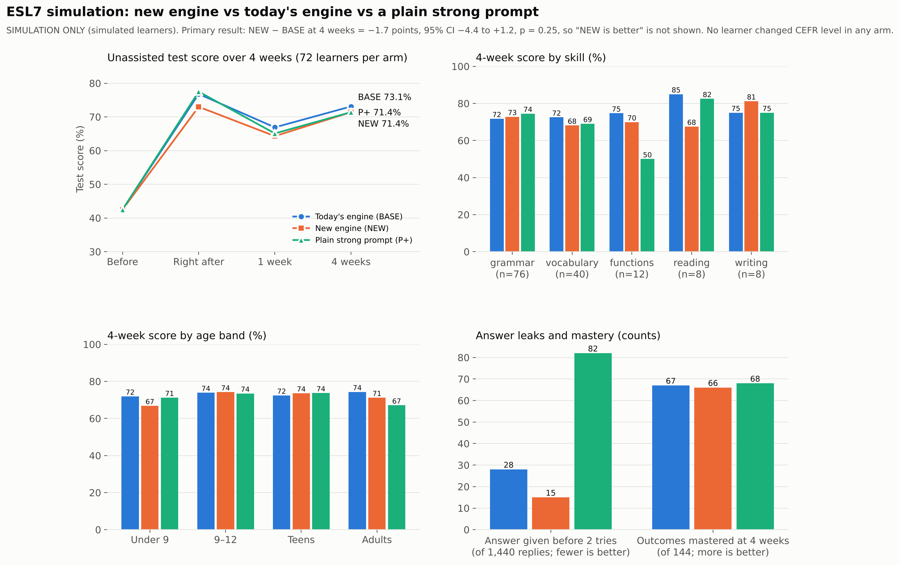

# ESL7-journey results (SIMULATION ONLY)

21 Nov 2026. Branch `claude/tutor-esl7`. Simulated learners, not real ones. These results are not evidence about real learners.

## 1. What changed, and the switches now on (lms-test only)
**Deploys:**

| PR | Change | Status |
|---|---|---|
| #44 | Moodle quiz import | Deployed |
| #45 | `workOnTrusted` + `oneTaskMethod` | Deployed |
| #46 + #47 | `spacedReview` + `ruleOnWrong` (the first #46 deploy was rolled back) | Deployed |
| #48 | `switchMove`, `spellingPattern`, `l1Lexical` (English only), `childShort` | Deployed |
| #49 | Fix: `spellingPattern` no longer flags lesson words such as "object" | Deployed |

**`ENARA_ENGINE_V2` on lms-test:** `wrongAnswer,closing,selfCheck,clarity,hints,strandLog,levelExplicit,esl5,planner2,workOn,sessionMemory,learnerProfile,whatWorks,moodleQuiz,workOnTrusted,oneTaskMethod,spacedReview,ruleOnWrong,switchMove,spellingPattern,l1Lexical,childShort`.

test.enara.app was not touched.

## 2. The study
- **Learners and outcomes:** 72 simulated learners, all age bands, A1–A2. Each learner had 2 outcomes, giving 36 outcomes, each taught to 4 learners per arm.
- **Sessions:** 4 sessions over 2 weeks, with 5 tutor turns each.
- **Tests:** unassisted, before tutoring, right after the first session, at 1 week and at 4 weeks.
- **Arms:**
  - **BASE:** the engine before these changes.
  - **NEW:** BASE plus the 8 new switches.
  - **P+:** a plain strong prompt with no memory between sessions.
- **Agents:** tutors were Sonnet agents; judges and scorers were Opus agents.
- **Pre-registered:** `config/agent_sim_esl7/PROTOCOL.md`, with amendments A–D.
- **Full tables:** `reports/exp4/agent_sim_esl7/ANALYSIS.md`.

## 3. Main result (pre-registered)
**4-week score per learner, NEW − BASE: −1.7 points** (95% CI −4.4 to +1.2, p = 0.25).

- **"NEW is better" is not shown.**
- **NEW − P+:** +0.1 points (p = 0.98).
- **BASE − P+:** +1.7 points (p = 0.35).
- **Without the 3 flagged outcomes** (marked ⚑; their texts were missing in rounds 1–7): NEW − BASE is −0.4 points (CI −3.0 to +2.6).

| | BASE | NEW | P+ |
|---|---|---|---|
| Before → right after → 1 week → **4 weeks** | 42 → 77 → 67 → **73** | 42 → 73 → 64 → **71** | 42 → 78 → 65 → **71** |
| Outcomes mastered at 4 weeks (unassisted, the outcome's own criterion) | 67 of 144 | 66 of 144 | 68 of 144 |
| CEFR level change (placement engine, before → 4 weeks) | 0 up, 0 down | 0 up, 0 down | 0 up, 0 down |
| Answer given before 2 real tries | 28 of 1,440 replies | **15** | 82 |
| Two-task replies | 0 | 0 | 0 |
| Stuck runs (3+ wrong tries on one item) | 1 | 3 | 6 |
| "Teacher would accept" (0–2; **guard failed**, see §6) | 1.47 | 1.40 | 1.96 |

## 4. By skill and by age band
Each cell shows the score before → right after → 1 week → **4 weeks**, in %, then mastered/total.

| Skill | BASE | NEW | P+ |
|---|---|---|---|
| functions | 24 → 86 → 70 → **75** (5/12) | 24 → 75 → 54 → **70** (6/12) | 24 → 76 → 49 → **50** (2/12) |
| grammar | 37 → 76 → 64 → **72** (34/76) | 37 → 77 → 65 → **73** (38/76) | 37 → 84 → 67 → **74** (41/76) |
| reading | 15 → 85 → 68 → **85** (6/8) | 15 → 55 → 60 → **68** (2/8) | 15 → 55 → 65 → **82** (6/8) |
| vocabulary | 62 → 69 → 69 → **72** (18/40) | 62 → 65 → 66 → **68** (15/40) | 62 → 67 → 68 → **69** (15/40) |
| writing | 50 → 100 → 77 → **75** (4/8) | 50 → 90 → 69 → **81** (5/8) | 50 → 90 → 56 → **75** (4/8) |

| Age band | BASE | NEW | P+ |
|---|---|---|---|
| Under 9 | 48 → 71 → 66 → **72** (14/36) | 48 → 63 → 58 → **67** (11/36) | 48 → 77 → 67 → **71** (14/36) |
| 9–12 | 42 → 76 → 62 → **74** (18/36) | 42 → 72 → 63 → **74** (19/36) | 42 → 78 → 63 → **74** (19/36) |
| Teens | 42 → 83 → 65 → **72** (16/36) | 42 → 82 → 66 → **74** (19/36) | 42 → 80 → 66 → **74** (21/36) |
| Adults | 38 → 77 → 75 → **74** (19/36) | 38 → 75 → 69 → **71** (17/36) | 38 → 75 → 64 → **67** (14/36) |
**Readings (small numbers; n = 4–76 per cell):**
- **Grammar:** NEW is slightly above BASE (73 vs 72; mastered 38 vs 34).
- **Functions:** NEW and BASE are well above P+.
- **Reading:** NEW is lowest. That is mainly the ⚑ outcomes: the missing texts in rounds 1–7, and the 300-character item cap that cuts A2 emails.
- **Under 9:** NEW is lowest (67 vs 72).

## 5. By learning outcome (4-week score, mastered of 4)
CEFR / profile references come from ENARA's outcome definitions (`data/outcomes/outcomes.json`). ⚑ marks an outcome affected by amendment D.

| Outcome | CEFR / profile reference | BASE wk4 (mastered) | NEW wk4 (mastered) | P+ wk4 (mastered) |
|---|---|---|---|---|
| `EN-C-A1-FN-basic-interaction` | CEFR CV: Overall written interaction, A1; Overall spoken interaction, A1 (written channel only) | 52% (1/4) | 50% (2/4) | 32% (0/4) |
| `EN-C-A1-RD-very-short-texts` ⚑ | CEFR CV: Overall reading comprehension, A1; Reading for orientation, A1 | 75% (2/4) | 55% (0/4) | 70% (2/4) |
| `EN-C-A1-WR-simple-sentences` | CEFR CV: Overall written production, A1; Creative writing, A1 | 88% (3/4) | 88% (3/4) | 75% (2/4) |
| `EN-C-A2-FN-routine-exchanges` | CEFR CV: Overall written interaction, A2; Transactions to obtain goods and services, A2; Correspondence, A2 | 80% (1/4) | 70% (1/4) | 55% (1/4) |
| `EN-C-A2-RD-short-everyday-texts` ⚑ | CEFR CV: Overall reading comprehension, A2; Reading correspondence, A2; Reading for information and argument, A2 | 95% (4/4) | 80% (2/4) | 95% (4/4) |
| `EN-C-A2-WR-linked-short-text` | CEFR CV: Overall written production, A2; Creative writing, A2 | 62% (1/4) | 75% (2/4) | 75% (2/4) |
| `EN-F-A1-GR-article-a-an` | EGP: Determiners / articles, A1 (a/an + singular noun) | 73% (1/4) | 75% (0/4) | 46% (0/4) |
| `EN-F-A1-GR-article-the` | EGP: Determiners / articles, A1-A2 (the for known reference) | 33% (0/4) | 25% (0/4) | 67% (2/4) |
| `EN-F-A1-GR-can-ability` | EGP: Modality / can (ability), A1 | 98% (4/4) | 98% (4/4) | 94% (4/4) |
| `EN-F-A1-GR-capitals-full-stops` | EGP: not a grammar category; mechanics outcome aligned to CEFR Companion Volume (Council of Europe, 2020) Orthographic control, A1 | 90% (3/4) | 96% (4/4) | 81% (3/4) |
| `EN-F-A1-GR-copula-be` | EGP: Verbs / be, A1 (affirmative and negative) | 69% (0/4) | 52% (0/4) | 44% (0/4) |
| `EN-F-A1-GR-prepositions-time` | EGP: Prepositions / time, A1 | 77% (2/4) | 92% (3/4) | 83% (2/4) |
| `EN-F-A1-GR-there-is-are` | EGP: Clause structure / there is, there are, A1 | 44% (0/4) | 40% (0/4) | 44% (0/4) |
| `EN-F-A1-GR-word-order-svo` | EGP: Clause structure / declarative word order, A1 | 85% (3/4) | 94% (4/4) | 83% (3/4) |
| `EN-F-A1-VO-classroom-objects` | EVP: A1 topic education | 69% (1/4) | 73% (2/4) | 56% (0/4) |
| `EN-F-A1-VO-days-months` | EVP: A1 days and months | 31% (0/4) | 31% (0/4) | 31% (0/4) |
| `EN-F-A1-VO-family` | EVP: A1 topic family | 58% (0/4) | 58% (0/4) | 58% (0/4) |
| `EN-F-A1-VO-food-drink` | EVP: A1 topic food and drink | 94% (4/4) | 92% (4/4) | 92% (4/4) |
| `EN-F-A1-VO-home-rooms` | EVP: A1 topic house and home | 54% (0/4) | 54% (0/4) | 54% (0/4) |
| `EN-F-A1-VO-numbers-time` ⚑ | EVP: A1 numbers and time expressions | 71% (1/4) | 71% (1/4) | 71% (1/4) |
| `EN-F-A2-FN-polite-requests` | CEFR CV: Transactions to obtain goods and services, A1-A2; EGP: Modality / can (requests), A1 | 92% (3/4) | 90% (3/4) | 62% (1/4) |
| `EN-F-A2-GR-comparatives` | EGP: Adjectives / comparatives, A2 | 75% (1/4) | 81% (2/4) | 90% (3/4) |
| `EN-F-A2-GR-conjunctions` | EGP: Clause structure / coordination and subordination, A1-A2 | 79% (2/4) | 85% (3/4) | 75% (2/4) |
| `EN-F-A2-GR-frequency-adverbs` | EGP: Adverbs / frequency, A1-A2 | 29% (0/4) | 38% (0/4) | 73% (2/4) |
| `EN-F-A2-GR-going-to` | EGP: Future / be going to, A2 | 90% (4/4) | 90% (4/4) | 94% (4/4) |
| `EN-F-A2-GR-much-many` | EGP: Determiners / quantifiers much, many, A2 | 90% (4/4) | 90% (4/4) | 94% (4/4) |
| `EN-F-A2-GR-past-questions-did` | EGP: Past / past simple questions, A2 | 50% (0/4) | 54% (0/4) | 60% (1/4) |
| `EN-F-A2-GR-past-simple-irregular` | EGP: Past / past simple, A2 (common irregular verbs) | 79% (2/4) | 79% (2/4) | 73% (2/4) |
| `EN-F-A2-GR-past-simple-regular` | EGP: Past / past simple, A1-A2 (regular -ed) | 90% (3/4) | 90% (3/4) | 85% (3/4) |
| `EN-F-A2-GR-present-continuous` | EGP: Present / present continuous, A1-A2 | 73% (2/4) | 62% (2/4) | 79% (2/4) |
| `EN-F-A2-GR-some-any` | EGP: Determiners / some, any, A1-A2 | 52% (0/4) | 65% (1/4) | 60% (1/4) |
| `EN-F-A2-GR-third-person-s` | EGP: Present / present simple, A1-A2 (third person -s) | 88% (3/4) | 79% (2/4) | 90% (3/4) |
| `EN-F-A2-VO-appearance` | EVP: A2 topic people: appearance | 96% (4/4) | 98% (4/4) | 98% (4/4) |
| `EN-F-A2-VO-clothes-shopping` | EVP: A1-A2 topic clothes and shopping | 94% (4/4) | 94% (4/4) | 94% (4/4) |
| `EN-F-A2-VO-jobs-workplaces` | EVP: A1-A2 topic work and jobs | 73% (2/4) | 54% (0/4) | 54% (0/4) |
| `EN-F-A2-VO-weather` | EVP: A1-A2 topic weather | 85% (2/4) | 56% (0/4) | 81% (2/4) |
## 6. Checks, limits and what was not measured
**Checks:**
- **Judge agreement:** 88.1% on a 10% re-judged sample. 85% was required, so it **passed**.
- **"Teacher would accept" agreement:** 81.6%. 85% was required, so it **failed**, although every pair was within 1 point. Those scores are reported, but not relied on.
- **Grader validation** passed before round 1.

**Engine findings during the run (details in `ENGINE_FINDINGS.md`):**
- **The most important:** at the start of session 2, NEW's "open with the reviews due" line is overridden by the "teach the rule first" block, and tutors settled it differently from round to round. So spaced reviews often did not run where they should.
- **Also:**
  - the under-9 length limit clashes with the rule block;
  - `ruleOnWrong` asks for a right/wrong pair where none is possible (spelling slips);
  - "partly right" is shown on correct polite requests;
  - a reading item plus its text is cut at 300 characters.
- **Fixed during the run:** two `spellingPattern` false slips, and the `ruleOnWrong` + rule-block clash (amendments B and C, PR #48 and PR #49).

**Not measured:**
- listening and speaking;
- lesson-level outcomes that have no item forms;
- real learners (the real-learner pilot waits for the legal review and consents, `REAL_LEARNER_PILOT_PLAN.md`).
- 3 outcomes have no wrong belief to simulate and were left out (amendment A).

**Limits:**
- Only 2 outcomes per learner over 4 weeks, which is too little to move a CEFR level.
- n = 4 per outcome per arm.
- Tutor agents, not a production model call.

## 7. What this suggests
On these simulated learners, the 8 new switches did not raise 4-week scores. They did halve early answer leaks.

The next step with the best chance of helping is to let "Reviews due" win over the rule block at the start of session 2. After that, re-check `childShort` with the rule block for under-9s. Both changes need a plan and your "go".
