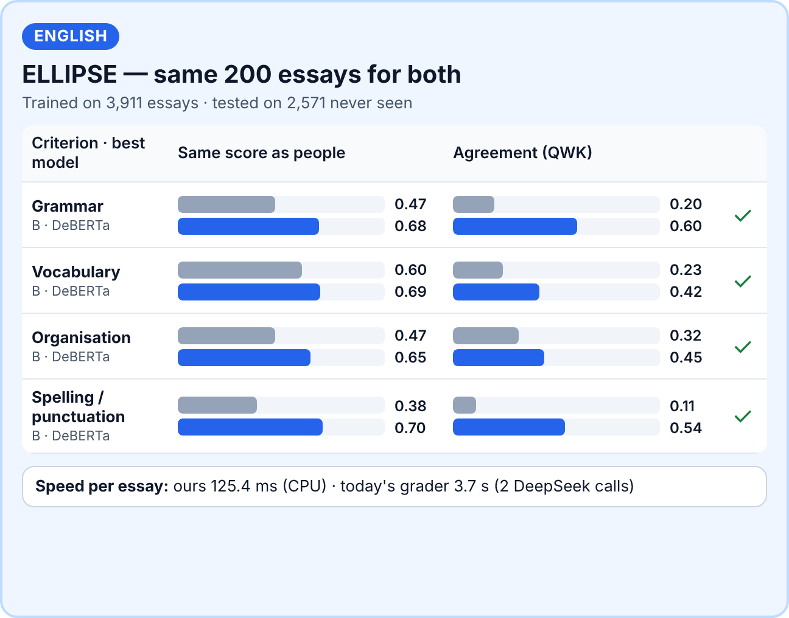

# Essay scoring — English results (ELLIPSE)

_23 Nov 2026, 2:00 PM Cairo. lms-test research only; no product code changed and nothing replaced. Essays were downloaded at run time on a GitHub runner and never stored; only numbers were published (`claude/tutor-lms-aes-fast-ellipse`)._

## In three lines
1. **Our trained model beats today's grader (DeepSeek) on all four English criteria** on the same 200 essays: it gives the same score as the human markers 65–70% of the time, against 38–60% for today's grader.
2. **It agrees with people much more consistently:** QWK 0.42–0.60 against 0.11–0.32. The biggest gains are spelling/punctuation and grammar, where today's grader is far too harsh.
3. **It is about 30× faster and costs nothing per essay** (0.13 s on a plain processor, against 3.7 s and two DeepSeek calls). The caveat is that it learned these markers' scale, not ENARA's rubric.

## 1. What was run
| | |
|---|---|
| Data | **ELLIPSE**: 6,482 essays by English learners in US grades 8–12, each scored 1–5 by trained human markers on 6 traits plus overall. Licence CC BY 4.0, so commercial use is allowed with attribution. Demographic columns were dropped. |
| Split | The official split: **3,911 training essays and 2,571 test essays**. The model never saw the test essays. The 200 essays today's grader marked this morning are all in the test set. |
| Model A: text patterns | Word pairs and letter sequences, plus essay length, sentence count, word variety and punctuation counts, feed one small scoring formula per trait (ridge regression). |
| Model B: language model | **DeBERTa-v3-base** (Microsoft, MIT licence), used as it is. It reads the first **256 tokens**, about 190 words, of each essay and turns them into a summary vector. A small ridge scorer per trait sits on top. |
| Where | A GitHub runner with 4 CPU cores and no GPU. The whole English job took **15 minutes**, training included. |
| Code | `deploy/lms-test/aes/train.py` (ops branch `claude/tutor-lms-dscompare-run`), run [45167740391](https://github.com/EnaraAI/enara-staging-alpha/actions/runs/45167740391). |

**Mapping to ENARA's 0–2 scale** is the same as for today's grader baseline: 1–2.5 → 0, 3–3.5 → 1, 4–5 → 2.

| ELLIPSE trait | ENARA criterion |
|---|---|
| Grammar (Syntax is also scored) | grammar_accuracy |
| Vocabulary (Phraseology is also scored) | vocabulary_range |
| Cohesion | organisation |
| Conventions | mechanics (spelling/punctuation) |
| none | task_completion stays with code rules and DeepSeek |

## 2. Head to head on the same 200 essays
"Same score" means the share of essays where the score on ENARA's 0–2 scale matches the human marker exactly. QWK measures agreement beyond chance (1 is perfect, 0 is chance). The best model on every criterion was **Model B (DeBERTa)**.

| Criterion | Today's grader: same score | Ours: same score | Today's grader QWK | Ours QWK | Today's grader: within 1 | Ours: within 1 |
|---|---|---|---|---|---|---|
| Grammar | 0.47 | **0.68** | 0.20 | **0.60** | 0.95 | **1.00** |
| Vocabulary | 0.60 | **0.69** | 0.24 | **0.43** | 1.00 | 1.00 |
| Organisation | 0.47 | **0.65** | 0.32 | **0.45** | 0.96 | **1.00** |
| Spelling/punctuation | 0.38 | **0.70** | 0.11 | **0.54** | 0.92 | **1.00** |

**Why today's grader loses:** it scores much lower than the markers. Out of 2, its grammar average is 0.44 against the markers' 0.90, and spelling/punctuation 0.20 against 0.84. On organisation it is too generous: 1.41 against 0.92.

## 3. All held-out essays (2,571)
The numbers hold beyond the 200, so the 200 were not a lucky sample.

| ELLIPSE trait | A: same score | A: QWK | **B: same score** | **B: QWK** | B: QWK on 1–5 scale | B: error (1–5) |
|---|---|---|---|---|---|---|
| Grammar | 0.64 | 0.47 | **0.70** | **0.62** | 0.71 | 0.45 |
| Syntax | 0.65 | 0.44 | **0.69** | **0.55** | 0.65 | 0.45 |
| Vocabulary | 0.68 | 0.36 | **0.70** | **0.48** | 0.63 | 0.41 |
| Phraseology | 0.63 | 0.42 | **0.67** | **0.56** | 0.67 | 0.45 |
| Cohesion | 0.62 | 0.39 | **0.65** | **0.50** | 0.61 | 0.48 |
| Conventions | 0.63 | 0.40 | **0.68** | **0.57** | 0.68 | 0.46 |
| Overall | | | | | **0.73** | 0.39 |

- On the full 1–5 scale, B's agreement with the markers is 0.61–0.73. A fully fine-tuned model would usually do better; how much has to be measured.
- Model A, the text-pattern model, is weaker in English, but still beats today's grader on every criterion.

## 4. Speed and cost
| | Ours (B) | Today's grader |
|---|---|---|
| Time per essay | **0.13 s** on CPU (reading 125 ms, scoring < 0.01 ms) | 3.7 s median, 7.0 s slowest 5% |
| Calls | none | 2 DeepSeek calls per essay |
| Cost per essay | none (CPU time only) | DeepSeek tokens |
| Feedback text and evidence | **no** | yes |

## 5. Caveats: read before deciding
1. **Whose scale?** Ours learned what these markers consider a 3 or a 4. Today's grader follows ENARA's rubric, which is stricter on grammar and spelling. Part of the gap is calibration, not error. We need to decide which scale is right for our learners.
2. **Not our learners.** ELLIPSE writers are US middle and high school English learners, writing on US school prompts. Our learners are younger and write shorter, different tasks. This must be re-checked on ENARA's own benchmark and teacher-marked answers before any use.
3. **First 256 tokens only.** Essays longer than about 190 words are judged on their opening. Reading 512 tokens may do slightly better; that run was stopped before it gave results.
4. **Grammar is compared on one trait.** Today's baseline compared its grammar score with the average of the markers' Grammar and Syntax scores. Ours is compared with Grammar only. Syntax gives almost the same result (0.69 same score, QWK 0.55), so the conclusion does not change.
5. **The model may be held back.** Model B's scorer chose the strongest setting allowed (alpha 30) on every trait, so a wider search may gain a little.
6. **Numbers only.** Ours gives a score per criterion, without reasons or quoted words. DeepSeek would still write the feedback the learner sees.

## 6. What it would mean for ENARA
Following the rules-first plan, the order per criterion would be: **code rules → trained model → DeepSeek**.

- **English grammar and spelling/punctuation** are the best candidates for our model. Both show its largest gains and today's grader's largest errors.
- **Vocabulary and organisation** could follow once checked on our own data.
- **Task completion and the feedback text** stay with DeepSeek.

This could cut DeepSeek's work per English essay and make scores fairer to learners on grammar and spelling.

## 7. Next steps (each needs your go)
1. **The 512-token run was stopped at 2:27 PM** without results: after 4 hours its log showed no finished step. If longer reading matters, rerun it as two parallel jobs like the fast run.
2. **Run our model on ENARA's own English benchmark** (`data/assessment-bench` language sets) and check it does not drop below the 0.85 within-1 bar.
3. **Decide the scale:** keep ENARA's stricter rubric and re-calibrate our model to it, or adopt the markers' scale.
4. **Fine-tune on a GPU** (Modal; estimated $2–5 per run) to push agreement higher.
5. **Only then** a switch, off by default and on for lms-test only, with each criterion showing "scored by model" and teacher override as today.
