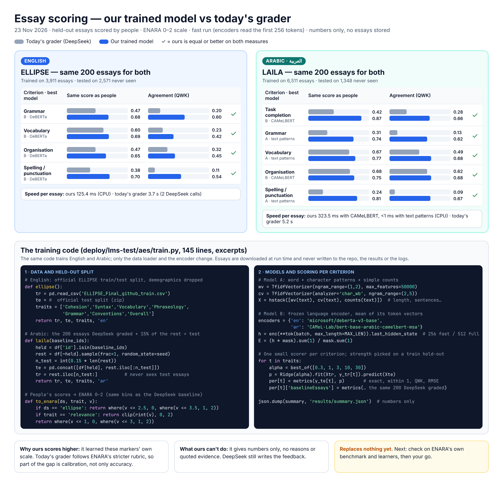

# Essay trait scoring with machine learning — licences, baseline, plan

_23 Nov 2026. lms-test only. No product code changed. No secrets asked for or printed. Essays are downloaded at run time on GitHub runners and never written to the repo, the results or the logs: only numbers are published._

> **Status (3:10 PM Cairo):** baseline and training done. **Our trained model beats today's grader on every criterion in both languages**, on the same 200 essays per language (§3). **It replaces nothing until it is checked on ENARA's own answers and you say go.**

## In three lines
1. **Today's grader (DeepSeek) is much harsher than human markers on grammar and spelling/punctuation** in both English and Arabic; its agreement with people per criterion is weak (QWK 0.09–0.32), except Arabic organisation and vocabulary (0.62 / 0.49).
2. **Our own trained model beats it everywhere:** on the same 200 essays per language it matches the human markers 65–87% of the time (today's grader 24–68%), at 0.1–0.3 s per essay with no model calls.
3. **Licences:** ELLIPSE allows commercial use; LAILA does not (used by your decision, the authors' written OK pending); QAES, AR-AES and laila-baselines are not usable today.

## 1. Licences

| Dataset | Licence (quoted exactly) | Commercial use | Conditions / notes |
|---|---|---|---|
| **ELLIPSE** (English, 6,482 essays) | "The data is provided under a Creative Commons Attribution 4.0 International License (CC BY 4.0)." | **Yes** | Attribution. We drop the demographic columns. |
| **LAILA** (Arabic, 7,859 essays) | "*LAILA* dataset is distributed under the CC BY-NC-ND 4.0 License." | **No** | Non-commercial, no derivatives. **Used for training by owner decision (23 Nov 2026)**; the authors are being contacted, written confirmation pending. A product model trained on it should not ship until that confirmation exists. |
| **laila-baselines** (code) | No licence stated | **No** (all rights reserved by default) | Not used; our training code is our own. |
| **QAES** | "QAES dataset is distributed under the CC BY-NC-ND 4.0 License" | **No** | Scores only; the essays come from the QCAW corpus, which is not included, so it cannot be benchmarked yet. |
| **AR-AES** | Not stated; no public download (paper: arXiv 2407.11212) | **Unclear** | A CC BY listing appears to cover the paper, not the data. Needs the authors. |

## 2. Baseline: today's grader on human-scored essays
`gradeOpenAnswer` unchanged, DeepSeek through lms-test, 200 essays per language (seeded sample of the test split), 0 errors. Human scores mapped to ENARA's 0–2 scale (ELLIPSE ≤2.5→0, 3–3.5→1, ≥4→2; LAILA 0–1→0, 2–3→1, 4–5→2; relevance as is).

**English (ELLIPSE)** — teacher-flag rate 0.175, median 3.7 s per essay

| Criterion | Same score as people | Within 1 | QWK | Grader mean | People mean |
|---|---|---|---|---|---|
| grammar_accuracy | 0.47 | 0.945 | 0.199 | 0.44 | 0.895 |
| vocabulary_range | 0.60 | 1.0 | 0.235 | | |
| organisation | 0.47 | 0.96 | 0.322 | 1.405 | 0.915 |
| mechanics | 0.375 | 0.915 | 0.106 | 0.20 | 0.84 |
| total (4 criteria) | 0.21 | 0.585 | Spearman 0.47 | | |

**Arabic (LAILA)** — teacher-flag rate 0.145, median 5.2 s per essay

| Criterion | Same score as people | Within 1 | QWK | Grader mean | People mean |
|---|---|---|---|---|---|
| task_completion | 0.425 | 1.0 | 0.279 | 1.325 | 1.78 |
| organisation | 0.68 | | 0.618 | | |
| vocabulary_range | 0.67 | | 0.491 | | |
| mechanics | 0.245 | | 0.091 | 0.23 | 0.99 |
| grammar_accuracy | 0.31 | | 0.133 | 0.27 | 0.955 |
| total (5 criteria) | 0.06 | 0.27 | Spearman 0.595 | | |

**Reading:** the grader is close on structure but scores grammar and mechanics about half a point too low out of 2. Part of this is our rubric being stricter than these datasets' markers (and their learners are older), so the gap is partly calibration, not only error.

## 3. Training results
Fast run: the language models read the first 256 tokens of each essay, English and Arabic as parallel jobs on GitHub CPUs (English 15 min, Arabic 45 min). Runs [45167740391](https://github.com/EnaraAI/enara-staging-alpha/actions/runs/45167740391) (English) and [45173613828](https://github.com/EnaraAI/enara-staging-alpha/actions/runs/45173613828) (Arabic). The slower 512-token run was stopped at 2:27 PM without results.

**Same 200 essays as today's grader**: "same score" = exact match with the human marker on the 0–2 scale; QWK = agreement beyond chance.

| Language | Criterion | Today's grader: same / QWK | Ours: same / QWK | Best model |
|---|---|---|---|---|
| English | Grammar | 0.47 / 0.20 | **0.68 / 0.60** | B (DeBERTa) |
| English | Vocabulary | 0.60 / 0.24 | **0.69 / 0.43** | B (DeBERTa) |
| English | Organisation | 0.47 / 0.32 | **0.65 / 0.45** | B (DeBERTa) |
| English | Spelling/punctuation | 0.38 / 0.11 | **0.70 / 0.54** | B (DeBERTa) |
| Arabic | Task completion | 0.43 / 0.28 | **0.87 / 0.66** | B (CAMeLBERT) |
| Arabic | Grammar | 0.31 / 0.13 | **0.74 / 0.62** | A (text patterns) |
| Arabic | Vocabulary | 0.67 / 0.49 | **0.77 / 0.68** | A (text patterns) |
| Arabic | Organisation | 0.68 / 0.62 | **0.75 / 0.68** | B (CAMeLBERT) |
| Arabic | Spelling/punctuation | 0.25 / 0.09 | **0.81 / 0.67** | A (text patterns) |

- **All held-out essays** (English 2,571, Arabic 1,348) give the same picture: QWK 0.48–0.62 (English, B) and 0.59–0.66 (Arabic, A); on the native 1–5 / 0–5 scales 0.61–0.77. English detail: `ESSAY_SCORING_ENGLISH_RESULTS.md`.
- **Arabic:** the simple text-pattern model is as good as or better than CAMeLBERT on most traits, and needs no language model at all (< 1 ms per essay).
- **Speed:** ours 0.13 s (English) / 0.32 s (Arabic, CAMeLBERT) / < 1 ms (text patterns) per essay on CPU; today's grader 3.7 s / 5.2 s and 2 DeepSeek calls.
- **Bug found and fixed:** LAILA ids start with zeros and were first read as numbers, so the 200 baseline essays were not held out. The Arabic run was repeated with the fix; the numbers above are from the corrected run.
- **Read with care:** ours learned these markers' scale; today's grader follows ENARA's stricter rubric. Neither dataset is our learners. See §4.5.

## 4. Plan

### 4.1 Trait mapping
| ENARA criterion (0–2) | English (ELLIPSE, 1–5) | Arabic (LAILA) |
|---|---|---|
| task_completion | none → stays with code + DeepSeek | relevance (0–2) |
| grammar_accuracy | Grammar + Syntax | grammar |
| vocabulary_range | Vocabulary + Phraseology | vocabulary |
| organisation | Cohesion | organization |
| mechanics | Conventions | mechanics |
| (reported only) | Overall | style, development, holistic |

### 4.2 Approach
| Option | What | Where it runs | Cost / speed | Verdict |
|---|---|---|---|---|
| A. Text features + ridge | Word and character patterns, length, sentence counts | Inside our backend (pure maths) | ~0; < 1 ms per essay | Running now. Cheap fallback. |
| B. Frozen encoder + ridge | DeBERTa-v3-base (en, MIT), CAMeLBERT-MSA (ar, Apache-2.0) | A small CPU service | ~0.1–0.5 s per essay on CPU | Running now. |
| C. Fine-tuned encoder | Same encoders, trained end to end per criterion | GPU (e.g. Modal; you would add the token as a GitHub secret yourself) | Training ≈ $2–5 per run (estimate); scoring ~50 ms on GPU, ~0.5 s CPU | Next, only if B is close to the bar. |

Today's grader costs two DeepSeek calls per essay (3.7–5.2 s median). A model in C would be roughly 10–50× faster and near-zero cost per essay.

### 4.3 Fit with the rules-first design
Order per criterion: **code rules → trained scorer → DeepSeek**.
- Code still decides what it is certain of (blank, too short, wrong language, length caps).
- The trained scorer gives a score + its confidence for the criteria where it passed the bar (likely mechanics and grammar first).
- DeepSeek keeps task completion, meaning and feedback text (the learner still gets reasons and quoted evidence), and any criterion where the scorer is unsure.
- Each criterion shows `scoredBy: code | model | llm`; teacher overrides work the same.

### 4.4 Evaluation (before any switch)
- Held-out essays only, side by side with DeepSeek on the **same 200 essays per language**: same-score rate, within 1, QWK, error, speed.
- **Bar per criterion:** trained scorer QWK ≥ DeepSeek's and within-1 ≥ 0.85; then our own benchmark (`data/assessment-bench`, language sets) must not drop more than 0.03.
- Switch default off; lms-test only after your go.

### 4.5 Risks
- **Domain shift:** ELLIPSE = US grades 8–12, LAILA = Qatar grades 10–12; our learners are mostly younger and write differently. Fix: check on our own benchmark, then retrain with teacher-marked ENARA answers.
- **Rubric mismatch:** their markers are more lenient than our rubric (see §2). We must decide whose scale is "right": theirs, or our rubric re-calibrated.
- **Teacher corrections:** overrides are the best training data we will have. Store them (already logged with a reason) and retrain monthly; never train on unreviewed model scores.
- **Gaming:** features reward length and rare words. Keep code checks (copied stem, off-topic) and DeepSeek's task check in front.
- **Licence:** LAILA-trained models must not ship commercially until the authors confirm in writing.
- **No feedback text:** a scorer gives numbers, not reasons. DeepSeek still writes the feedback.
