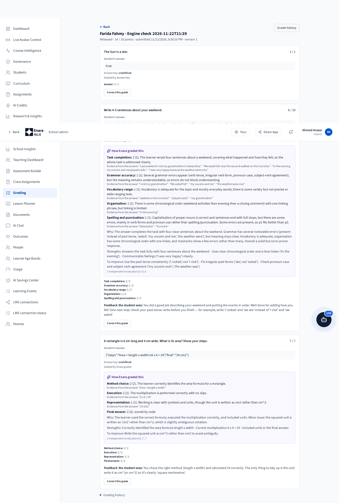

# Morning summary — 23 Nov 2026

_Overnight work on the assessment engine, lms-test only. Draft: updated through the night._

## In three lines
1. **P2a (grading engine for written answers) is live on lms-test.** A real quiz scored 14/18: essay 6/10, maths 7/7. Two display bugs were fixed.
2. **P2b (benchmark) is live.** 360 practice answers in Arabic and English, language and maths. It spends no Anthropic credits. First results: _pending_.
3. **P3a (science and humanities grading) is built.** PR [#92](https://github.com/EnaraAI/enara-staging-alpha/pull/92), plus 360 more practice answers.

## What was done
| Phase | PR | State |
|---|---|---|
| P2a grading engine, language and maths graders, teacher queue, override | [#90](https://github.com/EnaraAI/enara-staging-alpha/pull/90) | merged, live |
| P2b benchmark, maths grader fixes, display fixes | [#91](https://github.com/EnaraAI/enara-staging-alpha/pull/91) | merged, live |
| P3a science and humanities graders + benchmark | [#92](https://github.com/EnaraAI/enara-staging-alpha/pull/92) | _in CI_ |

## Pictures
Teacher's grading view of a real quiz graded on lms-test. The model quotes the learner's own words as evidence and gives feedback in plain words:

## Benchmark results (lms-test, DeepSeek)
_Pending._

## Needs your decision
1. **Code grader:** it has to run learners' code safely, which needs a sandbox service. Vercel has none, and an unsafe one would be wrong to build. Options: (a) a hosted sandbox such as Judge0 or Piston (cost, and a key you would add); (b) leave code questions graded by the teacher for now.
2. **Speaking:** the existing speaking exam never scores pronunciation (by design: there is no audio evidence, only the transcript). The plan mentions a "pronunciation flag". Should I keep the current rule (recommended) and only send speaking transcripts through the new language grader?
3. **The $2 Anthropic sample check** of the benchmark scores. It is off; say yes to turn it on.

## Notes
- No Anthropic credits were spent by any of this work. Benchmark calls never fall back to Anthropic.
- "Gold" (the reference scores) is **written by the authors of the practice answers, provisional**. Teacher-marked answers would replace it.
