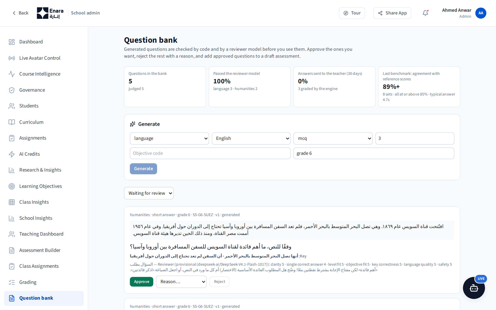

# Morning summary — 23 Nov 2026

_Overnight work on the assessment engine. lms-test only; test.enara.app untouched. **No Anthropic credits were used.**_

## In three lines
1. **Every phase of the assessment-engine plan (P1a to P5) is built, tested in E2E and live on lms-test.** That covers 8 PRs tonight (#90 to #97). Two items still need your decision: speaking and the code grader.
2. **The grader agrees with the reference scores in every subject.** Language, maths, science, humanities and listening, in Arabic and English, all score above the 0.85 bar (0.89 to 0.99). Every grading call went to DeepSeek; none went to Anthropic.
3. **Teachers can now generate questions, review them and add them to assessments** (the Question bank page). After two rounds of fixes, 7 of 8 subject sets pass the 0.80 quality bar, and the fix for the eighth (English maths) is merged.

## What was built tonight
| Phase | What it does | PR | State |
|---|---|---|---|
| P2a | Grading engine for written answers (language, maths), teacher queue, override with a reason | [#90](https://github.com/EnaraAI/enara-staging-alpha/pull/90) | live |
| P2b | Benchmark with 360 practice answers; maths grader fixes; teacher-view fixes | [#91](https://github.com/EnaraAI/enara-staging-alpha/pull/91) | live |
| P3a | Science and humanities grading (a checklist per question; humanities judged only against the source text) | [#92](https://github.com/EnaraAI/enara-staging-alpha/pull/92) | live |
| P3b | Listening (the learner hears a recording and never sees its transcript) + language grader calibration | [#93](https://github.com/EnaraAI/enara-staging-alpha/pull/93) | live |
| P4 | Question generation: generator, code checks, reviewer model, item bank, teacher review, Question bank page | [#94](https://github.com/EnaraAI/enara-staging-alpha/pull/94) | live |
| P5 | Benchmark baseline for all sets (blocks regressions), Item bank card, speed and cost figures | [#95](https://github.com/EnaraAI/enara-staging-alpha/pull/95) | live |
| P4 fixes | Generation fixes from benchmark run 1 | [#96](https://github.com/EnaraAI/enara-staging-alpha/pull/96) | live |
| P4 fixes | Fraction answers in generated maths | [#97](https://github.com/EnaraAI/enara-staging-alpha/pull/97) | merged (deploying) |

## Pictures
**Question bank:** a real Arabic question generated on lms-test from the Suez Canal source text. It shows the reviewer model's scores, and the Item bank card at the top:

**Teacher's grading view:** a real quiz graded on lms-test (14/18). The grader quotes the learner's own words as evidence:

## Grading benchmark (lms-test, DeepSeek)
Share of answers scored within 1 point of the reference; the bar is 0.85.

| Subject | English | Arabic |
|---|---|---|
| Maths | 0.911 | 0.967 |
| Language | 0.889 (was 0.822 before calibration) | 0.911 (was 0.800) |
| Science | 0.967 | 0.933 |
| Humanities | 0.956 | 0.889 |
| Listening | 0.989 | 0.978 |

- **Calibration:** the language grader kept to the middle level. It was too kind to weak answers and let Arabic colloquial pass as standard Arabic. Anchors for each level fixed it.
- **To watch:** English language sends 19% of answers to the teacher, close to the 20% limit. Arabic humanities is slightly strict (-0.47 points on average).
- **Speed:** a typical answer takes 3.4 to 4.7 s (two grading runs in parallel); the slowest 5% take up to 9.6 s.

## Generation benchmark (lms-test, DeepSeek, 10 questions per set, none stored)
Share of generated questions passing the code checks and the reviewer model; the bar is 0.80.

| Subject | Run 1 (en / ar) | Run 2 after fixes (en / ar) |
|---|---|---|
| Language | 0.3 / 0.5 | **0.8 / 0.8** |
| Maths | 0.8 / 0.9 | 0.6 / 0.9 (English fraction fix in #97) |
| Science | 0.9 / 1.0 | 0.9 / 0.9 |
| Humanities | 0.9 / 0.7 | 0.8 / **1.0** |

- **Run 1 fixes:** answer keys are tidied to each subject's fields; grammar distractors such as go / goes / went are allowed; the benchmark uses real objectives.
- **Run 2:** the English maths drop came from fractions written as text, fixed in #97. With only 10 questions per set, scores move by ±0.1 between runs.

## Bugs the tests caught tonight (all fixed)
- **Science/humanities answer leak:** the learner's copy of these questions revealed the answer points through the rubric titles (E2E 23). Learners now see "Required point 1, 2…".
- **Maths grader:** marked "cm^2", "cm²", "x = 7", "25%" and "65°" wrong (found while writing the benchmark data).
- **Personal-data check:** took a long number for a phone number (E2E 25).
- **Item bank link:** questions taken from the bank lost their link to it (E2E 25).

## Needs your decision
1. **Code grader:** grading code means running learners' code safely, which needs a sandbox service. Vercel has none, and building an unsafe one would be wrong. Options: (a) a hosted sandbox such as Judge0 or Piston (a cost, and a key you would add); (b) code questions graded by the teacher for now.
2. **Speaking:** the existing speaking exam deliberately never scores pronunciation (it only has the transcript, no audio evidence). The plan mentions a "pronunciation flag". I recommend keeping the current rule and sending speaking transcripts through the new language grader. Yes or no?
3. **Anthropic sample check (≤ $2):** a strong Anthropic model marks about 50–100 benchmark answers to double-check the reference scores. It is off; say yes to turn it on.
4. **Reference scores are provisional.** The scores used to judge the grader were written with the practice answers. Ten to twenty teacher-marked answers per subject would make the benchmark much stronger.

## Notes
- **Cost:** the call records estimate about $1.86 and $4.44 for the two grading runs, plus the generation runs. That is **DeepSeek on your Modal endpoint**, and the estimates are upper bounds because no DeepSeek price is set.
- **Model fallback:** benchmark and generation calls are blocked from it. Normal grading on lms-test still has "model fallback" on, which retries a failed DeepSeek call on Anthropic. Turn it off if you want zero Anthropic use until you add credits.
- **One mistake overnight:** a screenshot helper accidentally started the data reload on lms-test. That rolled back one deploy; it was redeployed and the data was fully restored (14,232 records).
- **Where everything is:** the plan and its progress table are in `docs/tutor/ASSESSMENT_ENGINE_PLAN.md`; the benchmark data (900 practice answers, 10 sets) is in `data/assessment-bench/` in the lms repo.
