# Picture trial: drawn SVG vs OpenMoji (for review)

21 Nov 2026. Owner decision pending. **OpenMoji stays the source until you approve a change.**

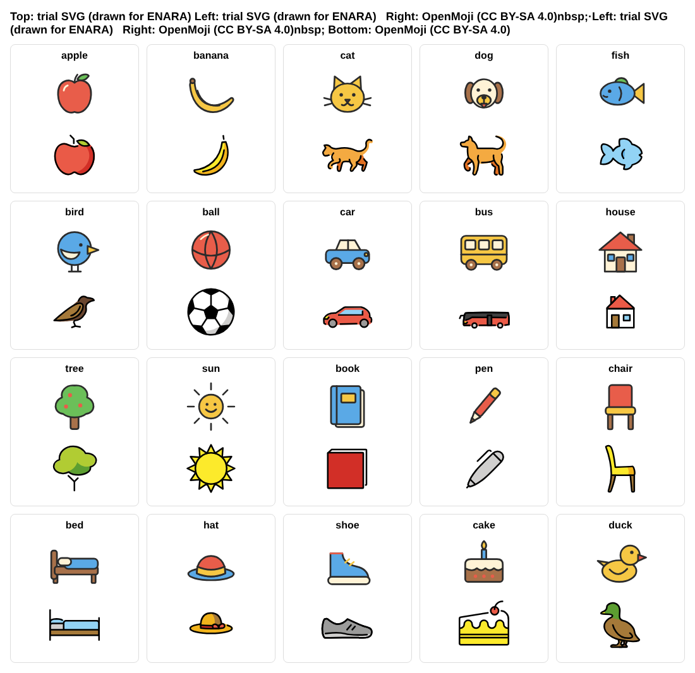

## The two sets
**Trial SVG:**
- 20 Cambridge Pre A1 Starters words, drawn as SVG by a Sonnet agent in one style:
  - flat shapes with a thick rounded outline;
  - 6 shared colours;
  - no text, brands or known characters;
  - each file under 0.7 KB.
- Owned by ENARA, so no attribution is needed.

**OpenMoji:** OpenMoji 15.1 colour set, CC BY-SA 4.0. An attribution line is needed on an About page.

## Side by side
| Word | Trial SVG | OpenMoji |
|---|---|---|
| apple | 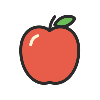 |  |
| banana | 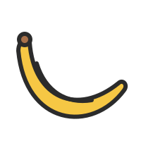 |  |
| cat | 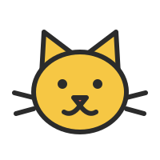 |  |
| dog | 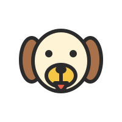 | 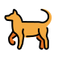 |
| fish | 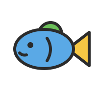 | 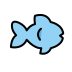 |
| bird | 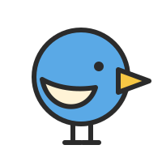 | 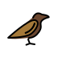 |
| ball | 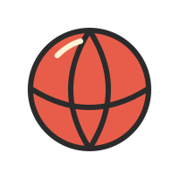 |  |
| car | 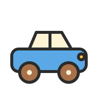 | 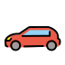 |
| bus | 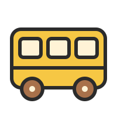 | 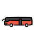 |
| house | 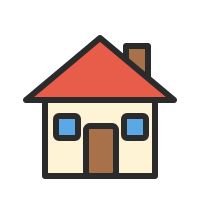 | 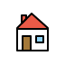 |
| tree | 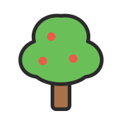 |  |
| sun | 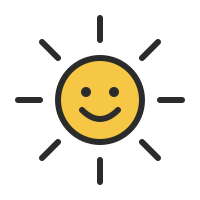 | 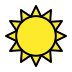 |
| book |  |  |
| pen |  | 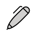 |
| chair | 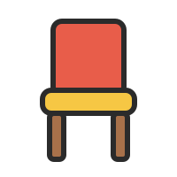 | 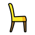 |
| bed | 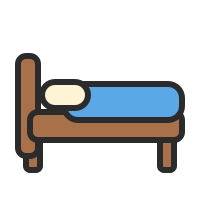 | 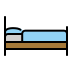 |
| hat | 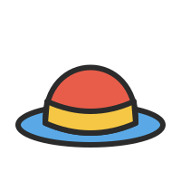 | 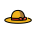 |
| shoe | 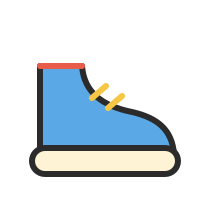 | 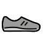 |
| cake | 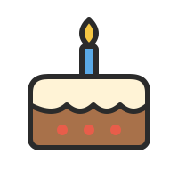 | 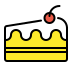 |
| duck | 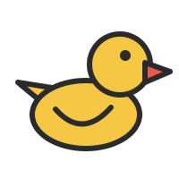 | 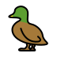 |

## Notes for your review
**Where the trial set is stronger:**
- One consistent child-friendly style; animals and objects are friendlier (cat, dog, bird and sun have simple faces).
- Very small files.
- No licence duty.

**Where OpenMoji is stronger:**
- Clearer real-world shapes for a few words: the ball (OpenMoji's is a football; the trial's is a beach ball), the shoe and the pen.
- It already covers more of the 495 words.

**Weak spots in the trial set:**
- The palette has no orange or white, so the duck's beak is red and "white" is cream.
- The pen reads as a pencil.

**If you approve the trial style:**
- draw the remaining kids-pack nouns in the same style, in batches;
- review them;
- swap the picture source behind the same word keys (no code change for the child).
